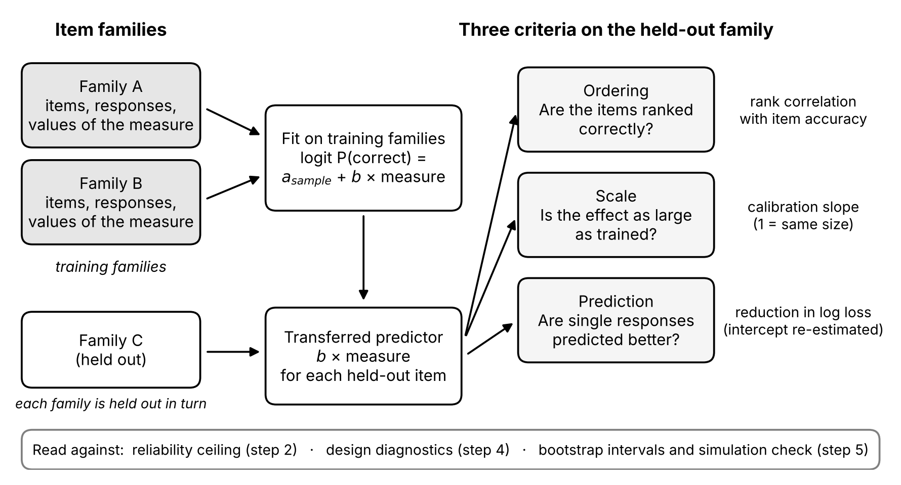
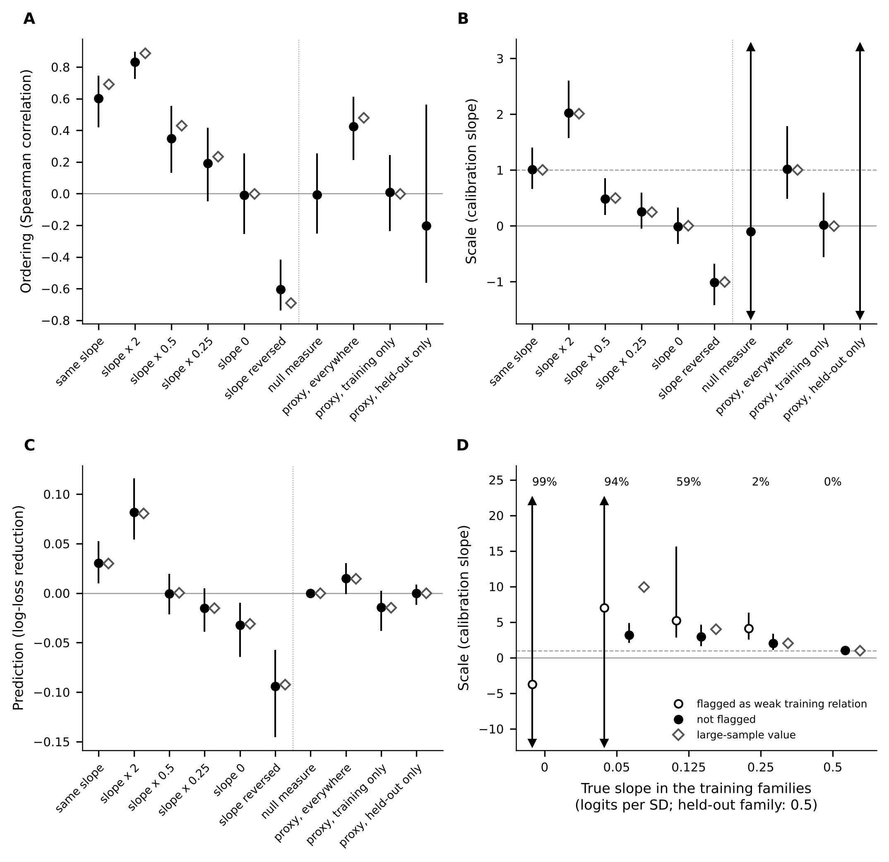
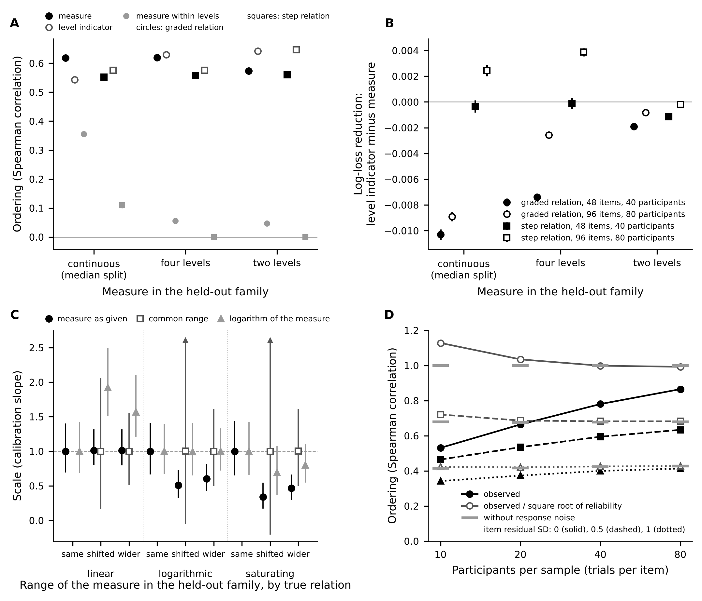
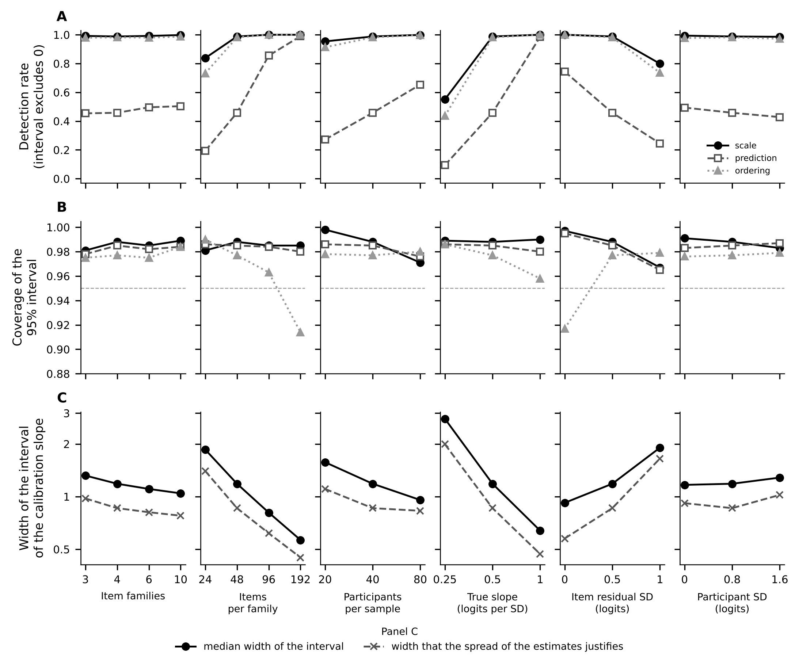
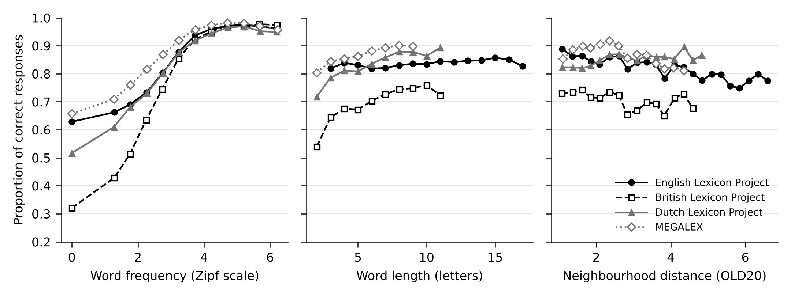
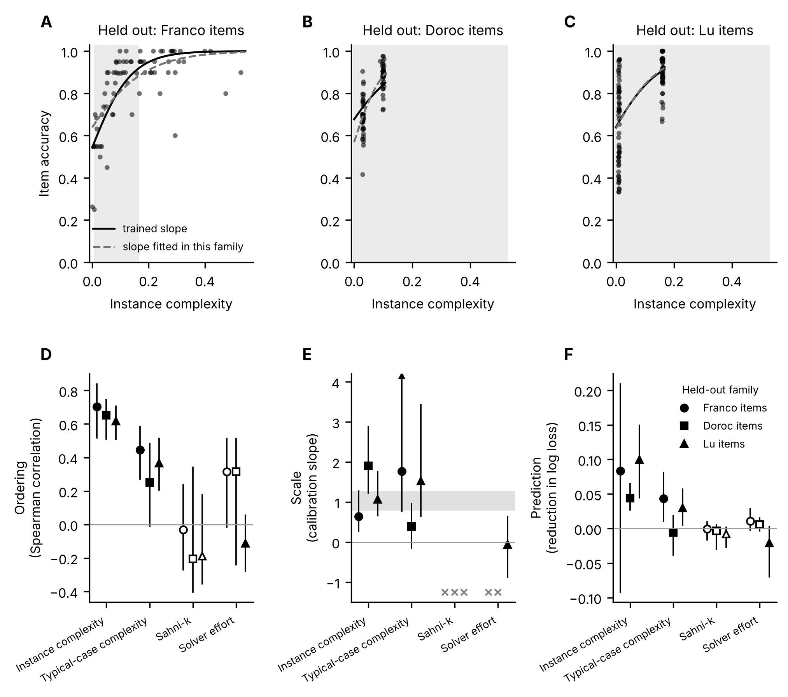

# Do item difficulty measures generalise to new stimulus sets? Leave-one-family-out validation, its pitfalls, and the itemtransfer package

Hongwon Jeong

Center for Creative Convergence Education, Hanyang University ERICA, Ansan, Republic of Korea

ORCID: 0009-0003-7908-7478

Correspondence: Hongwon Jeong, Center for Creative Convergence Education, Hanyang University ERICA, 55 Hanyangdaehak-ro, Sangnok-gu, Ansan, Gyeonggi-do 15588, Republic of Korea. Email: beatsbywoni@hanyang.ac.kr. Telephone: +82-31-400-5786

## Abstract

Researchers select stimuli and explain task difficulty with item-level measures, such as word frequency or the computational hardness of a puzzle. Whether such a measure holds for stimulus sets built differently from those on which it was validated is rarely tested, and it is unclear which statistics can be trusted for the test. This article presents leave-one-family-out transfer validation: the relation between a measure and accuracy is estimated on some item families (item sets from one design) and evaluated on a family that was held out. The procedure reports three criteria, the ordering of items, the size of the effect and the prediction of single responses, together with the reliability of item difficulty and diagnostics of the stimulus design. Simulations give four results. Intervals that resample participants but not items contained their target as rarely as 51% of the time. For the rank correlation between a measure and observed item accuracy, the usual bootstrap over participants and items was shifted downwards, and with thousands of items its percentile interval excluded its own estimate. With effects of medium size, prediction gained little or nothing when the effect in the new set was about half the trained effect, although the ordering stayed positive. Stimulus sets with two levels of a measure, or with a different range under a non-linear relation, limited conclusions about the form and size of a relation. Four lexical decision megastudies and three sets of knapsack problems serve as examples. The open-source Python package `itemtransfer` carries out the analyses.

**Keywords:** item difficulty, stimulus sampling, generalisation, external validation, bootstrap, calibration, megastudies

## Introduction

Researchers in many areas of psychology describe their stimuli with numbers that are assigned to each stimulus without reference to the responses under study. Word frequency and word length describe the words of a lexical decision task, the number of rules describes a matrix reasoning item, indices of randomness describe a sequence (Angelike & Musch, 2024), and measures from computer science describe how hard a puzzle should be. Such measures are used to select and match items, to equate conditions, and to state theories about what makes a task hard (Franco et al., 2022; Zorowitz et al., 2024). All of these uses rest on one assumption: the relation between the measure and behaviour that was found on one set of items will hold for the next set.

That assumption is rarely tested directly. A difficulty measure is usually validated on the items for which it was developed. The items of a study are typically produced by one design: a generator with fixed settings, a sampling rule applied to one corpus, or a set of hand-built conditions. Items from one design share properties that are not part of the measure, such as a size, a format, or the range of the measure itself. In this article, the set of items produced by one design is called an *item family*. The term is used more narrowly in automatic item generation, where it denotes the variants of one item template (Geerlings et al., 2011); here it denotes the whole item set of a study or resource. Validation inside a family shows that the measure works for that design. It cannot show whether the measure works for items that were built differently, although the next study will usually build them differently.

Standard analyses do not close this gap by themselves. Mixed-effects models with random effects for items support generalisation to new items from the population that the sampled items represent (Baayen et al., 2008; Judd et al., 2012), and cross-validation that holds out items assesses prediction within that population (Zorowitz et al., 2024). Neither evaluates transfer to a different design unless the analysis keeps the variation within a design apart from the differences between designs. Claims that ignore such design factors can be much broader than the data allow (Yarkoni, 2022). Related work in this journal points the same way. The fit of word-level predictors depends on the corpus on which it is evaluated (Boeve & Bogaerts, 2025), and measures that are meant to be general do not always survive a change of task (Robinson et al., 2024).

Established approaches address parts of the problem. The first is to compare the slope of the measure between families, by separate regressions, by an interaction term or in a mixed model. This can show whether the slopes differ, provided that the uncertainty takes the sampling of items into account, but a difference in slope does not by itself say whether it matters for prediction. The second is grouped cross-validation, which holds out one family at a time and evaluates prediction in that family. When it is reported as a single score without recalibration, the score cannot distinguish a measure that orders the new items with the wrong effect size from a measure that does neither, and it mixes differences in overall accuracy between families with differences in the relation of interest. The third is to hold out one study at a time and to report how the size of the effect in the held-out study compares with the size estimated elsewhere. This is the internal-external cross-validation of clinical prediction models (Debray et al., 2013; Steyerberg & Harrell, 2016; Van Calster et al., 2019), and it is the closest relative of the present procedure. It was developed for patients nested in studies. Behavioural data differ: participants are crossed with items, reliability limits what can be predicted, and stimulus designs often have few levels or narrow ranges. The present procedure adapts the approach to such data, and the simulation study examines how its components behave with the three or four families that are typically available.

### The present article

This article presents leave-one-family-out transfer validation, a procedure for testing whether item-level difficulty measures hold for item families other than those on which they were fitted. It applies when responses are scored as correct or incorrect and at least two families are available. The article makes five contributions.

1. Simulation results on when statistics of transfer between item sets can be trusted. In the conditions examined, intervals that resample participants but not items contained their target as rarely as half of the time. The usual bootstrap over participants and items was shifted downwards for the rank correlation between a measure and observed item accuracy, and with thousands of items its percentile interval excluded its own estimate. With effects of medium size, trial-level prediction gained little or nothing when the effect in the new family was about half the trained effect, even though the ordering stayed positive. A held-out family with two levels of the measure could not distinguish a gradual relation from a jump between the levels, and under a non-linear relation a different range of the measure changed the estimated effect size although the mechanism was identical.
2. A procedure in five steps that takes these results into account. It reports three criteria next to the reliability of the data, the design of the held-out family and intervals that respect the sampling of items (Figure 1).
3. A comparison with slope tests, a mixed model and grouped cross-validation in its common form, which shows where these analyses mislead, where they are the better tool and where they should be combined with the procedure.
4. Two worked examples with public data: three word measures in lexical decision across four megastudies, and four measures of computational hardness in knapsack decisions across three small item sets.
5. An open-source Python package, `itemtransfer`, which carries out the procedure and simulates the user's own design.

The three criteria are established statistics, and their sources are given below. What the article adds is a single workflow that shows which aspect of a measure transfers and which features of the validation design limit that conclusion. The procedure is not a model of how people solve a task. It asks a narrower question that a theory of difficulty should be able to pass: does a relation found on some items predict behaviour on items of another kind? The next section describes the procedure. The simulation study, the two examples and the software follow.



**Figure 1.** Leave-one-family-out transfer validation. The slope of a measure is fitted on the training families and applied to the items of the held-out family, where it is judged by three criteria. Each family is held out in turn.

## Leave-one-family-out transfer validation

### Data and terms

The procedure uses four terms. An *item* is one stimulus: a word, a problem instance, a test item. An *item family* is a set of items produced by one design, and two families share no item. A *sample* is a group of participants who responded to items of one family. A family can have several samples, for example a laboratory study and its replication with the same items. A *measure* is a number assigned to each item without use of the responses under analysis. It is computed from the item alone, or from the item and a fixed external resource such as a corpus.

The input consists of two tables. The trial table has one row per response, with the participant, the item, the sample, and whether the response was correct. The item table has one row per item, with its family and one column per measure. Participants need not respond to all items of a family.

The relation between a measure and accuracy is described by a logistic regression of single responses on the measure, with one intercept per sample:

logit P(correct) = *a*<sub>sample</sub> + *b* × measure.

The intercepts absorb differences in overall accuracy between samples. Every response has the same weight, so samples with more responses count for more; step 4 examines the alternative of equal weight per sample. The slope *b* is the quantity whose transfer is tested. The model ignores that responses are clustered within participants and items; the bootstrap of step 5 accounts for the clustering. The slope *b* is therefore a population-averaged association in which every response counts once. It is not an average of participant-specific or item-specific effects, and under the random-intercept models of the simulation study it lies closer to 0 than the slope of a model with random effects. The bootstrap accounts for sampling variation and does not remove this difference. The simulation study examines the consequences. With several measures, the model contains one slope per measure, and the transferred predictor defined below is the sum of the products of slopes and measures. Table 1 lists the five steps.

**Table 1.** The five steps of leave-one-family-out transfer validation.

| Step | Purpose | Computation | How to read the output |
|---|---|---|---|
| 1. Recompute | Give the measure one definition in all families | Compute every measure for every item with one implementation; compare with published values | Differences of definition are resolved before any response is analysed |
| 2. Reliability ceiling | Find out how well item difficulty can be predicted at all | Split-half reliability of item difficulty in each sample; agreement between samples that share items | The part of item difficulty that does not replicate cannot be predicted; reliability is the benchmark for the ordering criterion |
| 3. Transfer | Test a relation on a family that did not contribute to it | Fit the slope on all other families (the training families); judge it on the held-out family by ordering, scale and prediction | The three criteria answer different questions and can disagree |
| 4. Design diagnostics | Find design features that limit the conclusion | Five checks of the measure and the families, described under step 4 | A flag limits what the family can show |
| 5. Uncertainty | Attach intervals and check them | Bootstrap over participants and items (items only for ordering); simulation check of the scale and prediction intervals for the user's own design | Conclusions are worded from intervals, and only where the simulation supports them |

### Step 1: Recompute the measures

The first step ensures that a measure means the same thing in every family. Published item files often contain the measure, but different studies compute it with different software, different reference data or slightly different definitions. A difference of definition between families would later appear as a failure of transfer. All measures are therefore recomputed for all items with one implementation, and discrepancies from the published values are listed and explained before any response is analysed. This step is specific to the measures and is the only one that the software does not carry out.

### Step 2: Estimate the reliability ceiling

The second step establishes how much of the variation in item difficulty is reproducible. Item accuracy in a sample is an estimate from a limited number of responses. If two halves of a sample disagree about which items are hard, no measure can predict item difficulty well, and a low correlation between a measure and accuracy says little about the measure.

Reliability is estimated within each sample by split halves. The participants are divided at random into two halves, item accuracy is computed in each half on the logit scale, and the Pearson correlation between the halves is corrected to the full sample size with the Spearman-Brown formula (Brown, 1910; Spearman, 1910), which assumes that the two halves are equivalent. Accuracies of 0 and 1 are kept finite by adding half a response to the correct and to the incorrect count. The result is the median over 1,000 random splits; the spread over the splits shows how much the estimate depends on the split and is not a confidence interval. When two samples responded to the same items, the correlation between their item accuracies is also computed, as observed and corrected for the unreliability of each sample (Spearman, 1904), with an interval from resampled items. A corrected correlation close to 1 means that the samples agree on item difficulty as far as measurement error allows. A clearly lower value means that item difficulty itself differs between samples. A single prediction per item then cannot reproduce the reliable differences between the samples.

The reliability is used as a benchmark and not as a strict bound. Under the classical assumptions, which include measurement error that is uncorrelated with the predictor, the correlation of a predictor with observed item accuracy equals its correlation with error-free accuracy times the square root of the reliability, so its absolute value is at most that square root. This holds for Pearson correlations on the logit scale; for the rank correlation of the ordering criterion it is an approximation, which the simulation study checks.

### Step 3: Test transfer by three criteria

The third step tests the relation between a measure and accuracy on a family that played no part in estimating it. Each family is held out in turn. The slope *b* is estimated from the trials of all other families, the *training families*. The product of this slope and the measure, the *transferred predictor*, is computed for each item of the held-out family and judged by three criteria.

*Ordering* asks whether the measure ranks the held-out items by difficulty. It is the Spearman correlation between the transferred predictor and the accuracy of the held-out items. For a single measure this is simply the rank correlation between measure and accuracy within the held-out family; only its sign depends on the training families. Ordering therefore tests the direction of the relation and nothing about its size. It becomes a stronger test when several measures are combined, because their relative weights are then taken from the training families.

*Scale* asks whether the effect has the size that the training families suggest. It is the calibration slope: the slope of a logistic regression of the held-out responses on the transferred predictor, with a free intercept (Van Calster et al., 2019). For a single measure the calibration slope equals the slope fitted in the held-out family itself divided by the training slope. A value of 1 means that a unit of the measure changes accuracy in the held-out family as much as in the training families. A value of 0 means no relation, 2 an effect twice as large as trained, and a negative value an effect in the opposite direction.

*Prediction* asks how much the transferred relation improves the prediction of single responses. It is the relative reduction in log loss, (*L*<sub>0</sub> − *L*<sub>1</sub>) / *L*<sub>0</sub>. Log loss is the mean negative log-likelihood per response, *L* = −mean[*y* log *p* + (1 − *y*) log(1 − *p*)], where *y* is 1 for a correct response and 0 otherwise and *p* is the predicted probability of a correct response. *L*<sub>1</sub> is the log loss of the transferred predictor and *L*<sub>0</sub> that of a model with an intercept only, both computed on the same held-out responses. The overall accuracy of a new family is not known in advance, so an intercept has to be estimated from held-out data. To keep this apart from the evaluation, the held-out items are divided at random into two halves. The slope is fixed at its training value. One intercept is estimated from one half of the items, and the log loss is computed on the other half. The comparison model is estimated and scored on the same halves and has no slope. The halves then swap roles, and the result is averaged over 500 random divisions. The division is over items, not participants, so an item never contributes to both the intercept and the evaluation. Ordering and scale can thus be reported for a new family without using its responses for anything but the evaluation, whereas the prediction criterion describes the situation in which pilot responses to some items of the new family are available to set the overall level of accuracy.

The three criteria are linked. Let *c* be the calibration slope, so that the effect in the held-out family is *c* times the trained effect. Compared with the model without the measure, the gain in log-likelihood per response is then approximately

½ × *w* × Var(transferred predictor) × (2*c* − 1),

where *w* is the mean of *p*(1 − *p*) over the held-out responses (derivation in the supplementary material). In this approximation, which holds for small effects, prediction breaks even near *c* = 0.5: a trained effect that is about twice as large as the effect in the held-out family predicts about as well as an intercept alone. The exact break-even point depends on the size of the effect and on the distribution of the measure. For a normally distributed measure it lies between 0.49 and 0.50 when the trained slope is 0.5 logits per standard deviation or less, and it falls to 0.44 for a slope of 2 (supplementary material). The gain also grows with the spread of the measure in the held-out family. Ordering, in contrast, stays positive for any *c* above 0. Table 2 shows how the criteria are interpreted together.

**Table 2.** Reading the three transfer criteria together.

| Ordering | Calibration slope | Reduction in log loss | Reading |
|---|---|---|---|
| Clearly positive | Near 1 | Clearly positive | The relation transfers in direction, size and predictive value |
| Clearly positive | Near 1 | Near 0 | The relation holds, but the held-out items differ too little on the measure, or the design is too small, for it to show in prediction |
| Clearly positive | Clearly above 1 | Positive | The direction transfers; the effect is larger in the held-out family than trained |
| Clearly positive | About 0.5 or below | Near 0 or negative | The direction transfers; the trained effect is about twice the effect in the held-out family or more, so its predictions are little or no better than none |
| Near 0 | Unstable, wide interval | Near 0 or negative | No evidence of a relation; check the reliability ceiling and the training slope before concluding that the measure fails |
| Negative | Negative | Negative | The relation reverses in the held-out family |

Effect sizes never agree exactly, so the calibration slope is compared with a tolerance, an idea borrowed from equivalence testing (Schuirmann, 1987). The rule below compares a whole 95% interval with the tolerance and is therefore stricter than the usual equivalence test. The trained effect size is said to hold when the whole interval of the calibration slope lies inside the tolerance and to differ when the whole interval lies outside it. In all other cases the scale is undetermined. Asking only whether the interval includes 1 is not enough: with tens of thousands of items, every interval excludes 1 for deviations of a few per cent. The examples use a tolerance of 0.80 to 1.25, limits that are conventional for ratios in bioequivalence testing, where 0.80 is the reciprocal of 1.25. They serve as an illustration and are not a standard for behavioural research. The tolerance was chosen after the lexical decision data had been analysed, so the examples also report the result under a narrower and a wider tolerance. Users should fix their tolerance before they see their results, from the deviation in effect size that would change what they do with the measure.

### Step 4: Run the design diagnostics

The fourth step looks for features of the stimulus design that limit or explain the transfer result. Five diagnostics are computed. Their default rules are heuristics that the user can change, and the absence of a flag is not a guarantee.

*Level structure.* A measure has a level structure in a family when it takes at most six distinct values there, or when its values fall into a few clearly separated clusters (the rule is given in the supplementary material). With a few exact levels, the criteria can only reflect contrasts between the levels. With tight clusters, they may be dominated by the contrasts between clusters. The transferred measure is compared with a level indicator, a model that predicts each item by the mean accuracy of its level in the held-out family. If the measure predicts no better than the indicator, the family shows that the levels differ and does not show that the relation is graded. The correlation between measure and accuracy within each level is reported as well.

*Range overlap.* The procedure reports the share of held-out items whose value of the measure lies inside the range of the training families, and it raises a flag when the share is below 80%. The trained slope is then applied outside the range in which it was estimated. The criteria are recomputed on the range that the held-out and training families have in common.

*Weak training relation.* The calibration slope is a ratio whose denominator is the training slope. When the training slope is close to 0, the ratio is unstable. The procedure flags measures for which the bootstrap interval of the training slope includes 0. For these, the calibration slope is not interpreted, and the training slope and the slope fitted in the held-out family are read directly. In very large data sets the interval of a negligible slope can exclude 0, so the size of the training slope should be read even when no flag is raised.

*Correlated measures.* Within a family, two measures can be correlated because of the way the items were built. The procedure reports the Spearman correlation between measures in each family and raises a flag when its absolute value is .70 or above. The flag warns that the separate relations of the two measures with accuracy are then hard to interpret in that family and that the coefficients of a joint model may depend strongly on the design. It does not mean that the two effects cannot be separated in principle.

*Weighting.* When training samples differ in size, the largest dominates the trained slope. The transfer is repeated with every training sample given equal total weight, and a flag is raised when the calibration slope changes by more than 0.25 and by more than 25%.

### Step 5: Quantify uncertainty

The fifth step attaches intervals to the criteria and checks whether the intervals can be trusted for the design at hand. Two sources of sampling variation matter: other participants would have given other responses, and another draw from the same design would have produced other items. For the calibration slope and the reduction in log loss, both are resampled together. In each bootstrap resample, participants are drawn with replacement within each sample and items within each family (Owen, 2007), and the whole of step 3 is repeated, including the fit on the training families. Intervals are 95% percentile intervals.

The interval of the ordering correlation is computed differently. The items are resampled as before and the training fit is repeated, but the participants are kept as observed. Resampled participants add noise to the accuracy of every item, and noise pulls a rank correlation towards 0. The simulation study shows the size of this effect. The quantity that this interval targets is the rank correlation that a sample of this size yields for new items from the same design. It is not the correlation with error-free item difficulty; the reliability of step 2 shows how much higher that would be. Because participants are not resampled, the interval does not carry their sampling variation, and it can be somewhat too narrow when participants are few and items differ little beyond the measure.

The bootstrap treats the families as given. With three or four families, the variation of a slope across all possible designs cannot be estimated, and the procedure does not attempt it. Each result is a statement about one held-out family.

Whether the intervals hold their nominal coverage depends on the numbers of items and participants and on the distribution of the measure. The procedure therefore includes a simulation check. It generates artificial data with the user's design, that is, the same families, samples, numbers of participants and items, values of the measure and overall accuracies, under a known relation between measure and accuracy. Applying the procedure to many such data sets gives the coverage of the intervals, the probability of detecting a true relation, and the rate at which a measure without any relation is declared related to accuracy. The check reports these rates for the calibration slope and the reduction in log loss. It does not cover the interval of the ordering correlation, whose behaviour was examined separately in the simulation study.

## Simulation study

The simulation study has five aims. The first is to show which property of the data each criterion responds to. The second is to show how the design of the held-out family changes what a criterion can show. The third is to establish when the intervals can be trusted. The fourth is to compare the procedure with the analyses that a researcher would otherwise run. The fifth is to examine the tolerance rule and the consequences of a model without random effects. None of the aims depends on a particular task. The report follows Morris et al. (2019).

### Data generation, conditions and analysis

Responses were generated from the model of step 3 with two additions on the logit scale. Each item received a residual, which stands for everything that makes items differ in difficulty and that the measure does not capture. Each participant received an ability. Both were normally distributed. In the base condition there were four families, of which one was held out. Each family had 48 items and one sample of 40 participants, and every participant responded to every item. The measure was standard normal. Its slope was 0.5 logits per standard deviation in every family, which is called a relation of medium size below. Item residuals had a standard deviation of 0.5 logits, so that the measure and the residual contributed equally to the true variance of item difficulty. Abilities had a standard deviation of 0.8 logits, and mean accuracy was about .70.

Each aim varied this condition: the slope in the held-out family, the number of levels and the range of the measure, the form of the relation, and the numbers of families, items and participants. The conditions are named where their results are reported, and the supplementary material lists them all, with bias and root mean squared error. Every data set was analysed with the `itemtransfer` package. Intervals were 95% percentile intervals from 500 resamples. The true values of the calibration slope and of the reduction in log loss were computed from a data set large enough to remove sampling error, with 120,000 items per family. For ordering, the target is the mean of the observed correlation over data sets with the same numbers of items and participants (Table 4). Performance is summarised by three rates. Coverage is the share of intervals that contain the true value or, for ordering, the target. The detection rate is the share of intervals that exclude 0 in the expected direction. The false-positive rate is the same share for a measure that has no relation with accuracy. Rates are based on 1,000 data sets unless noted, which gives Monte Carlo standard errors of at most 1.6 percentage points.

### The three criteria respond to different properties

With the same slope in all families, the criteria agreed on average and differed in power (Figure 2A to 2C). The median calibration slope was 1.01. The intervals of the calibration slope and of ordering excluded 0 in 99% and 98% of the data sets, the interval of the reduction in log loss in only 48%. A perfectly transferring relation of medium size reduces log loss by about 3%, and a design of this size cannot reliably distinguish 3% from nothing.

The calibration slope recovered the ratio of the held-out slope to the training slope: its medians were 2.03, 0.49, 0.25 and −1.01 for ratios of 2, 0.5, 0.25 and −1. Ordering weakened with a smaller held-out slope and stayed positive on average. Prediction followed the approximation of step 3 in this condition, whose effect is of medium size. In very large samples the reduction in log loss was 0 to three decimal places when the held-out effect was half the trained effect, and negative below that. A reduction in log loss near 0 or below, next to a calibration slope of about 0.5 or less, is therefore a consequence of the mismatch in scale and not additional evidence against the measure.

Transfer is evidence about a relation and not about its cause. A proxy, that is, a measure without an effect of its own that correlated .7 with the true measure, appeared to transfer when the correlation held in every family, with a median calibration slope of 1.02. It failed on all three criteria when the correlation held in the training families only, and it was flagged as a weak training relation when the correlation held in the held-out family only.

A weak training relation made the calibration slope meaningless (Figure 2D). With a training slope of 0.05 and a held-out slope of 0.5, the central 90% of the estimates ran from −43 to 50. The flag of step 4 was raised in 94% of these data sets.



**Figure 2.** The three criteria respond to different properties of the data. Ordering (A), scale (B) and prediction (C) for the held-out family in ten conditions of the simulation. Left of the dotted line, the true measure is analysed and the slope in the held-out family is the training slope multiplied by the factor shown. Right of the dotted line, the slope is the same in all families and the measure analysed has no relation with accuracy or is a proxy that correlates .7 with the true measure in all families, in the training families only, or in the held-out family only. Filled circles are medians over the simulated data sets, bars run from the 5th to the 95th percentile, and open diamonds are the values for very large samples. Triangles mark bars that continue beyond the plotted range. (D) Calibration slope when the true slope in the training families is weaker than in the held-out family. Open circles are data sets in which the weak training relation was flagged, filled circles data sets without the flag; percentages give the share of flagged data sets.

### The design of the held-out family limits the conclusion

A family with two levels of the measure could not distinguish a graded relation from a step, in which all items above the middle of the range are harder by a fixed amount (Figure 3A and 3B). Ordering was .57 under the graded relation and .56 under the step, and both were detected in 98% of the data sets. The level indicator ordered the items better than the measure in both cases, and within the levels the measure hardly ordered the items even when the true relation was graded. With four levels, 96 items and 80 participants the comparison became informative: under a step, the indicator predicted better than the measure in 89% of the data sets.

A different range of the measure changed the calibration slope when the relation was not linear, although the mechanism was identical (Figure 3C). The measure ranged from 1 to 4 in the training families and, in the condition reported here, from 2 to 8 in the held-out family. When accuracy depended on the logarithm of the measure, the calibration slope was 0.51 in very large samples. When the effect levelled off at high values, a saturating relation, it was 0.34, and the reduction in log loss was negative. Restricting all families to their common range restored a calibration slope of 1.00 in every case, at the price of precision, because a third of the items remained. Transforming the measure helped only when the transformation was the correct one.

Ordering was attenuated by response noise as classical test theory predicts (Figure 3D). The ratio of the observed ordering to the ordering against error-free accuracies equalled the square root of the split-half reliability to within .03 in all twelve conditions, so the classical relation was a good approximation for rank correlations here. A measure that was the only source of item difficulty reached an ordering of only .53 with 10 participants. Dividing the observed ordering by the square root of the reliability recovered the error-free value when the reliability was about .6 or higher. Below that, the corrected value overshot.



**Figure 3.** Design features of the held-out family that change what the criteria can show. (A) Ordering when the measure in the held-out family is continuous or takes four or two levels, for a graded relation (circles) and for a step (squares). Filled black symbols show the transferred measure, open symbols a level indicator, and small grey symbols the mean correlation within levels; for the continuous measure, the two halves of a median split serve as levels. (B) Reduction in log loss of the level indicator minus that of the transferred measure; values above zero mean that the indicator predicts better. (C) Calibration slope when the range of the measure in the held-out family equals the training range, is shifted or is wider, under three forms of the true relation. Symbols show values for very large samples, bars the 5th to 95th percentile of the estimates. (D) Mean ordering as a function of the number of participants for three sizes of the item residual: observed, divided by the square root of the split-half reliability, and computed without response noise (horizontal marks).

### Intervals depend on what is resampled

The intervals of the calibration slope and of the reduction in log loss from the bootstrap over participants and items contained the true value at least as often as they should (Figure 4). Coverage lay between 96.5% and 100% in all 25 conditions with a common slope, and a measure without relation was declared related in at most 0.2% of the data sets. The intervals were 1.1 to 2.1 times wider than the actual spread of the estimates across data sets. Resampling adds new sampling error on top of the error that the observed accuracies already contain. The price is power, above all for prediction. In this set of runs its detection rate was 46% in the base condition, 86% with 96 items and 99% with 192 items.

Precision depended on the held-out items far more than on the number of families. The median width of the calibration-slope interval fell from 1.32 to 1.04 between 3 and 10 families, and from 1.86 to 0.57 between 24 and 192 items.

Resampling participants only, which treats the items as fixed, failed (Table 3). Coverage was as low as 51%, and a measure without relation was declared related in up to 37% of the data sets. More participants make this worse, because the interval shrinks while the variation between items remains. Resampling items only gave coverage between 91% and 97% across all conditions examined. That stimuli must be treated as a sample has long been established for significance tests (Clark, 1973); these results show the size of the error for transfer statistics.

**Table 3.** Calibration slope: coverage of the 95% interval, and false-positive rate for a measure without relation, when participants and items, participants only or items only are resampled.

| Items per family | Slope | Item residual | Coverage: both | Coverage: participants | Coverage: items | False positives: both | False positives: participants | False positives: items |
|---|---|---|---|---|---|---|---|---|
| 48 | 0.5 | 0 | .997 | .926 | .910 | .000 | .061 | .003 |
| 48 | 0.5 | 0.5 | .988 | .781 | .952 | .000 | .137 | .001 |
| 48 | 0.5 | 1 | .967 | .508 | .941 | .002 | .311 | .004 |
| 96 | 0.25 | 1 | .974 | .529 | .953 | .001 | .259 | .003 |
| 96 | 1 | 1 | .965 | .583 | .932 | .001 | .366 | .003 |

*Note.* 1,000 data sets per row. The second row is the base condition.

The interval of the ordering correlation needed a different treatment (Table 4). In the bootstrap over participants and items, the resampled correlations lay .04 to .16 below the estimate in every condition. With 48 items the shift was hidden inside a wide interval. With 768 items the interval contained the target in only 54% of the data sets, and with 3,072 items it excluded its own estimate in every data set. A second kind of bootstrap interval that corrects for such a shift, the basic interval, did not help, and it declared a measure without relation related in 6% to 13% of the data sets. When only items were resampled, 93% to 95% of the intervals contained the target at every number of items in the base condition. Across all 23 conditions examined, the share lay between 90.5% and 99%. The lowest values occurred where participants are the main source of error, that is, with few participants or without item residuals, because this interval does not resample participants. The target here is the average ordering correlation for samples of the given size. It is not the correlation with error-free item difficulty, which no finite sample attains; the reliability of step 2 shows how much higher that would be. The items-only interval is the one that the procedure uses.

**Table 4.** Interval of the ordering correlation: share of 95% intervals that contain the target, by number of held-out items and bootstrap.

| Items per family | Participants and items, percentile | Participants and items, basic | Items only, percentile | Percentile interval of participants and items excludes its own estimate |
|---|---|---|---|---|
| 48 | .97 | .83 | .93 | .00 |
| 192 | .90 | .77 | .94 | .00 |
| 768 | .54 | .53 | .95 | .41 |
| 3,072 | .06 | .02 | .94 | 1.00 |

*Note.* Base condition with 40 participants; 500 data sets for 48 and 192 items, 300 for 768 and 200 for 3,072. The target is the mean ordering correlation over data sets of the same size.



**Figure 4.** Performance of the bootstrap over participants and items when one design factor is varied at a time. (A) Detection rate: the share of data sets in which the 95% interval excludes 0. (B) Coverage of the 95% interval, the share of intervals that contain the true value (for ordering, the mean observed correlation over data sets of the same size); the dashed line marks the nominal level. The ordering interval shown here is the one from the bootstrap over participants and items; its falling coverage with more items is the reason why the procedure uses an interval from resampled items instead. (C) Median width of the interval of the calibration slope and the width of the central 95% of the estimates. Each point is based on 1,000 data sets.

### Comparison with alternative analyses

Nine scenarios were analysed by the procedure and by two alternatives that need no special software (Table 5). The first was grouped cross-validation in its common default form, without recalibration and with a point score. One model with a single intercept is fitted on the training families. Its log loss on the held-out family is compared with that of a model that predicts the mean accuracy of the training data. The share of log loss removed is the score. The second was a test of whether the slopes of the four families differ. It was run once with the standard errors of an ordinary logistic regression and once with standard errors that treat the responses to one item as a cluster, called item-based below.

The test of slope differences was valid only with item-based standard errors. With ordinary standard errors it rejected equal slopes in 31% of the data sets in which the slopes were equal, and in 72% for a measure without relation and large item residuals. With item-based standard errors the rejection rate under equal slopes was 7% to 9%, moderately above the nominal 5%. This test detected a difference in slope more often than the procedure did. When the held-out slope was half the training slope, it rejected in 54% of the data sets, whereas the interval of the calibration slope excluded 1 in 42%. For the question whether slopes differ, the test is the more sensitive tool, and the scale criterion of the procedure, which for a single measure is a ratio of two slopes, should be read together with it.

Grouped cross-validation was distorted by differences in mean accuracy. With equal slopes, the mean score was .030 when all families were equally hard, .021 when the held-out family was easier and .023 when it was harder. The score was negative in 1%, 16% and 14% of the data sets, respectively. The mean of the prediction criterion of the procedure, which re-estimates the intercept, stayed between .029 and .031. The score is a point estimate. For a measure without relation it was positive in 41% to 44% of the data sets, as a statistic centred near 0 will be, whereas the interval of the prediction criterion never lay above 0. The two columns of Table 5 therefore apply different rules, a sign and an interval, and the comparison shows what the default use of grouped cross-validation leaves out. It does not show that grouped cross-validation with recalibration and resampled intervals would perform worse; that analysis is in effect the prediction criterion of the procedure.

The two design problems were invisible in the main output of every method. With a step relation and a two-level family, all methods indicated successful transfer. With a saturating relation and a shifted range, all methods indicated a much weaker effect in the held-out family. Only the diagnostics of step 4 pointed to the level structure and to the range.

**Table 5.** The procedure and two alternative analyses in nine simulated scenarios.

| Scenario | Calibration slope, median | Prediction: interval above 0 | Grouped cross-validation: score above 0 | Slopes differ, ordinary SE | Slopes differ, item-based SE |
|---|---|---|---|---|---|
| Same slope in all families | 1.00 | .47 | .99 | .31 | .08 |
| Same slope, held-out family easier | 1.03 | .36 | .84 | .32 | .09 |
| Same slope, held-out family harder | 0.99 | .51 | .86 | .36 | .08 |
| Held-out slope half the training slope | 0.51 | .00 | .52 | .84 | .54 |
| Held-out slope twice the training slope | 2.01 | 1.00 | 1.00 | 1.00 | .97 |
| Step relation, two levels in the held-out family | 1.16 | .64 | 1.00 | .45 | .11 |
| Saturating relation, shifted range | 0.34 | .00 | .43 | 1.00 | .98 |
| No relation, item residual 0.5 | 0.00 | .00 | .41 | .36 | .09 |
| No relation, item residual 1 | 0.06 | .00 | .44 | .72 | .07 |

*Note.* Entries other than the calibration slope are shares of 1,000 newly generated data sets per scenario. The prediction column counts 95% intervals above 0; the grouped cross-validation column counts positive point scores, without recalibration of the intercept. The data sets were newly generated, so the first row differs slightly from the base condition reported above. "Slopes differ" is the rejection rate at the .05 level of a test of equal slopes in the four families. SE = standard error.

A logistic mixed model with crossed random intercepts for participants and items is the analysis that many readers would choose, and it was added as a third alternative in six scenarios (Table 6). Its likelihood-ratio test of equal slopes in the training families and the held-out family rejected equal slopes in 7% of the data sets with equal slopes, and it detected a held-out slope of half the training slope in 61%, more often than either the item-based test above or the procedure. Its ratio of slopes was also unaffected by differences between participants: when abilities varied twice as much in the held-out family, the median ratio was 0.98, against 0.83 for the slopes without random effects. The mixed model was not immune to differences between families. When the item residuals were twice as large in the held-out family, which violates its assumption of one item variance, it rejected equal slopes in 13% of the data sets. For the question whether slopes differ, a mixed model is therefore the best of the analyses compared here, and the scale criterion should be read together with it where it can be fitted.

**Table 6.** A logistic mixed model with crossed random intercepts compared with a logistic regression without random effects: ratio of the held-out slope to the training slope, and rejection of equal slopes.

| Scenario | Ratio of slopes, mixed model | Ratio of slopes, no random effects | Equal slopes rejected, mixed model | Equal slopes rejected, no random effects |
|---|---|---|---|---|
| Same slope in all families | 1.02 | 1.01 | .07 | .19 |
| Held-out slope half the training slope | 0.51 | 0.51 | .61 | .85 |
| Held-out slope twice the training slope | 1.98 | 1.99 | 1.00 | 1.00 |
| Same slope, abilities vary twice as much in the held-out family | 0.98 | 0.83 | .03 | .35 |
| Same slope, item residuals twice as large in the held-out family | 0.95 | 0.90 | .13 | .41 |
| No relation, item residual 1 | | | .06 | .46 |

*Note.* 200 data sets per scenario, generated as in the base condition. Ratios are medians. Rejection rates are for likelihood-ratio tests at the .05 level; Monte Carlo standard errors are at most .035. The mixed models were fitted with the R package lme4 (Bates et al., 2015).

A random-effects meta-analysis of the four slopes, reported in the supplementary material, estimated the variation between families as exactly zero in more than half of the data sets with a common slope.

### The tolerance rule and the model without random effects

The tolerance rule made few errors and was rarely decisive. When the true calibration slope was exactly 0.80 or 1.25, the rule returned "within tolerance" in at most 1.7% of the data sets and "outside tolerance" in at most 2.3%. The rule can return "within tolerance" only if the interval is narrower than 0.45, the width of the tolerance. With 48 items in each training family, the median width was 1.19 with 48 held-out items and 0.64 with 768, because the training slope stays uncertain. A true slope of 1 was therefore almost always "undetermined". Only when every family had 768 items was it classified as within tolerance in 81% of the data sets. In designs of ordinary size the rule can show that an effect size differs, and it will otherwise return "undetermined".

Because the model has no random effects, families can differ in calibration slope although the measure acts identically in each. More variation between participants, or between items beyond the measure, flattens the slope that the model estimates. With the same generating slope everywhere, the calibration slope in very large samples was 0.80 when the standard deviation of abilities in the held-out family was twice that in the training families. It was 0.90 when the item residuals were twice as large. Differences in mean accuracy changed it by at most 0.09. Deviations of 10% to 20% from 1 can thus arise without any difference in how the measure acts, which is a reason for a tolerance and against a test of the value 1.

### Summary and limits of the simulation study

The simulation supports the procedure in three respects and limits it in two. The three criteria answer different questions. The level and range diagnostics identify held-out families that cannot support a conclusion about the form or the size of a relation. The intervals for scale and prediction from the bootstrap over participants and items were conservative in the conditions with a common slope. The items-only interval for ordering was far better calibrated than the interval from participants and items; its coverage lay between 90.5% and 99% in complete designs and is not established for sparse or unbalanced designs, several samples per family or combined predictors. On the other side, about 100 held-out items were needed before all three criteria detected a relation of medium size in most data sets. Agreement in effect size could be shown only with several hundred items in every family.

The data were generated from the model of the analysis with item and participant effects added, mostly for complete designs with one sample per family and families of equal size. The simulation check of step 5 exists so that users can repeat the check of the scale and prediction intervals for their own design.

## Worked example 1: Word measures in lexical decision across four megastudies

The first example applies the procedure to data that many readers of this journal know: megastudies of visual lexical decision. With tens of thousands of items per family, it shows the procedure at a scale where intervals are narrow and where the reading of the calibration slope against a tolerance matters. The results on word frequency agree with what the field knows, which is the purpose of a first example: a validation procedure should recover known facts before it is trusted with open questions.

### Task, measures and data

In visual lexical decision, a participant sees a string of letters and decides whether it is a word. The example uses the word trials of four megastudies. Two are English: the English Lexicon Project from the United States (Balota et al., 2007), called the American megastudy below, and the British Lexicon Project (Keuleers et al., 2012), the British megastudy. The Dutch megastudy is the Dutch Lexicon Project (Keuleers et al., 2010), and the French megastudy is MEGALEX (Ferrand et al., 2018). Each megastudy is one family with one sample. The outcome is the accuracy of the response. Accuracy is the secondary outcome of these studies, after response time, and for many words it is close to its maximum; it mostly reflects whether participants know a word (Keuleers et al., 2015).

Three familiar measures were examined. Word frequency was expressed on the Zipf scale, the base-10 logarithm of the frequency per billion words (van Heuven et al., 2014), and taken from one multilingual resource for all three languages (the `wordfreq` package, here in version 3.1.1; Speer, 2022), so that one implementation serves all families. Between 2.3% and 3.7% of the words of a megastudy are absent from this resource and received its lowest value, 0. Word length was counted in letters. Neighbourhood distance is the mean edit distance from a word to its 20 nearest words (Yarkoni et al., 2008), computed here against the word list of the same megastudy. This measure is therefore a function of the word and of a reference list. One implementation gives it one definition, but not one scale: the lists differ in size and composition, and a shared English word takes the value of the megastudy to which it is assigned.

The two English megastudies share 18,978 words, which conflicts with the requirement that families share no item. The shared words were used for the agreement between samples in step 2. For the transfer analysis, each shared word was assigned at random to one of the two megastudies. The consequences of this choice were examined in two further analyses, one with the opposite assignment and one in which the shared words were removed from both megastudies. The main analysis comprises 92,788 words and 3.7 million responses. An analysis plan was written before step 3 was run and is part of the supplementary material, with a list of deviations. The plan was written after a feasibility check that had shown rough correlations and slopes within each megastudy, including a larger frequency slope in the British megastudy, so the example is not a confirmatory test. The supplementary material gives the timeline and the flow of the data, from 4.35 million word responses in the four megastudies to the 3.66 million that remain when each shared word is kept in one megastudy.

### Steps 1 and 2: Recomputed measures and reliability ceiling

Recomputing the measures uncovered differences of definition that a user of the published item files would not see. The published length values of the Dutch megastudy count each accented letter as three characters, and two megastudies count apostrophes. Published values of neighbourhood distance rest on reference word lists of different sizes, which shifts the scale of the measure by 0.35 to 0.5 units between megastudies.

The split-half reliability of word difficulty was between .87 and .95 for the families as analysed (Table 7). The two English megastudies nevertheless disagreed beyond measurement error. On their shared words, the correlation between the two sets of word accuracies was .73, and .83, 95% CI [.82, .84], after correction for unreliability. Part of the reliable variation in word difficulty is therefore specific to a megastudy, whether because of dialect, participants or the composition of the lists (see also Keuleers et al., 2012). A measure computed from the word alone cannot account for that part in both megastudies at once.

### Step 3: Transfer

Word frequency ordered the words of every held-out megastudy, across languages as well as within English (Table 7). The reduction in log loss was 7% to 13%. The calibration slopes of the American, Dutch and French megastudies lay between 0.84 and 0.92, and their intervals lay inside the tolerance of 0.80 to 1.25. For the British megastudy the effect was 1.43 times as large as trained, and the interval lay outside the tolerance.

These conclusions depend on the tolerance, which was chosen after the results were known. Under a narrower tolerance of 0.90 to 1.11, the American and the British megastudy would both differ in scale and the other two would be undetermined. Under a wider tolerance of 0.67 to 1.50, all four would agree. The robust statement is that the frequency effect transferred with a deviation of at most 16% in three megastudies and of 43% in the fourth.

Word length and neighbourhood distance, used alone, contributed almost nothing out of family: their reductions in log loss were at most .004, and the trained relation for neighbourhood distance ordered the Dutch words in the wrong direction. For neighbourhood distance this result concerns the measure together with its reference list. With reference lists of equal size the trained slopes were about half as large and the conclusion was the same (supplementary material), but the lists still differ in language and composition, so the result does not show that a neighbourhood measure on a common scale would fail to transfer. The two measures are strongly correlated and act in opposite directions, so each hides the other when used alone. A model with one slope for each of the three measures improved on frequency alone in the British, Dutch and French megastudies, by .03 to .04 in the reduction in log loss. In the American megastudy it did not: ordering was lower than for frequency alone, and the calibration slope of 0.69 lay outside the tolerance. The American list contains longer words than the other three, so the trained relations for length and neighbourhood distance were applied outside their range.

**Table 7.** Transfer to each held-out megastudy in the lexical decision example (step 3).

| Held-out megastudy | Words | Reliability | Model | Slope trained / fitted in the family | Ordering | Calibration slope | Reduction in log loss |
|---|---|---|---|---|---|---|---|
| English Lexicon Project | 30,992 | .87 | Frequency | 0.80 / 0.68 | .56 [.56, .57] | 0.84 [0.81, 0.88] | .071 [.067, .076] |
| | | | Three measures | | .53 [.53, .54] | 0.69 [0.66, 0.72] | .071 [.064, .078] |
| British Lexicon Project | 19,241 | .95 | Frequency | 0.70 / 1.00 | .68 [.67, .69] | 1.43 [1.37, 1.49] | .132 [.127, .138] |
| | | | Three measures | | .75 [.74, .75] | 1.54 [1.48, 1.61] | .174 [.168, .181] |
| Dutch Lexicon Project | 14,089 | .92 | Frequency | 0.78 / 0.70 | .54 [.52, .55] | 0.89 [0.85, 0.95] | .097 [.087, .108] |
| | | | Three measures | | .58 [.57, .59] | 0.98 [0.93, 1.03] | .127 [.117, .138] |
| MEGALEX | 28,466 | .88 | Frequency | 0.79 / 0.72 | .52 [.52, .53] | 0.92 [0.87, 0.96] | .085 [.077, .093] |
| | | | Three measures | | .59 [.58, .60] | 0.92 [0.88, 0.97] | .114 [.103, .123] |

*Note.* Slopes are in logits per Zipf unit. Brackets give 95% bootstrap intervals from 1,000 resamples: items only for ordering, participants and items for the other criteria. The results for length and neighbourhood distance alone are in the supplementary material.

### Step 4: Design diagnostics and sensitivity analyses

None of the five diagnostics explained the larger effect in the British megastudy, and the explanation had to be sought outside them. Frequency covers the same range in all four megastudies, the training relation was strong, and equal weighting of the training samples changed no calibration slope of frequency by more than 0.03. The only flag concerned length and neighbourhood distance, whose Spearman correlation was between .69 and .85.

Four sensitivity analyses narrowed the explanation down (Table 8). The opposite assignment of the shared words changed nothing. Removing the shared words from both English megastudies brought the British calibration slope to 1.04 and, because the British megastudy is among their training families, raised the slopes of the Dutch and French megastudies to 1.02 and 1.08. Removing the words that the frequency resource does not know reduced it to 1.28. A cubic function of frequency, which was not planned and was added to test whether a non-linear relation is responsible, left it at 1.33. The mismatch in scale is therefore tied to which words a list contains, and a more flexible function of frequency does not remove it.

A follow-up analysis, also unplanned, compared slopes on fixed word sets. On the shared words the frequency slope was 0.98 logits per Zipf unit in the American sample and 1.16 in the British sample, a ratio of 1.19. Within the American sample alone, it was 0.98 on the shared words and 0.62 on the remaining words. The choice of words thus mattered more than the sample. This agrees with earlier findings that the size of the frequency effect depends on the range of words and on the vocabulary of the participants (Brysbaert et al., 2018; Keuleers et al., 2015). The procedure cannot say which property of the word sets is responsible. Language, laboratory, nonwords and list composition are confounded across megastudies. Figure 5 shows accuracy as a function of each measure in the four megastudies.

**Table 8.** Calibration slope of word frequency under five variants of the lexical decision analysis.

| Analysis | English Lexicon Project | British Lexicon Project | Dutch Lexicon Project | MEGALEX |
|---|---|---|---|---|
| Main analysis | 0.84 [0.81, 0.88] | 1.43 [1.37, 1.49] | 0.89 [0.85, 0.95] | 0.92 [0.87, 0.96] |
| Shared English words assigned the other way | 0.84 [0.81, 0.88] | 1.43 [1.37, 1.49] | 0.90 [0.85, 0.95] | 0.92 [0.86, 0.96] |
| Shared English words removed | 0.88 [0.84, 0.92] | 1.04 [0.97, 1.11] | 1.02 [0.97, 1.09] | 1.08 [1.01, 1.13] |
| Words unknown to the frequency resource removed | 0.90 [0.86, 0.95] | 1.28 [1.23, 1.34] | 0.86 [0.81, 0.91] | 0.95 [0.88, 1.00] |
| As the previous row, with a cubic function of frequency | 0.90 [0.86, 0.95] | 1.33 [1.27, 1.39] | 0.84 [0.79, 0.90] | 0.95 [0.87, 1.00] |

*Note.* Brackets give 95% bootstrap intervals; the variants used 200 resamples. The last two rows were not part of the analysis plan.



**Figure 5.** Lexical decision example. Proportion of correct responses to words in four megastudies as a function of word frequency, word length and neighbourhood distance (labelled OLD20 in the figure). Words were grouped into bins of the measure; bins with fewer than 30 words are not shown. The leftmost point of the frequency panel contains the words that are absent from the frequency resource.

### Step 5: Uncertainty

The simulation check of step 5 was applied to a design with 1,000 words per family and the observed pattern of missing responses. The intervals of the calibration slope contained the true value in 93% to 96% of 200 simulated data sets, and a measure without relation was declared related to accuracy in at most 0.5%. The check covers a smaller design than the data. It also showed that the calibration slopes of the four megastudies would lie between 0.96 and 1.05 if one slope held everywhere, which matches the effect of differences in overall accuracy in the simulation study.

### What the example shows

The procedure recovered three known facts about word frequency: it orders words by difficulty in every megastudy and language, its effect size varies between word lists, and length and neighbourhood distance add to it only in combination. It expressed them in a form that a correlation within one megastudy does not provide, namely how far a relation estimated elsewhere can be relied on for a new list. The example also shows a limit of one diagnostic at this scale. No training relation was flagged as weak, although the calibration slopes of length and neighbourhood distance were unstable (between −1.02 and 2.69; supplementary material). With more than 60,000 training words, the interval of even a negligible slope excludes 0.

## Worked example 2: Measures of computational hardness in knapsack decisions

The second example is a small design of the kind that most laboratories can assemble from public data: three families with 72 to 120 items each. It shows what the procedure can and cannot conclude at this size, and it shows the level and range diagnostics at work.

### Task, measures and data

In the knapsack decision task, a participant sees a set of objects, each with a value and a weight. The participant decides whether some subset of the objects has a total weight at or below a given capacity and a total value at or above a given target. Several measures have been proposed to describe how hard a single instance of this task is for a person (Franco et al., 2021, 2022).

Four measures were examined. *Instance complexity* is the distance between the target and the best total value that any admissible subset can reach, divided by the total value of all objects (Franco et al., 2021). Despite its name, a larger value should make the decision easier, because the answer is then further from the borderline. *Typical-case complexity* runs from 0 to 1 and depends only on the capacity and the target, each expressed as a share of the totals. It is 1 when half of all randomly generated instances with that capacity and target have a solution, and 0 when nearly all or nearly none do (Yadav, Murawski, et al., 2018). Higher values should make the decision harder. *Sahni-k* refers to a simple rule that adds objects in order of their value per unit of weight for as long as they fit. Sahni-k is the smallest number of objects that have to be placed in the subset beforehand for this rule to find the best subset (Sahni, 1975). *Solver effort* is the logarithm of the number of inference steps that a general-purpose constraint solver needs to decide the instance.

The data come from four published studies of one research group (Table 9). The 264 items form three families that share no item, and each family is named after the study that generated its items. Table 9 gives the role of each sample. When a family is held out, none of its samples enters the training fit. The Franco family is evaluated on the Franco et al. (2021) sample, which answered all 72 items; the Franco et al. (2024a) sample answered 56 of them and serves as a training sample for the other two families. This choice was fixed in the analysis plan of an earlier analysis of these data, before the results were seen. The pilot sample of the Lu family was used for the reliability ceiling only. The four samples of the transfer analysis comprise 118 participants and 11,450 responses, of which 10,330 belong to the three evaluation samples. An item that two samples share is one unit in the resampling of items. The families differ in design. The Franco items cover instance complexity continuously, whereas the Doroc and Lu items were built at two levels of it. The Doroc items contain eight objects and the other items six. The timing differed as well. The Franco studies showed every instance for a fixed 22 s and then allowed 2 s for the response. In the Doroc and Lu studies participants could end the viewing period themselves, within a limit of 40 s and 25 s respectively, and then had 3 s to respond.

**Table 9.** Samples of the knapsack example and the reliability of item difficulty (step 2).

| Family | Sample | Setting | Participants | Items | Responses | Role in the transfer analysis | Split-half reliability |
|---|---|---|---|---|---|---|---|
| Franco | Franco et al. (2021) | Laboratory; fixed viewing time of 22 s | 20 | 72 | 1,427 | Training; evaluation of the Franco family | .78 [.71, .84] |
| Franco | Franco et al. (2024a) | Scanner; fixed viewing time of 22 s | 20 | 56 | 1,120 | Training only | .61 [.46, .74] |
| Doroc | Doroc, Yadav, and Murawski (2025) | Laboratory, two sessions; self-paced, up to 40 s | 42 | 72 | 6,029 | Training; evaluation of the Doroc family | .86 [.79, .91] |
| Lu | Lu et al. (2025), main | Online; self-paced, up to 25 s | 36 | 120 | 2,874 | Training; evaluation of the Lu family | .82 [.77, .86] |
| Lu | Lu et al. (2025), pilot | In person; self-paced, up to 25 s | 17 | 120 | 1,359 | None (reliability only) | .70 [.62, .77] |

*Note.* Reliability is on the logit scale with the Spearman-Brown correction; brackets give the 2.5th and 97.5th percentiles over 1,000 random splits of the participants, which describe the dependence on the split and are not confidence intervals. The times are the limits of the period in which the instance was visible; the response followed within 2 s (Franco) or 3 s (Doroc, Lu). "Training" means that the sample enters the fit when another family is held out. In the Doroc sample every participant answered every item in two sessions; both responses are used.

### Steps 1 and 2: Recomputed measures and reliability ceiling

All measures were recomputed from the weights and values of the objects. The recomputed values agreed with the published ones except for one item and for solver effort, whose counts depend on the version of the solver; details are in the supplementary material.

Item difficulty was measured with reliabilities between .61 and .86 (Table 9). Samples that answered the same items agreed as far as their reliability allowed: the corrected correlation was .93, 95% CI [.69, 1.15], between the two Franco samples and .95 [.86, 1.03] between the two Lu samples. Corrected correlations can exceed 1 by sampling error. With reliabilities near .8, a perfect measure could reach an ordering correlation of about .9, the square root of the reliability.

### Step 3: Transfer

Instance complexity ordered the items of every held-out family, with correlations between .62 and .70 (Table 10, Figure 6). It was also the only measure whose reduction in log loss was positive in every family, although the interval for the Franco items included 0. Typical-case complexity ordered the Franco and Lu items and gave no evidence of a relation for the Doroc items. Sahni-k and solver effort showed no clear evidence of transfer in these item sets: their ordering intervals included 0 in every family, and their reductions in log loss were near 0 or negative.

The scale could not be established for the two informative measures. All six of their calibration-slope intervals crossed a limit of the tolerance, and the intervals were between 1.0 and 3.9 wide. This is what the simulation leads one to expect with 72 to 120 held-out items. The design can show that a relation is present and has the right direction. It cannot show that the effect size is the same.

**Table 10.** Transfer of four measures to each held-out family of the knapsack example (step 3).

| Held-out family | Measure | Slope trained / fitted in the family | Ordering | Calibration slope | Reduction in log loss |
|---|---|---|---|---|---|
| Franco | Instance complexity | 13.6 / 8.7 | .70 [.52, .84] | 0.64 [0.27, 1.27] | .083 [−.092, .209] |
| | Typical-case complexity | −0.84 / −1.48 | .44 [.27, .58] | 1.76 [0.76, 4.65] | .043 [.010, .081] |
| | Sahni-k | −0.09 / −0.01 | −.03 [−.27, .24] | weak training relation | .000 [−.016, .010] |
| | Solver effort | −0.12 / −0.48 | .31 [−.01, .51] | weak training relation | .011 [−.002, .029] |
| Doroc | Instance complexity | 9.2 / 17.5 | .65 [.51, .75] | 1.90 [1.21, 2.89] | .044 [.027, .065] |
| | Typical-case complexity | −1.33 / −0.51 | .25 [−.01, .48] | 0.38 [−0.14, 0.95] | −.006 [−.038, .019] |
| | Sahni-k | 0.09 / −0.22 | −.21 [−.40, .34] | weak training relation | −.003 [−.030, .005] |
| | Solver effort | −0.11 / −0.24 | .31 [−.24, .51] | weak training relation | .005 [−.003, .015] |
| Lu | Instance complexity | 10.6 / 11.3 | .62 [.51, .71] | 1.07 [0.66, 1.75] | .100 [.044, .149] |
| | Typical-case complexity | −0.86 / −1.31 | .37 [.21, .51] | 1.52 [0.65, 3.42] | .030 [.005, .057] |
| | Sahni-k | −0.19 / 0.40 | −.19 [−.35, .18] | weak training relation | −.008 [−.027, .001] |
| | Solver effort | −0.29 / 0.02 | −.11 [−.28, .05] | −0.06 [−0.89, 0.64] | −.021 [−.070, .002] |

*Note.* Slopes are in logits per unit of the measure. Brackets give 95% bootstrap intervals from 2,000 resamples: items only for ordering, participants and items for the other two criteria. A positive ordering means that the measure ranks the items in the direction found in the training families. Ordering intervals of measures with a weak training relation are wide because the sign of the trained slope changes between resamples.



**Figure 6.** Knapsack example. (A to C) Item accuracy against instance complexity in each held-out family. The solid line applies the slope trained on the other two families, and the dashed line the slope fitted in the family itself. Grey areas mark the range of instance complexity in the training families. (D to F) Ordering, calibration slope and reduction in log loss for the four measures, with 95% bootstrap intervals. Open symbols mark a weak training relation, for which no calibration slope is shown (crosses in E); arrowheads mark intervals that continue beyond the plotted range. The grey band in E is the tolerance of 0.80 to 1.25.

### Step 4: Design diagnostics

The diagnostics qualified the result for instance complexity in three ways.

*Level structure.* In the Doroc and Lu families, instance complexity takes two tight clusters of values. A level indicator fitted in the family reduced log loss by about as much as the transferred measure in point estimate: by .055 against .044 for the Doroc items, and by .097 against .100 for the Lu items. Within the levels, the correlations between instance complexity and accuracy lay between −.14 and .25. These two families therefore show that items far from the borderline are easier than items close to it. They do not show that difficulty changes gradually with the distance. Only the Franco family, with its continuous values, bears on that question (Figure 6A).

*Range.* Only 53% of the Franco items lay inside the range of instance complexity that the training families cover. All families were then restricted to the range that they share. The calibration slopes became 1.43 [0.85, 2.47] for the Franco items, 1.47 [1.01, 2.12] for the Doroc items and 0.71 [0.47, 1.03] for the Lu items, against 0.64, 1.90 and 1.07 on the full range. The restriction thus moved every slope, and it did not bring them into agreement. The low unrestricted value for the Franco items is consistent with a relation that flattens at high values of the measure, where accuracy approaches its maximum, which is the pattern that the simulation produced for a saturating relation. With intervals this wide, that reading remains a hypothesis.

*Weighting.* The calibration slope for the Lu items rose from 1.07 to 1.42 when every training sample received equal weight.

Two diagnostics concerned the other measures. The training relation was weak for Sahni-k in all three analyses and for solver effort in two. Sahni-k is 0 for 201 of the 264 items, so these item sets say little about it. Instance complexity and typical-case complexity were strongly correlated in the Franco family (Spearman correlation −.72) and moderately in the Lu family (−.55), and almost uncorrelated in the Doroc family (−.09), whose design fixed the capacity. Typical-case complexity thus showed a relation with accuracy where it was correlated with instance complexity and none where it was not. The model with all four measures predicted no better than instance complexity alone in any family (supplementary material). This pattern is the one that the simulation produced for a proxy. One family is not enough to establish it, since the interval of the calibration slope for the Doroc items, [−0.14, 0.95], does not exclude a sizeable effect.

A logistic mixed model with crossed random intercepts for participants and items led to the same reading of instance complexity. Its ratios of the held-out slope to the slope of the other two families were 0.53, 2.03 and 1.44 for the Franco, Doroc and Lu families, and a likelihood-ratio test rejected equal slopes in the three families, χ²(2) = 25.2, *p* < .001. For typical-case complexity the test did not reject equal slopes, χ²(2) = 3.9, *p* = .14.

When the Franco family was evaluated on the Franco et al. (2024a) sample instead, a sensitivity analysis foreseen in the original plan, instance complexity gave an ordering of .68 [.48, .82], a calibration slope of 0.43 [0.18, 0.89] and a reduction in log loss of −.009 [−.173, .133]. Both evaluations support the transfer of the ordering. The second gives stronger evidence that the trained effect is larger than the effect in this family, but its interval crosses the lower limit of the tolerance, so the scale remains undetermined under the rule, and its interval of the reduction in log loss includes 0.

### Step 5: Uncertainty

The simulation check generated 200 data sets with the design of this example and one common, linear slope for instance complexity. The intervals of the calibration slope contained the true value in 94.5% to 99% of the data sets, and a measure without relation was declared related in at most 0.5%. The check also showed what the design cannot do. For the Doroc family, whose two levels of instance complexity lie close together, a perfectly transferring relation was detected by the prediction criterion in only 43% of the simulated data sets.

### What the example shows

At this size, the procedure supports a bounded conclusion. Instance complexity carries information about item difficulty to new families of knapsack items, in the right direction and with predictive value in two of three families. Whether its effect has a constant size, and whether it is graded, cannot be decided from these item sets. The diagnostics give the reasons: two families have two levels, the third covers a wider range than the others, and the result depends on how the training samples are weighted. A report of the three ordering correlations alone, all between .62 and .70, would have suggested a more uniform result than the data contain. The four samples come from one research group, so the example illustrates the procedure and is not a general assessment of these measures.

## Software

The Python package `itemtransfer` (version 0.2.0) carries out steps 2 to 5. It depends only on NumPy, pandas and SciPy, is released under the MIT licence, and is installed from its repository with `pip install git+https://github.com/beatsbywoni/itemtransfer`.

The input is the pair of tables described above: one row per response and one row per item. Each step is one function, and a further function runs all steps and writes the tables and a summary in plain language (Box 1). The functions check their input and say in words what has to be changed, for example an item that is listed in two families or a measure that is missing for some items. A measure that does not vary in the training families or in the held-out family is reported as such, and the criteria that need its variation are left empty.

**Box 1.** Steps 2 to 5 with `itemtransfer`.

```python
import itemtransfer as it

# trials: participant, item, sample, correct (0 or 1)
# items:  item, family, and one column per measure
measures = ["frequency", "length"]

# Step 2: reliability ceiling
it.reliability(trials, seed=1)
it.agreement(trials, "sample A", "sample B", seed=1)

# Step 3: transfer by ordering, scale and prediction, with intervals
result = it.transfer(trials, items, measures, tolerance=(0.80, 1.25), seed=1)
result.table

# Step 4: design diagnostics, returned as tables and plain-language warnings
checks = it.diagnose(trials, items, measures, result=result)
print("\n".join(checks["warnings"]))

# Step 5: coverage and detection rates (scale, prediction) for a design like this one
design = it.design_from_data(trials, items, "frequency")
it.check_intervals(design, n_sim=200, seed=1)

# All steps in one call, written to a folder
it.report(trials, items, measures, out_dir="transfer_report", n_sim=200, seed=1)
```

The table returned by `transfer` has one row per held-out family and model. Next to the three criteria and their intervals it gives the training slope and the slope fitted in the held-out family. A further column reads the calibration slope against the tolerance: "within tolerance", "outside tolerance", "undetermined", or "weak training relation" when the interval of the training slope includes 0. The simulation check reports coverage and detection rates for the calibration slope and the reduction in log loss. It adds a measure without relation to every simulated data set, so that false-positive rates are reported together with coverage. Every random step takes a seed, and the report records the seed, the settings and the versions of all packages.

The computations work on counts per item, so large data sets are feasible: the transfer analysis of the lexical example, with 3.7 million responses and 1,000 resamples, took about 35 minutes on two processor cores.

The repository contains a tutorial with a small synthetic data set, a suite of 78 tests, the simulation code, and the scripts of both examples. The main results of both examples come from the functions shown in Box 1; the follow-up analyses of the lexical example use additional scripts in the repository.

## Discussion

Difficulty measures are developed on one kind of item and used on others. Leave-one-family-out transfer validation tests that step directly. A relation between a measure and accuracy is estimated on some item families and judged on a family that was held out. The three criteria are read against the reliability of the data and the design of the held-out family. This section states what the procedure adds to existing practice, how it can be used in other paradigms, and where its limits lie.

### What the procedure adds

The findings on inference are warnings for analyses of accuracy by item properties in data where participants are crossed with items. They were obtained under the simulated conditions described above. The uncertainty must take the sampling of items into account, as has long been known for significance tests (Clark, 1973): intervals from resampled participants alone contained their target as rarely as 51% of the time, and a test of slope differences with ordinary standard errors rejected equal slopes six times too often. The percentile interval of the usual bootstrap over participants and items should not be used for the rank correlation between a measure and observed item accuracy, because the resampled correlations are shifted downwards and, with thousands of items, the interval excludes its own estimate. And a score from grouped cross-validation without recalibration mixes differences in mean accuracy with differences in the relation of interest.

The procedure combines three questions that existing analyses answer separately or not at all. A mixed model with crossed random effects, or a test of slope differences with item-based standard errors, is the sensitive tool for the question whether effect sizes differ, and it complements the calibration slope. The prediction criterion says whether a difference in slope matters for single responses. The reliability ceiling says how much there is to predict. The diagnostics say what the design of the held-out family can show, and in the simulated scenarios with two levels or a shifted range they were the only output that pointed to the cause.

The design of the held-out family decides what a positive result means. Stimulus sets in experimental work are often built at a few levels of a measure to increase power. That is harmless for the original study and limiting for validation: two families of the knapsack example could show that two levels differ and nothing about the form of the relation. Range has a similar effect. Under a non-linear relation, a family that covers other values of the measure yields a calibration slope far from 1 although nothing about the mechanism has changed.

The diagnostics do not find every cause. In the lexical example, the larger frequency effect in the British megastudy was traced to the composition of the word lists by sensitivity analyses that lie outside the five diagnostics. Varying the definition of the families, as was done there, is a useful addition whenever families overlap or were assembled by different rules.

### Using the procedure in other paradigms

The procedure needs responses scored as correct or incorrect, a measure defined for every item, and at least two families that share no item. Many paradigms meet these conditions. Reasoning items from different generators or item banks can serve as families, with rule counts or other structural properties as measures (Zorowitz et al., 2024). So can puzzles from different sources, and memory or perception tasks whose stimuli come from different normed sets. Public collections of item responses make such analyses possible without new data (Domingue et al., 2025).

What counts as a family is a substantive decision that should be made before the results are seen. A useful rule is that a family is whatever a later study would replace as a whole: the generator and its settings, the corpus, the item bank. When two resources share items, as the two English megastudies do, the shared items violate the definition. They can be assigned to one family or removed, and the lexical example shows that the two choices can lead to different results. Both should be reported.

For planning, the simulation gives three rules of thumb. More items in the family that will be held out improve precision more than additional families do. About 100 held-out items were needed in the base condition before a relation of medium size was detected by all three criteria in most data sets. A family intended for validation should cover the measure continuously or in more than two levels, with enough items per level, and its range should overlap with that of the training families. In the simulated scenario, four levels with 96 items were informative. The simulation check gives the coverage and detection rates of the scale and prediction criteria for a specific design before data are collected. It follows the approach of simulation-based planning tools for item effects and for model estimation (Beeckmans et al., 2024; Buchanan et al., 2026).

Results should be reported per held-out family: the three criteria with the reliability, the slope fitted in the family, the flags of step 4, and a tolerance for the calibration slope that was fixed in advance. An average over families hides the disagreement that the procedure exists to reveal.

Such a report can guide the selection of stimuli, within limits. A positive ordering in every held-out family supports the use of a measure to rank or stratify candidate items from a comparable design. It does not establish that items matched on the measure are matched in difficulty, because part of item difficulty lies outside the measure. Predicted accuracies for new items need, in addition, an intercept for the new participants and setting, even when the calibration slope lies within the tolerance. If the slope lies outside the tolerance or is undetermined, the size of the effect has to be estimated on the new items as well before item sets are equated in expected accuracy. In the lexical example, frequency gave useful information about the order of the words in every list examined, and the British list shows why the size of its effect should be checked when the composition of a list changes.

### Limitations

First, the procedure handles binary responses only. Response time is the main outcome in several fields, including word recognition. The logic of the five steps carries over, but step 3 would need a model for response times, and the behaviour of the criteria would have to be established again.

Second, the model of step 3 has no random effects, so its slopes are population-averaged. Families that differ in the variation between participants, or in item variation beyond the measure, differ in calibration slope even when the measure acts identically. The simulation puts the size of this effect at 10% to 20% for a twofold difference in these standard deviations. A mixed model with crossed random effects removed the dependence on participant variation in the simulation, and it is the better tool for testing whether slopes differ. It has its own assumptions, among them a common item variance, and it is demanding to fit with tens of thousands of items.

Third, the statements of the procedure are conditional on the families at hand. With three or four families, the variation of a slope across all possible designs cannot be estimated, and each result concerns one held-out family. A random-effects meta-analysis of the slopes would address families in general, but with so few families it estimated the variation between them as zero in more than half of the simulated data sets.

Fourth, transfer shows that a relation holds and does not show why. A measure can transfer because it is correlated with the property that drives difficulty. Causal claims need families in which the candidate measures are uncorrelated, or experiments.

Fifth, the effect of the measure is linear on the logit scale. The range diagnostic detects some consequences of non-linearity, and the user can transform the measure or enter several terms. The procedure does not search for the correct form.

Sixth, the tolerance for the calibration slope is an illustrative convention, and the rule returns "undetermined" unless every family has several hundred items. Calibration slopes should therefore always be reported with their intervals.

Seventh, the simulations generated data from the model of the analysis with item and participant effects added, mostly for complete designs. The interval of the ordering correlation was examined in such designs only; for sparse or unbalanced designs, and for small samples of participants, its coverage is not established. The procedure applies no correction for the number of measures, families and criteria that are examined, so the results of the examples are descriptive, family by family.

## Conclusion

A difficulty measure earns general use by holding for items that were built differently from those on which it was developed. Leave-one-family-out transfer validation turns that general claim into three questions for each held-out family: whether the measure preserves the ordering of the items, the size of its effect, and its value for predicting single responses. The simulations show why the answers can disagree and why the intervals must respect the sampling of items. In the examples, word frequency ordered the words of four megastudies while the size of its effect depended on the composition of the lists. Instance complexity ordered the items of three knapsack families, whose small and partly two-level designs left the size of its effect undetermined. The `itemtransfer` package makes the procedure available for any task with correct and incorrect responses and at least two families of items.

## Declarations

**Funding.** No funding was received for conducting this study.

**Conflicts of interest/Competing interests.** The author has no competing interests to declare that are relevant to the content of this article.

**Ethics approval.** Not applicable. The study analysed public, de-identified data from published studies and collected no new data from human participants.

**Consent to participate.** Not applicable.

**Consent for publication.** Not applicable.

**Availability of data and materials.** No new data were collected. The knapsack data are available from the repositories of the original authors (Doroc, Murawski, & Yadav, 2025; Franco et al., 2024b; Suzuki et al., 2023; Yadav, Bossaerts, et al., 2018). The lexical decision data are available from the sites of the four megastudies (Balota et al., 2007; Ferrand et al., 2018; Keuleers et al., 2010, 2012). The repository of this article lists the source and checksum of every file, gives instructions for obtaining the files, and contains the scripts that prepare them, the item-level and summary tables whose licences permit redistribution, and all result files. Derived tables for the Lu et al. (2025) data, the English Lexicon Project and MEGALEX are not redistributed, because these sources carry no licence that permits it; the scripts rebuild them from the original files.

**Code availability.** The `itemtransfer` package, the simulation code and the analysis code of both examples are available at https://github.com/beatsbywoni/itemtransfer and are archived at https://doi.org/10.5281/zenodo.24201429.

**Authors' contributions.** The sole author conceived the study, developed the procedure and the software, conducted the analyses and wrote the manuscript.

**Use of artificial intelligence.** Claude (Anthropic), a large language model, was used under the author's direction for code scaffolding, analysis scripting, running the simulations and analyses, critical review of drafts, and drafting and language editing of the manuscript. The author reviewed all code, results and text and takes full responsibility for the content.

## Open Practices Statement

The data analysed in this article are public and are available from the sources cited under Availability of data and materials. The code for the software, the simulation study and both examples, together with all result files and the supplementary material, is available at https://github.com/beatsbywoni/itemtransfer. The analysis plan of the lexical decision example was written before its transfer analysis was run and is included with a dated list of deviations; it was not registered with an external registry. The tolerance for the calibration slope, the items-only interval for ordering and the analyses marked as unplanned were introduced after results had been seen. The knapsack example and the simulation study were not preregistered.

## References

Angelike, T., & Musch, J. (2024). A comparative evaluation of measures to assess randomness in human-generated sequences. *Behavior Research Methods, 56*(7), 7831–7848. https://doi.org/10.3758/s13428-024-02456-7

Baayen, R. H., Davidson, D. J., & Bates, D. M. (2008). Mixed-effects modeling with crossed random effects for subjects and items. *Journal of Memory and Language, 59*(4), 390–412. https://doi.org/10.1016/j.jml.2007.12.005

Balota, D. A., Yap, M. J., Cortese, M. J., Hutchison, K. A., Kessler, B., Loftis, B., Neely, J. H., Nelson, D. L., Simpson, G. B., & Treiman, R. (2007). The English Lexicon Project. *Behavior Research Methods, 39*(3), 445–459. https://doi.org/10.3758/BF03193014

Bates, D., Mächler, M., Bolker, B., & Walker, S. (2015). Fitting linear mixed-effects models using lme4. *Journal of Statistical Software, 67*(1), 1–48. https://doi.org/10.18637/jss.v067.i01

Beeckmans, M., Huycke, P., Verguts, T., & Verbeke, P. (2024). How much data do we need to estimate computational models of decision-making? The COMPASS toolbox. *Behavior Research Methods, 56*(3), 2537–2548. https://doi.org/10.3758/s13428-023-02165-7

Boeve, S., & Bogaerts, L. (2025). A systematic evaluation of Dutch large language models' surprisal estimates in sentence, paragraph and book reading. *Behavior Research Methods, 57*(9), Article 266. https://doi.org/10.3758/s13428-025-02774-4

Brown, W. (1910). Some experimental results in the correlation of mental abilities. *British Journal of Psychology, 3*(3), 296–322. https://doi.org/10.1111/j.2044-8295.1910.tb00207.x

Brysbaert, M., Mandera, P., & Keuleers, E. (2018). The word frequency effect in word processing: An updated review. *Current Directions in Psychological Science, 27*(1), 45–50. https://doi.org/10.1177/0963721417727521

Buchanan, E. M., Elsherif, M. M., Geller, J., Aberson, C. L., Gurkan, N., Ambrosini, E., Heyman, T., Montefinese, M., Vanpaemel, W., Barzykowski, K., Batres, C., Fellnhofer, K., Huang, G., McFall, J., Ribeiro, G., Röer, J. P., Ulloa, J. L., Roettger, T. B., Valentine, K. D., . . . Lewis, S. C. (2026). Accuracy in parameter estimation and simulation approaches for sample-size planning accounting for item effects. *Behavior Research Methods, 58*(2), Article 48. https://doi.org/10.3758/s13428-025-02860-7

Clark, H. H. (1973). The language-as-fixed-effect fallacy: A critique of language statistics in psychological research. *Journal of Verbal Learning and Verbal Behavior, 12*(4), 335–359. https://doi.org/10.1016/S0022-5371(73)80014-3

Debray, T. P. A., Moons, K. G. M., Ahmed, I., Koffijberg, H., & Riley, R. D. (2013). A framework for developing, implementing, and evaluating clinical prediction models in an individual participant data meta-analysis. *Statistics in Medicine, 32*(18), 3158–3180. https://doi.org/10.1002/sim.5732

Domingue, B. W., Braginsky, M., Caffrey-Maffei, L., Gilbert, J. B., Kanopka, K., Kapoor, R., Lee, H., Liu, Y., Nadela, S., Pan, G., Zhang, L., Zhang, S., & Frank, M. C. (2025). An introduction to the Item Response Warehouse (IRW): A resource for enhancing data usage in psychometrics. *Behavior Research Methods, 57*(10), Article 276. https://doi.org/10.3758/s13428-025-02796-y

Doroc, K., Murawski, C., & Yadav, N. (2025). *Acute stress and complex decision-making* [Data set]. OSF. https://osf.io/y7m3s/

Doroc, K., Yadav, N., & Murawski, C. (2025). Acute stress impairs decision-making at varying levels of decision complexity. *Communications Psychology, 3*, 179. https://doi.org/10.1038/s44271-025-00355-x

Ferrand, L., Méot, A., Spinelli, E., New, B., Pallier, C., Bonin, P., Dufau, S., Mathôt, S., & Grainger, J. (2018). MEGALEX: A megastudy of visual and auditory word recognition. *Behavior Research Methods, 50*(3), 1285–1307. https://doi.org/10.3758/s13428-017-0943-1

Franco, J. P., Bossaerts, P., & Murawski, C. (2024a). The neural dynamics associated with computational complexity. *PLOS Computational Biology, 20*(9), e1012447. https://doi.org/10.1371/journal.pcbi.1012447

Franco, J. P., Bossaerts, P., & Murawski, C. (2024b). *The neural dynamics associated with computational complexity* [Data set]. OSF. https://osf.io/g4h7y/

Franco, J. P., Doroc, K., Yadav, N., Bossaerts, P., & Murawski, C. (2022). Task-independent metrics of computational hardness predict human cognitive performance. *Scientific Reports, 12*, 12914. https://doi.org/10.1038/s41598-022-16565-w

Franco, J. P., Yadav, N., Bossaerts, P., & Murawski, C. (2021). Generic properties of a computational task predict human effort and performance. *Journal of Mathematical Psychology, 104*, 102592. https://doi.org/10.1016/j.jmp.2021.102592

Geerlings, H., Glas, C. A. W., & van der Linden, W. J. (2011). Modeling rule-based item generation. *Psychometrika, 76*(2), 337–359. https://doi.org/10.1007/s11336-011-9204-x

Judd, C. M., Westfall, J., & Kenny, D. A. (2012). Treating stimuli as a random factor in social psychology: A new and comprehensive solution to a pervasive but largely ignored problem. *Journal of Personality and Social Psychology, 103*(1), 54–69. https://doi.org/10.1037/a0028347

Keuleers, E., Diependaele, K., & Brysbaert, M. (2010). Practice effects in large-scale visual word recognition studies: A lexical decision study on 14,000 Dutch mono- and disyllabic words and nonwords. *Frontiers in Psychology, 1*, Article 174. https://doi.org/10.3389/fpsyg.2010.00174

Keuleers, E., Lacey, P., Rastle, K., & Brysbaert, M. (2012). The British Lexicon Project: Lexical decision data for 28,730 monosyllabic and disyllabic English words. *Behavior Research Methods, 44*(1), 287–304. https://doi.org/10.3758/s13428-011-0118-4

Keuleers, E., Stevens, M., Mandera, P., & Brysbaert, M. (2015). Word knowledge in the crowd: Measuring vocabulary size and word prevalence in a massive online experiment. *Quarterly Journal of Experimental Psychology, 68*(8), 1665–1692. https://doi.org/10.1080/17470218.2015.1022560

Lu, X., Murawski, C., Bossaerts, P., & Suzuki, S. (2025). Estimating self-performance when making complex decisions. *Scientific Reports, 15*, 3203. https://doi.org/10.1038/s41598-025-87601-8

Morris, T. P., White, I. R., & Crowther, M. J. (2019). Using simulation studies to evaluate statistical methods. *Statistics in Medicine, 38*(11), 2074–2102. https://doi.org/10.1002/sim.8086

Owen, A. B. (2007). The pigeonhole bootstrap. *The Annals of Applied Statistics, 1*(2), 386–411. https://doi.org/10.1214/07-AOAS122

Robinson, M. M., DeStefano, I. C., Vul, E., & Brady, T. F. (2024). Local but not global graph theoretic measures of semantic networks generalize across tasks. *Behavior Research Methods, 56*(6), 5279–5308. https://doi.org/10.3758/s13428-023-02271-6

Sahni, S. (1975). Approximate algorithms for the 0/1 knapsack problem. *Journal of the ACM, 22*(1), 115–124. https://doi.org/10.1145/321864.321873

Schuirmann, D. J. (1987). A comparison of the two one-sided tests procedure and the power approach for assessing the equivalence of average bioavailability. *Journal of Pharmacokinetics and Biopharmaceutics, 15*(6), 657–680. https://doi.org/10.1007/BF01068419

Spearman, C. (1904). The proof and measurement of association between two things. *American Journal of Psychology, 15*(1), 72–101. https://doi.org/10.2307/1412159

Spearman, C. (1910). Correlation calculated from faulty data. *British Journal of Psychology, 3*(3), 271–295. https://doi.org/10.1111/j.2044-8295.1910.tb00206.x

Speer, R. (2022). *rspeer/wordfreq: v3.0* (Version 3.0.2) [Computer software]. Zenodo. https://doi.org/10.5281/zenodo.7199437

Steyerberg, E. W., & Harrell, F. E., Jr. (2016). Prediction models need appropriate internal, internal–external, and external validation. *Journal of Clinical Epidemiology, 69*, 245–247. https://doi.org/10.1016/j.jclinepi.2015.04.005

Suzuki, S., Murawski, C., Bossaerts, P., & Lu, X. (2023). *Estimating self-performance when making complex decisions* [Data set]. OSF. https://doi.org/10.17605/OSF.IO/PKS4B

Van Calster, B., McLernon, D. J., van Smeden, M., Wynants, L., & Steyerberg, E. W. (2019). Calibration: The Achilles heel of predictive analytics. *BMC Medicine, 17*, Article 230. https://doi.org/10.1186/s12916-019-1466-7

van Heuven, W. J. B., Mandera, P., Keuleers, E., & Brysbaert, M. (2014). SUBTLEX-UK: A new and improved word frequency database for British English. *Quarterly Journal of Experimental Psychology, 67*(6), 1176–1190. https://doi.org/10.1080/17470218.2013.850521

Yadav, N., Bossaerts, P., Murawski, C., & Franco, J. P. (2018). *Human decision-making and computational complexity: The knapsack problem* [Data set]. OSF. https://doi.org/10.17605/OSF.IO/T2JV7

Yadav, N., Murawski, C., Sardina, S., & Bossaerts, P. (2018). *Phase transition in the knapsack problem* [Preprint]. arXiv. https://doi.org/10.48550/arXiv.1806.10244

Yarkoni, T. (2022). The generalizability crisis. *Behavioral and Brain Sciences, 45*, Article e1. https://doi.org/10.1017/S0140525X20001685

Yarkoni, T., Balota, D., & Yap, M. (2008). Moving beyond Coltheart's *N*: A new measure of orthographic similarity. *Psychonomic Bulletin & Review, 15*(5), 971–979. https://doi.org/10.3758/PBR.15.5.971

Zorowitz, S., Chierchia, G., Blakemore, S.-J., & Daw, N. D. (2024). An item response theory analysis of the matrix reasoning item bank (MaRs-IB). *Behavior Research Methods, 56*(3), 1104–1122. https://doi.org/10.3758/s13428-023-02067-8
