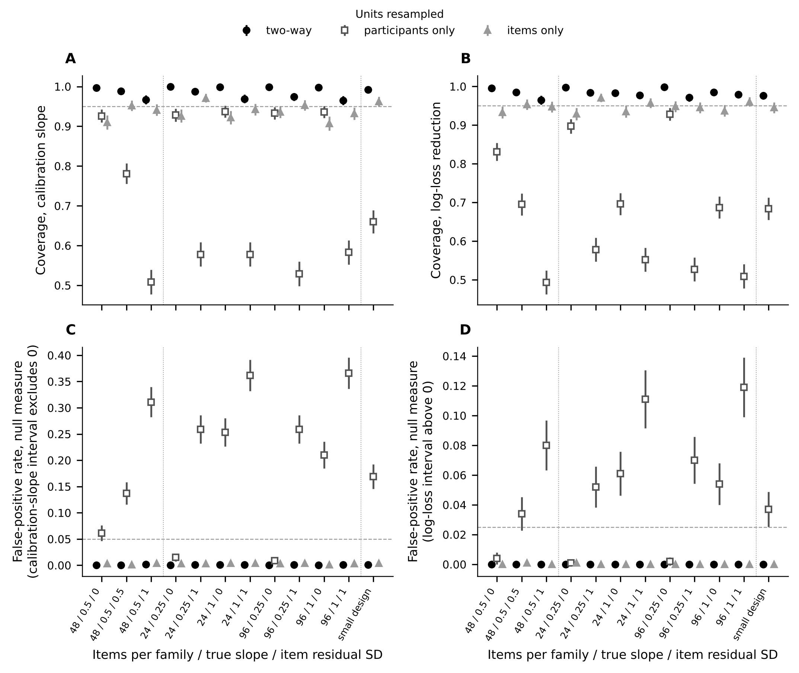
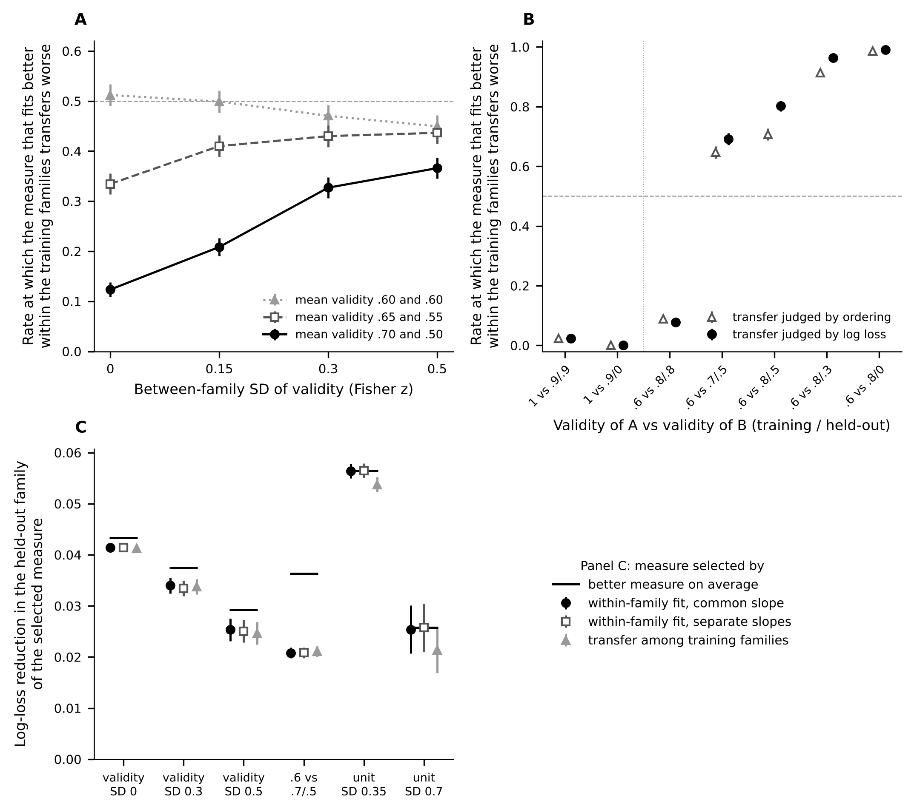
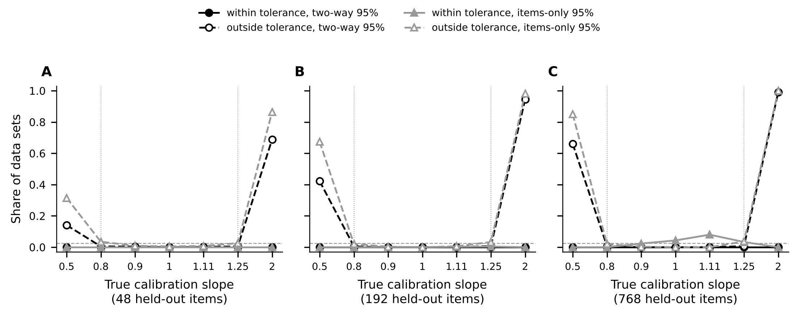
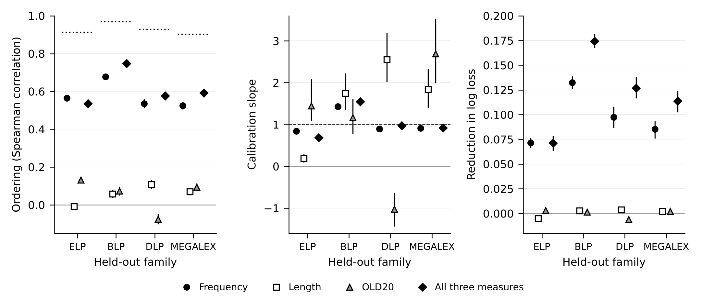

# Supplementary material

Do item difficulty measures generalise to new stimulus sets? Leave-one-family-out validation, its pitfalls, and the itemtransfer package

Hongwon Jeong

Part 1 gives the final methods and results that the article relies on and that are not in its tables. Parts 2 to 4 are working documents, kept as they were written and dated: the report of the simulation study (Part 2), the analysis plan and the report of the lexical decision example (Part 3), and the output of the software for the knapsack example (Part 4). Statements in Parts 2 to 4 that were superseded later are marked there, and Part 1 states the final version. The working documents use the short names of the megastudies (ELP = English Lexicon Project, BLP = British Lexicon Project, DLP = Dutch Lexicon Project) and OLD20 for neighbourhood distance.

# Part 1. Final methods and results

## 1.1 What each criterion estimates, and what is resampled

| Criterion | Quantity in the held-out family | Target in the simulation study | Resampled for the interval |
|---|---|---|---|
| Ordering | Spearman correlation between the transferred predictor and observed item accuracy | The mean of this correlation over data sets with new items and new participants of the same numbers. It is not the correlation with error-free accuracy | Items within families (training fit repeated). Participants are kept as observed |
| Scale | Calibration slope: slope of a logistic regression of the held-out responses on the transferred predictor. The slopes are population-averaged, that is, from a model without random effects | Its value in a data set with 120,000 items per family, with abilities integrated out | Participants within samples and items within families |
| Prediction | Relative reduction in log loss against an intercept-only model; both intercepts estimated on one half of the held-out items and scored on the other half | As for scale | Participants within samples and items within families |

The items-only interval for ordering contained its target in 90.5% to 99% of the data sets in the 23 complete, balanced conditions in which it was examined (Part 2, S5). It was not examined for sparse or unbalanced designs, for several samples per family, or for predictors made of several measures; for such designs its coverage is not established. The simulation check of the software reports coverage for the calibration slope and the prediction criterion, not for ordering.

## 1.2 Link between the calibration slope and the prediction criterion

Let the transferred predictor of item i be z_i (the trained slope times the measure), and let the logit of the probability of a correct response in the held-out family be a + c z_i, so that c is the calibration slope. The prediction criterion compares two models whose intercepts are re-estimated in the held-out family: the model a' + z_i, with the slope fixed at its trained value, and the model a'' without the measure. Expand the expected log-likelihood per response of the model a' + k z_i around k = 0 to second order in k. The first derivative with respect to k at k = 0 is the covariance between z and the probability of a correct response, which to first order in the effect is c w Var(z), where w is the mean of p(1 - p) and Var(z) is the variance of the transferred predictor over the held-out responses. The second derivative is - w Var(z). The expected gain of the model with slope k over the model without the measure is therefore approximately w Var(z) (c k - k^2 / 2), and at the trained slope, k = 1, it is (1/2) w Var(z) (2c - 1).

This is a local approximation for small effects. It ignores terms of third and higher order, and the exact break-even point depends on the size of the trained effect and on the distribution of the measure. The table gives the exact values by numerical integration (script `sim/exact_breakeven.py`, file `sim/results/exact_breakeven.csv`). For a standard normal measure the break-even calibration slope is 0.49 to 0.50 up to a trained slope of 0.5 logits per standard deviation, 0.48 at a slope of 1, 0.44 at 2 and 0.40 at 3. For a measure that is uniform between -4 and 4, whose spread is larger, the break-even point is lower, and a calibration slope of 0.5 leaves a clearly positive reduction in log loss at larger slopes (7.9% at a trained slope of 1 with intercept 0). The statement in the article is therefore limited to effects of small to medium size, and the software computes the reduction in log loss exactly and never uses the approximation.

| Measure | Trained slope (logits per unit) | Intercept | Break-even calibration slope | Reduction in log loss at c = 0.5 | at c = 1 |
|---|---|---|---|---|---|
| normal | 0.25 | 0 | 0.498 | 0.0000 | 0.0110 |
| normal | 0.25 | 1 | 0.498 | 0.0000 | 0.0104 |
| normal | 0.25 | 2 | 0.499 | 0.0000 | 0.0089 |
| normal | 0.5 | 0 | 0.493 | 0.0006 | 0.0414 |
| normal | 0.5 | 1 | 0.494 | 0.0005 | 0.0395 |
| normal | 0.5 | 2 | 0.497 | 0.0002 | 0.0350 |
| normal | 1 | 0 | 0.476 | 0.0074 | 0.1352 |
| normal | 1 | 1 | 0.479 | 0.0063 | 0.1327 |
| normal | 1 | 2 | 0.485 | 0.0039 | 0.1254 |
| normal | 2 | 0 | 0.436 | 0.0558 | 0.3335 |
| normal | 2 | 1 | 0.440 | 0.0529 | 0.3330 |
| normal | 2 | 2 | 0.448 | 0.0447 | 0.3314 |
| normal | 3 | 0 | 0.401 | 0.1361 | 0.4799 |
| normal | 3 | 1 | 0.404 | 0.1338 | 0.4801 |
| normal | 3 | 2 | 0.410 | 0.1266 | 0.4809 |
| uniform | 0.25 | 0 | 0.494 | 0.0007 | 0.0559 |
| uniform | 0.25 | 1 | 0.494 | 0.0007 | 0.0526 |
| uniform | 0.25 | 2 | 0.493 | 0.0007 | 0.0450 |
| uniform | 0.5 | 0 | 0.478 | 0.0091 | 0.1856 |
| uniform | 0.5 | 1 | 0.477 | 0.0090 | 0.1765 |
| uniform | 0.5 | 2 | 0.475 | 0.0083 | 0.1541 |
| uniform | 1 | 0 | 0.435 | 0.0786 | 0.4461 |
| uniform | 1 | 1 | 0.434 | 0.0761 | 0.4356 |
| uniform | 1 | 2 | 0.430 | 0.0689 | 0.4052 |
| uniform | 2 | 0 | 0.359 | 0.3240 | 0.7040 |
| uniform | 2 | 1 | 0.359 | 0.3152 | 0.7009 |
| uniform | 2 | 2 | 0.359 | 0.2905 | 0.6912 |
| uniform | 3 | 0 | 0.307 | 0.5139 | 0.8023 |
| uniform | 3 | 1 | 0.308 | 0.5073 | 0.8013 |
| uniform | 3 | 2 | 0.312 | 0.4871 | 0.7982 |

## 1.3 Rule for detecting a level structure

A measure is treated as having a level structure in a family (a) when it takes at most six distinct values there, or (b) when its sorted values can be cut at their largest gaps into two to six groups such that the smallest gap between neighbouring groups is more than twice the widest range within a group and every group contains at least two items. Both numbers (six levels, ratio 2) are arguments of the function `diagnose` and can be changed. The rules of the other diagnostics are in the article; all are heuristics.

## 1.4 Settings of the analyses

| Analysis | Package version | Bootstrap resamples | Random divisions of held-out items (estimate / within each resample) | Seed | Weights | Other settings |
|---|---|---|---|---|---|---|
| Knapsack example | 0.2.0 | 2000 | 500 / 10 | 20261016 (bootstrap), 20261017 (divisions) | every response counted once | Evaluation samples: Franco 2021, Doroc 2025, Lu 2025 main. Reliability only: Lu 2025 pilot. Ordering interval from items only. Tolerance 0.80 to 1.25. Reliability from 1000 splits. Simulation check: 200 data sets with 200 resamples |
| Lexical decision example, main analysis | 0.2.0 | 1000, in batches of 50 | 500 / 10 | 20261113 | every response counted once | Ordering interval from items only. Tolerance 0.80 to 1.25. Sensitivity analyses: 200 resamples |
| Simulation study, S1 to S5 | 0.1.0 (the functions used are unchanged in 0.2.0) | 500 | 100 / 10 | 2601 to 2605; generator seeded by study, condition and replication | every response counted once | 1,000 or 2,000 data sets per condition unless stated in Part 2 |
| Simulation study, S6 to S8 | 0.2.0 | 500 | 100 / 10 | 2606 to 2608 | every response counted once | See Part 2 |
| Mixed models | R 4.6.2, lme4 2.1.0 | none | none | 2610 to 2615 (simulation) | not applicable | See 1.6 and 1.8 |

The test suite of version 0.1.0 had 73 tests; version 0.2.0, which produced the results of both examples, has 78. In every analysis the model has one intercept per sample, an item that two samples share is one unit in the resampling of items, and when a family is held out none of its samples enters the training fit.

## 1.5 Knapsack example: recomputation of the measures (step 1)

Every measure was recomputed from the weights and values of the objects with one implementation. Instance complexity, the capacity and target ratios that enter typical-case complexity, satisfiability, the best attainable value and Sahni-k agreed with every value that the source studies report, with one exception: for one item of the Doroc family the stored instance complexity corresponds to a best attainable value of 128, whereas enumeration gives 130, which places the item just below its designed level without changing whether it has a solution. Typical-case complexity was computed from the probability that a random instance with the same number of objects, capacity ratio and target ratio has a solution (estimated from 20,000 random instances with independent uniform weights and values) as 1 minus the absolute value of twice this probability minus 1. Solver effort is the base-2 logarithm of 1 plus the number of propagations of the Gecode constraint solver (Gecode 6.3.0 through MiniZinc 2.9.3) on the model of Franco et al. (2021). The recomputed propagation counts correlated .88 with the published counts for the Franco decision items; the difference is attributed to the solver versions.

## 1.6 Knapsack example: evaluation sample of the Franco family, and mixed model

The Franco family is evaluated on the Franco et al. (2021) sample (all 72 items). The plan of the earlier analysis of these data, frozen on 26 October 2026 before any result was computed, fixed this choice and named the evaluation on the Franco et al. (2024a) sample (56 of the 72 items) as a sensitivity analysis. Its result (file `knapsack_report/sensitivity_franco2024_evaluation.csv`, 2,000 resamples):

| Measure | Items | Responses | Ordering | Calibration slope | Reduction in log loss |
|---|---|---|---|---|---|
| Instance complexity | 56 | 1,120 | 0.68 [0.48, 0.82] | 0.43 [0.18, 0.89] | -0.009 [-0.173, 0.133] |
| Typical-case complexity | 56 | 1,120 | 0.54 [0.37, 0.66] | 1.47 [0.59, 4.04] | 0.035 [0.005, 0.075] |

Mixed model (script `glmm/glmm_knapsack.R`, files `glmm/glmm_knapsack_slopes.csv` and `glmm/glmm_knapsack_ratios.csv`). The four samples of the transfer analysis were analysed together (11,450 responses, 118 participants, 264 items) with `lme4::glmer`, binomial family, Laplace approximation, optimiser bobyqa. Model with one slope per family: `correct ~ 0 + sample + family:measure + (1 | participant) + (1 | item)`; model with a common slope: `correct ~ 0 + sample + measure + (1 | participant) + (1 | item)`. The two were compared by a likelihood-ratio test with 2 degrees of freedom. For the ratio of slopes, the model `correct ~ 0 + sample + measure_training + measure_heldout + (1 | participant) + (1 | item)` was fitted once per held-out family, where the two predictors are the measure in the other families and in the held-out family; the interval of the ratio is a delta-method interval. All six fits converged and none was singular. The ratio without random effects in the last column comes from the same fixed effects in an ordinary logistic regression; it differs from the calibration slope of the article for the Franco family, because here both Franco samples are in the held-out part.

| Measure | Held-out family | Slope in the other families | Slope in the held-out family | Ratio, mixed model | Ratio, no random effects | Test of equal slopes in the three families |
|---|---|---|---|---|---|---|
| Instance complexity | Franco | 13.56 | 7.15 | 0.53 [0.37, 0.69] | 0.54 | chi-square(2) = 25.19, p = 3.4e-06 |
| Instance complexity | Doroc | 9.43 | 19.10 | 2.03 [1.41, 2.64] | 1.90 | chi-square(2) = 25.19, p = 3.4e-06 |
| Instance complexity | Lu | 8.67 | 12.50 | 1.44 [1.03, 1.85] | 1.07 | chi-square(2) = 25.19, p = 3.4e-06 |
| Typical-case complexity | Franco | -1.30 | -1.65 | 1.27 [0.60, 1.94] | 1.62 | chi-square(2) = 3.92, p = 0.14 |
| Typical-case complexity | Doroc | -1.62 | -0.69 | 0.43 [-0.09, 0.94] | 0.38 | chi-square(2) = 3.92, p = 0.14 |
| Typical-case complexity | Lu | -1.29 | -1.60 | 1.24 [0.59, 1.89] | 1.52 | chi-square(2) = 3.92, p = 0.14 |

## 1.7 Lexical decision example: flow of the data, final results, timeline

Flow of the data (counts from the loader, see Part 3 and `second_example/PROVENANCE.md`).

| Megastudy | Participants | Words | Word responses, all | Words in the transfer analysis | Word responses in the transfer analysis | Exclusions before the count of word responses |
|---|---|---|---|---|---|---|
| English Lexicon Project | 814 | 40,481 | 1,372,240 | 30,992 | 1,050,513 | 6 of 820 participant files that the depositors mark as redundant or faulty; 722 word responses without a valid accuracy code. The article of the project reports 816 participants; the deposit does not identify them, so 814 is used |
| British Lexicon Project | 78 | 28,730 | 1,120,470 | 19,241 | 750,388 | none |
| Dutch Lexicon Project | 39 | 14,089 | 549,471 | 14,089 | 549,471 | block 50, which the authors exclude; time-outs count as errors, as the authors scored them |
| MEGALEX | 96 | 28,466 | 1,311,740 | 28,466 | 1,311,740 | none |
| Total | | | 4,353,921 | 92,788 | 3,662,112 | |

Nonword responses are not used. The difference between 4,353,921 and 3,662,112 responses is due to the 18,978 words that the two English megastudies share: each was assigned at random to one megastudy, and its responses in the other megastudy are left out of the transfer analysis (they are used for the agreement between samples in step 2).

Final transfer results for all four models (file `second_example/results/step3_transfer.csv`, version 0.2.0; ordering intervals from resampled items, the others from participants and items). Table 7 of the article is taken from the same file.

| Held-out megastudy | Model | Training slope | Slope fitted in the family | Ordering | Calibration slope | Reduction in log loss |
|---|---|---|---|---|---|---|
| English Lexicon Project | Frequency | 0.80 | 0.68 [0.66, 0.70] | 0.56 [0.56, 0.57] | 0.84 [0.81, 0.88] | 0.071 [0.067, 0.076] |
| English Lexicon Project | Length | 0.10 | 0.02 [0.01, 0.03] | -0.01 [-0.02, 0.00] | 0.20 [0.11, 0.28] | -0.005 [-0.007, -0.003] |
| English Lexicon Project | Neighbourhood distance | -0.10 | -0.14 [-0.16, -0.12] | 0.13 [0.12, 0.14] | 1.45 [1.10, 2.08] | 0.003 [0.002, 0.004] |
| English Lexicon Project | Three measures |  |  | 0.53 [0.53, 0.54] | 0.69 [0.66, 0.72] | 0.071 [0.064, 0.078] |
| British Lexicon Project | Frequency | 0.70 | 1.00 [0.96, 1.04] | 0.68 [0.67, 0.69] | 1.43 [1.37, 1.49] | 0.132 [0.127, 0.138] |
| British Lexicon Project | Length | 0.05 | 0.09 [0.07, 0.10] | 0.06 [0.04, 0.07] | 1.75 [1.36, 2.21] | 0.003 [0.002, 0.003] |
| British Lexicon Project | Neighbourhood distance | -0.11 | -0.13 [-0.17, -0.09] | 0.07 [0.06, 0.09] | 1.17 [0.79, 1.60] | 0.002 [0.001, 0.002] |
| British Lexicon Project | Three measures |  |  | 0.75 [0.74, 0.75] | 1.54 [1.48, 1.61] | 0.174 [0.168, 0.181] |
| Dutch Lexicon Project | Frequency | 0.78 | 0.70 [0.66, 0.74] | 0.54 [0.52, 0.55] | 0.89 [0.85, 0.95] | 0.097 [0.087, 0.108] |
| Dutch Lexicon Project | Length | 0.05 | 0.13 [0.10, 0.15] | 0.11 [0.09, 0.12] | 2.55 [2.04, 3.17] | 0.004 [0.003, 0.005] |
| Dutch Lexicon Project | Neighbourhood distance | -0.15 | 0.16 [0.10, 0.21] | -0.07 [-0.09, -0.06] | -1.02 [-1.43, -0.64] | -0.006 [-0.008, -0.005] |
| Dutch Lexicon Project | Three measures |  |  | 0.58 [0.57, 0.59] | 0.98 [0.93, 1.03] | 0.127 [0.117, 0.138] |
| MEGALEX | Frequency | 0.79 | 0.72 [0.68, 0.75] | 0.52 [0.52, 0.53] | 0.92 [0.87, 0.96] | 0.085 [0.077, 0.093] |
| MEGALEX | Length | 0.05 | 0.09 [0.08, 0.11] | 0.07 [0.06, 0.08] | 1.84 [1.41, 2.32] | 0.002 [0.002, 0.003] |
| MEGALEX | Neighbourhood distance | -0.10 | -0.26 [-0.31, -0.20] | 0.09 [0.08, 0.11] | 2.69 [2.00, 3.52] | 0.002 [0.001, 0.003] |
| MEGALEX | Three measures |  |  | 0.59 [0.58, 0.60] | 0.92 [0.88, 0.97] | 0.114 [0.103, 0.123] |

Non-linear frequency function (not planned; file `second_example/results/posthoc_nonlinear_frequency.csv`, 200 resamples). Words unknown to the frequency resource were removed, and frequency was entered linearly or as a cubic polynomial.

| Held-out megastudy | Words | Linear: calibration slope | Cubic: calibration slope | Linear: reduction in log loss | Cubic: reduction in log loss |
|---|---|---|---|---|---|
| English Lexicon Project | 30,052 | 0.90 [0.86, 0.95] | 0.90 [0.86, 0.95] | 0.077 | 0.080 |
| British Lexicon Project | 18,598 | 1.28 [1.23, 1.34] | 1.33 [1.27, 1.39] | 0.131 | 0.130 |
| Dutch Lexicon Project | 13,568 | 0.86 [0.81, 0.91] | 0.84 [0.79, 0.90] | 0.082 | 0.084 |
| MEGALEX | 27,622 | 0.95 [0.88, 1.00] | 0.95 [0.87, 1.00] | 0.082 | 0.084 |

Neighbourhood distance was computed against the complete word list of the megastudy to which a word belongs (40,481, 28,730, 14,089 and 28,466 words), so a shared English word has the value of the megastudy to which it was assigned, and the values are not on one scale. With reference lists of equal size (a random 14,089 words of each list) the trained slopes were about half as large, the reversal of sign for the Dutch megastudy remained, and the reductions in log loss stayed at or below .001 (Part 3). A common, fixed reference list for the two English megastudies was not examined.

Timeline (all on 13 November 2026, Korean time). The dates of the plan are the times recorded in the file; the plan was not registered externally.

| Time | Event | What was known |
|---|---|---|
| before 10:12 | Feasibility check on copies of the data with rough versions of the measures | Within each megastudy: correlations of accuracy with frequency (.53 to .69) and length, slopes of frequency (about 0.70 in three megastudies, 1.06 in the British one), one split-half reliability each, raw agreement of the two English megastudies (.73) |
| 10:12 | Analysis plan written (Part 3), after step 1 | As above. No transfer result |
| 10:14 | Item file of the English Lexicon Project obtained; used in step 1 only | |
| after 10:14 | Steps 2 to 5 run as planned | |
| 12:09 | Additions after the transfer results had been seen, listed in the plan as deviations | Transfer results. Added: analysis without words unknown to the frequency resource, comparison of the three-measure model with frequency, slopes on fixed word sets, examination of the ordering interval |
| afternoon | Simulation of the ordering interval (Part 2, S5); package changed to the items-only interval; tolerance of 0.80 to 1.25 introduced in place of the planned rule (interval includes 1) | All results of the example |
| evening | Transfer analysis rerun with version 0.2.0 (identical calibration slopes and reductions in log loss); cubic frequency function added | |

## 1.8 Mixed model in the simulation study (Table 6 of the article)

Script `glmm/glmm_simulation.R`, files `glmm/glmm_simulation_raw.csv` (one row per data set) and `glmm/glmm_simulation_summary.csv`. Data were generated in R as in the base condition (four families, 48 items and 40 participants each, complete design, intercept 1, slope 0.5, item residual SD 0.5, ability SD 0.8), with the changes named in the scenario; 200 data sets per scenario, seeds 2610 to 2615. Mixed model: `y ~ 0 + family + x_training + x_heldout + (1 | participant) + (1 | item)` against `y ~ 0 + family + x + (1 | participant) + (1 | item)`, `lme4::glmer` with `nAGQ = 0` (a fast approximation in which the fixed effects are estimated in the penalised least-squares step) and optimiser bobyqa; likelihood-ratio test with 1 degree of freedom. The comparison without random effects uses the same fixed effects in `glm` and a likelihood-ratio test. All 1,200 fits returned estimates; none was excluded.

| Scenario | Data sets | Ratio of slopes, mixed model (median) | Ratio, no random effects (median) | Equal slopes rejected, mixed model | Equal slopes rejected, no random effects |
|---|---|---|---|---|---|
| same slope | 200 | 1.02 | 1.01 | 0.070 | 0.190 |
| held-out slope half | 200 | 0.51 | 0.51 | 0.610 | 0.845 |
| held-out slope twice | 200 | 1.98 | 1.99 | 0.995 | 0.995 |
| same slope, ability SD 1.6 in held-out family | 200 | 0.98 | 0.83 | 0.025 | 0.345 |
| same slope, item residual SD 1 in held-out family | 200 | 0.95 | 0.90 | 0.125 | 0.410 |
| no relation, item residual SD 1 | 200 | 0.01 | 0.02 | 0.060 | 0.460 |

## 1.9 Where each table and figure of the article comes from

| Article | Result files (repository folder `paper/`) | Script |
|---|---|---|
| Figure 1 | none (schematic) | `figures/make_schematic.py` |
| Figures 2 to 4 | `sim/results/sim01_summary.csv`, `sim02_summary.csv`, `sim03_summary.csv` and the files of large-sample values | `sim/make_figures.py` |
| Table 3 | `sim/results/tables/s3_bootstrap_comparison.csv` | `sim/make_tables.py` |
| Table 4 | `sim/results/tables/ordering_interval.csv` | `sim/make_tables.py` |
| Table 5 | `sim/results/tables/s6_comparators.csv` | `sim/make_tables.py` |
| Table 6 | `glmm/glmm_simulation_summary.csv` | `glmm/glmm_simulation.R` |
| Text on the tolerance rule and on the model without random effects | `sim/results/tables/s8_tolerance.csv`, `s7_noncollapsibility.csv` | `sim/sim08_tolerance.py`, `sim/sim07_noncollapsibility.py` |
| Table 7 | `second_example/results/step3_transfer.csv`, `step2_reliability.csv` | `second_example/run_lexical.py` |
| Table 8 | `second_example/results/step3_transfer.csv`, `sensitivity_transfer.csv`, `posthoc_nonlinear_frequency.csv` | `run_lexical.py`, `nonlinear_frequency.py` |
| Figure 5 | `second_example/results/figure1_binned_accuracy.csv` | `second_example/figures_lexical.py` |
| Table 9 | `knapsack_report/reliability.csv` | `itemtransfer/examples/knapsack.py` |
| Table 10, Figure 6 | `knapsack_report/transfer.csv`, `weak_training.csv`, `predictions.csv` | `itemtransfer/examples/knapsack.py`, `figures/make_knapsack_figure.py` |
| Knapsack diagnostics in the text | `knapsack_report/levels.csv`, `range.csv`, `weighting.csv`, `measure_correlations.csv`, `interval_check.csv`, `sensitivity_franco2024_evaluation.csv`, `glmm/glmm_knapsack_*.csv` | as above |

# Part 2. Simulation study: full report (working document, 13 November 2026)

Figure numbers in this part refer to the figures of the report: its Figures 1, 2 and 3 are Figures 2, 3 and 4 of the article; its Figures 4, 5 and 6 are shown at the end of this part. Sections S1 to S5 were run with version 0.1.0 of the package and S6 to S8 with version 0.2.0. Statements that were superseded are marked "Status".

## Simulation study: what leave-one-family-out transfer validation can and cannot show

Status: all runs finished on 13 November 2026. Every number below comes from a file in `results/`
(`*_summary.csv`, `*_targets.csv`, `tables/*.md`); the scripts that made them are `sim00` to `sim08`, the figures
are in `figures/` (captions in `figures/captions.md`). Rates are followed by their Monte Carlo standard error in
parentheses, as recommended by Morris, White and Crowther (2019).

### Questions

The procedure judges a measure on a held-out item family by three criteria: ordering (Spearman correlation
between the transferred predictor and item accuracy), scale (calibration slope) and prediction (relative
log-loss reduction with the intercept calibrated on half of the held-out items). The simulation asks five
questions that do not depend on a particular task.

1. Do the three criteria respond to different properties of the data, and when do they disagree?
2. Which features of the held-out family (designed levels, range of the measure, reliability of item
   difficulty) change what a criterion can show?
3. Do the bootstrap intervals have the coverage they claim, how often is a real relation detected, and how often
   is a relation "detected" for a measure without one?
4. Does the measure that fits better within the training families also transfer better?
5. (Added during the work, on request.) Should the interval of the ordering criterion be a percentile interval
   or a basic (reflected) interval?
6. to 8. (Added after an internal review.) What does the procedure give beyond grouped cross-validation, a test
   of slope heterogeneity and a random-effects meta-analysis (S6); how far can the calibration slope move when
   only the variances or the mean accuracy of a family differ (S7); and what are the error rates of the
   tolerance rule for the calibration slope (S8)?

### Common design

Data are generated for one participant j and one item i of a family as

    logit P(correct) = intercept + slope x g(measure_i) + d_i + u_j,

with item residuals d ~ N(0, item residual SD) and participant effects u ~ N(0, participant SD). The item
residual stands for everything that makes items differ in difficulty and that the measure does not capture.
Slopes are in logits per standard deviation of the measure: 0.25 (weak), 0.5 (medium), 1 (strong). The sign is
chosen so that a higher measure means a harder item; all slopes are reported as magnitudes.

**Base case.** Four item families (one held out, three for training), one sample per family, 48 items and 40
participants per family (every participant responds to every item), measure standard normal, slope 0.5, item
residual SD 0.5, participant SD 0.8, intercept 1 (mean accuracy about .70). In the base case the measure
accounts for half of the true variance of item difficulty on the logit scale.

**Analysis.** Each simulated data set is analysed with the functions of the package `itemtransfer` that
`transfer()` itself calls, for the one designated held-out family (families are exchangeable unless a study
makes the held-out family different, so one fold per data set suffices and keeps replications independent).
Intervals are 95% percentile intervals of the two-way bootstrap (participants within samples, items within
families) with 500 resamples; the prediction criterion uses 100 item splits for the estimate and 10 inside each
resample. `sim00_validate.py` confirms that this engine returns exactly the numbers of the public `transfer()`
and `diagnose()` on the same data (largest difference 3e-17), and that `check_intervals()` on the equivalent
package `Design` gives the same operating characteristics (coverage .977 against .997, detection .997 against
.993, 300 data sets each).

**Large-sample targets.** For every cell the value of each statistic for very many items and participants was
computed explicitly: 120,000 items per family (60,000 for ten families), the participant distribution
integrated out by Gauss-Hermite quadrature (61 nodes), three independent item sets. The targets are saved in
`results/*_targets.csv` with their standard deviation over item sets (calibration slope in the base case:
1.0007, SD 0.003; log-loss reduction: 0.0299, SD 0.0001). The log-loss reduction is a trial-level quantity, so
its target does not depend on the number of trials per item. The ordering correlation does: its large-sample
value is the correlation with error-free item accuracies, which no finite sample attains (see S2c and S5).

**Number of bootstrap resamples.** For 150 base-case data sets, intervals from 250, 500, 1,000 and 2,000
resamples were compared with intervals from 4,000 resamples. With 500 resamples an end point moves by 4.3% of
the interval width (root mean square; 3.6% for the log-loss reduction), and the question "does the interval
contain the target" changed its answer in 2 of 150 data sets (`results/sim00_bootstrap_size.csv`). This noise
is small against the effects reported below, so 500 resamples were used throughout.

**Performance measures.** Coverage (share of intervals that contain the target), detection rate (share of
intervals that exclude 0 for the calibration slope, or lie above 0 for the log-loss reduction and the ordering
correlation), false-positive rate (the same for a measure without relation), median interval width, and the mean
or median of the estimates. Monte Carlo standard errors of rates are sqrt(p(1 - p) / n). With 1,000
replications the standard error of a coverage near .95 is .007 and that of a rate near .50 is .016.

#### Design table

| Study | Varied | Fixed | Cells | Replications per cell | Bootstrap |
|---|---|---|---|---|---|
| S1 Separation of the criteria | held-out slope as a multiple of the training slope (-1, 0, 0.25, 0.5, 1, 2); null measure; proxy measure correlated .7 with the true measure in the training families only, in the held-out family only, or everywhere; training slope 0, 0.05, 0.125, 0.25 with held-out slope 0.5 | base case | 10 | 1,000 (2,000 in the common-slope cell) | two-way, 500 |
| S2a Level structure | measure in the held-out family continuous, four levels or two levels; true relation graded or a step; 48 items and 40 participants, or 96 and 80 | 4 families, training measure continuous, effect SD 0.5 | 12 | 1,000 (500 for the larger design) | two-way, 500 |
| S2b Range mismatch | relation linear, logarithmic or saturating in the measure; held-out range 1 to 4 (as training), 2 to 8, 1 to 8 | 4 families, 48 items, 40 participants, effect SD 0.5 in training | 9 | 1,000 | two-way, 500 |
| S2c Reliability | participants 10, 20, 40, 80; item residual SD 0, 0.5, 1 | 4 families, 48 items, slope 0.5 | 12 | 2,000 | none |
| S3 Operating characteristics | one factor at a time: families 3, 4, 6, 10; items 24, 48, 96, 192; participants 20, 40, 80; slope 0.25, 0.5, 1; item residual SD 0, 0.5, 1; participant SD 0, 0.8, 1.6. Factorial: items (24, 96) x slope (0.25, 1) x item residual SD (0, 1). Two small designs. Slope differing between families (4 cells) | base case | 29 | 1,000 | two-way, 500; in 15 cells also participants-only and items-only |
| S4 Fit and transfer | two measures whose validities are fixed per family, random per family, or equal with a family-specific unit; 3, 4, 6, 10 families | 48 items, 40 participants (two cells 96 and 80), latent slope 1, item residual SD 0.5 | 28 | 2,000 | none |
| S6 Comparison with other analyses | nine scenarios (common slope; held-out intercept 2 or 0; held-out slope x 0.5 or x 2; step relation with two-level held-out family; saturating relation with shifted range; no relation with item residual SD 0.5 or 1) | base case | 9 | 1,000 | two-way, 500 |
| S7 Non-collapsibility | held-out family only: participant SD 0, 0.8, 1.6, 2.4; item residual SD 0, 0.5, 1, 1.5; intercept -0.5, 0, 1, 2, 3 | base case, identical conditional slope | 13 | large-sample values; 500 data sets for two cells | two-way, 500 |
| S8 Tolerance rule | true calibration slope 0.5 to 2 (seven values); held-out items 48, 192, 768; all families 192 or 768 items | 4 families, 40 participants | 27 | 1,000 (48 or 192 held-out items), 300 otherwise | two-way and items-only, 500, 95% and 90% |
| S5 Ordering interval | items 48, 192, 768, 3,072; participants 20, 40, 80; item residual SD 0 or 0.5; slope 0.5 or 1 | 4 families | 8 | 500 (48 and 192 items), 300 or 200 (768 and 3,072 items) | two-way and items-only, 500, no prediction criterion |

The full table with scripts and outputs is `results/tables/design_table.md` (and `.csv`).

### S1. The criteria respond to different things

**Design.** Base case. (a) The same slope in all families. (b) The slope in the held-out family is the
training slope times -1, 0, 0.25, 0.5 or 2. (c) A null measure. (d) A proxy measure with no effect of its own
that correlates .7 with the true measure in all families, only in the training families, or only in the
held-out family. (e) A training slope of 0, 0.05, 0.125 or 0.25 with a held-out slope of 0.5.

**Results (Figure 1; `results/tables/s1_separation.md`).**

| Condition | Ordering, mean | Calibration slope, median (5% to 95%) | Log-loss reduction, mean | Slope interval excludes 0 | Log-loss interval above 0 | below 0 |
|---|---|---|---|---|---|---|
| same slope | .596 (.002) | 1.01 (0.66 to 1.40) | .0308 (.0003) | .993 (.002) | .482 (.011) | .000 |
| held-out slope x 2 | .823 (.002) | 2.03 (1.57 to 2.61) | .0832 (.0006) | 1.000 | 1.000 | .000 |
| held-out slope x 0.5 | .348 (.004) | 0.49 (0.20 to 0.85) | -.0007 (.0004) | .543 (.016) | .006 (.002) | .006 (.002) |
| held-out slope x 0.25 | .190 (.004) | 0.25 (-0.05 to 0.59) | -.0160 (.0004) | .144 (.011) | .000 | .092 (.009) |
| held-out slope 0 | -.004 (.005) | -0.01 (-0.32 to 0.33) | -.0341 (.0005) | .024 (.005) | .000 | .500 (.016) |
| held-out slope reversed | -.595 (.003) | -1.01 (-1.42 to -0.68) | -.0964 (.0009) | .989 (.003) | .000 | 1.000 |
| null measure | -.005 (.003) | -0.10 (-10.8 to 11.0) | -.0007 (.0001) | .001 (.001) | .000 | .003 (.001) |
| proxy, r = .7 everywhere | .419 (.003) | 1.02 (0.48 to 1.78) | .0147 (.0002) | .804 (.009) | .201 (.009) | .000 |
| proxy, r = .7 in training only | .003 (.003) | 0.02 (-0.56 to 0.59) | -.0158 (.0003) | .025 (.004) | .000 | .176 (.009) |
| proxy, r = .7 in held-out only | -.017 (.010) | -2.14 (-43.0 to 43.3) | -.0008 (.0001) | .013 (.003) | .001 (.001) | .011 (.002) |

1. With a common slope the three criteria agree in expectation (calibration slope 1.01, target 1.00), but not in
   their verdicts: the interval of the calibration slope excluded 0 in 99.3% (0.2) of the data sets and the
   interval of the ordering correlation lay above 0 in 97.7% (0.3), whereas the interval of the log-loss
   reduction lay above 0 in only 48.2% (1.1). A medium relation that transfers perfectly improves trial-level
   prediction by about 3%, and the base design cannot reliably tell 3% from 0.
2. The calibration slope recovers the ratio of the held-out slope to the training slope (medians 2.03, 0.49,
   0.25, -0.01 and -1.01 for ratios 2, 0.5, 0.25, 0 and -1; coverage of the large-sample target between .976
   and .991). Ordering does not show the ratio: it only becomes weaker or stronger because the same residual
   noise meets a smaller or larger signal (.35 at ratio 0.5, .82 at ratio 2).
3. The prediction criterion is not a monotone companion of the other two. Its large-sample value is 0 when
   the held-out slope is half the training slope, and negative below that (-.015 at ratio 0.25, -.031 at ratio
   0): a transferred slope that is more than twice too steep predicts worse than no measure at all, although
   the measure still orders the held-out items (ordering .19 to .35). To a first approximation the gain is
   proportional to 2c - 1, where c is the calibration slope. Reported next to a calibration slope below 0.5, a
   negative log-loss reduction is therefore a consequence of the scale, not separate evidence against the
   measure.
4. A null measure fails all three criteria, and the false-positive rates are far below nominal: 0.1% (0.1) for
   the calibration slope, 0.0% for the log-loss reduction, 0.0% for ordering. Its calibration slope is
   arbitrary (5th to 95th percentile -10.8 to 11.0) and the weak-training flag was raised in 97.4% (0.4) of the
   data sets.
5. Collinearity by design. A proxy that correlates .7 with the true measure everywhere appears to transfer:
   training slope -0.29, calibration slope 1.02, interval excluding 0 in 80.4% (0.9). Where the correlation
   exists only in the training families the same proxy has a clear training slope (-0.30, flagged in 0.1% of the data sets) and
   fails in the held-out family on all three criteria (calibration slope 0.02; log-loss interval below 0 in
   17.6% (0.9)). Where it exists only in the held-out family there is nothing to transfer (flag in 98.1%). The
   procedure reports where a correlation with the effective measure exists; it cannot say which measure is
   the effective one. Only a family in which the two measures are uncorrelated separates them.
6. Weak training relation. With a true training slope of 0.05 and a held-out slope of 0.5 the large-sample
   calibration slope is 9.95, the median estimate 6.5, the 5th to 95th percentile -42.9 to 49.9, and 80% of
   the estimates exceed 5 in absolute value; ordering drops to .38 (target .69) because the sign of the
   trained slope is wrong in part of the data sets. The flag (interval of the training slope includes 0) was
   raised in 94.0% (0.8) of these data sets, in 59.1% (1.6) at a training slope of 0.125 and in 2.3% (0.5) at
   0.25. Among flagged data sets 85% (slope 0.05) and 57% (slope 0.125) of the calibration slopes exceeded 5 in
   absolute value; among unflagged ones 5% and 1%. The flag removes the wild values. It also selects: the
   unflagged data sets are those in which the training slope happened to be overestimated, so their
   calibration slopes are too small (median 3.2 against a target of 9.95 at slope 0.05).

**What a user should take from this.** Read the three criteria as answers to three questions and expect
disagreement of two kinds: a clear ordering with a prediction interval that includes 0 (low power of the
prediction criterion), and a clear ordering with a negative log-loss reduction (calibration slope below about
0.5). Do not interpret a calibration slope when the weak-training flag is raised. Do not read transfer of a
measure as evidence that this measure, rather than a correlate, drives difficulty.

**Limitations.** One design size; proxy correlation .7 only; slopes differ only in the held-out family; the
measure is normal and the relation linear.

### S2. Design features of the held-out family

#### S2a. Designed levels

**Design.** Training families have a continuous measure. In the held-out family the measure is continuous,
takes four designed levels or takes two designed levels (same standard deviation; items within a level differ
slightly, as in real designs). The true relation is graded (linear in the measure) or a step (items above the
middle of the range are harder by a fixed amount, with no graded effect), with the same effect standard
deviation of 0.5 logits. The level-indicator baseline of `diagnose()` fits one probability per level in the
calibration half of the held-out items.

**Results (Figure 2A and 2B; `results/tables/s2a_levels.md`).**

| True relation | Held-out measure | Ordering, measure | Ordering, level indicator | Ordering within levels | Calibration slope, median | Indicator minus measure, log loss (48 / 40) | (96 / 80) | Indicator better, rate (96 / 80) |
|---|---|---|---|---|---|---|---|---|
| graded | continuous | .618 (.003) | .543 (.003) | .355 (.004) | 1.01 | -.0103 (.0002) | -.0089 (.0002) | .012 (.005) |
| graded | four levels | .620 (.003) | .630 (.003) | .056 (.005) | 1.00 | -.0074 (.0001) | -.0026 (.0001) | .048 (.010) |
| graded | two levels | .574 (.003) | .642 (.003) | .047 (.005) | 1.00 | -.0019 (.0001) | -.0008 (.0000) | .154 (.016) |
| step | continuous | .552 (.003) | .575 (.003) | .109 (.005) | 1.03 | -.0003 (.0002) | .0024 (.0002) | .690 (.021) |
| step | four levels | .557 (.003) | .576 (.003) | -.000 (.005) | 1.03 | -.0001 (.0002) | .0039 (.0002) | .892 (.014) |
| step | two levels | .560 (.003) | .646 (.003) | -.001 (.005) | 1.14 | -.0012 (.0001) | -.0002 (.0001) | .346 (.021) |

(For the continuous measure the two halves of a median split serve as levels.)

1. In a two-level family the ordering criterion "succeeds" equally under both truths: .574 (graded) and .560
   (step), with the interval above 0 in 97.7% and 98.4% of the data sets. The whole correlation is carried by
   the contrast between the levels: the level indicator orders the items better than the measure (.642 and
   .646), and within the levels the measure hardly orders them even when the true relation is graded (.047),
   because the range within a level is too small.
2. A two-level family cannot distinguish a graded relation from a step by any output of the procedure. The
   difference in log-loss reduction between indicator and measure is -.002 under the graded truth and -.001
   under the step truth with 48 items, and -.0008 against -.0002 with 96 items and 80 participants. The one
   trace of the step is a calibration slope above 1 (large-sample value 1.15, median 1.14), which a user would
   read as "effect somewhat stronger here", and whose interval included 1 in 96.3% (0.6) of the data sets.
3. With four levels or a continuous measure the comparison becomes informative, but only with enough data.
   Under a step truth the level indicator predicts better than the measure in 89.2% (1.4) of the data sets
   with four levels at 96 items and 80 participants, against 44.9% (1.6) at 48 and 40; under a graded truth it
   does so in 4.8% (1.0) and 3.6% (0.6). Within-level correlations of a continuous measure are .36 under the
   graded and .11 under the step truth.
4. The level indicator is at a disadvantage that should be kept in mind: it estimates one parameter per level
   on half of the held-out items, which costs .007 in log-loss reduction with four levels and 48 items even
   when the measure is exactly right.

**What a user should take from this.** A held-out family with two designed levels supports "items at the
high level are harder than items at the low level, by about the amount the trained slope predicts" and nothing
about the form of the relation between or within levels. A graded relation needs a family with at least four
levels or a continuous measure, and then a comparison with the level indicator and the within-level
correlations.

**Limitations.** One step location (the middle of the range), equal numbers of items per level, one effect
size.

#### S2b. Range of the measure under a non-linear relation

**Design.** The measure is uniform on 1 to 4 in the training families and on 1 to 4, 2 to 8 or 1 to 8 in the
held-out family. The true effect is linear in the measure, in its logarithm, or saturating (1 - exp(-measure /
2)), with the same mechanism and the same coefficients in all families. Three analyses: the measure as given,
all families restricted to the common range, and the logarithm of the measure.

**Results (Figure 2C; `results/tables/s2b_range.md`).** Large-sample calibration slopes, with the share of
intervals that included 1 (48 items, 40 participants) in parentheses:

| True relation | Held-out range | Measure as given | Common range | Logarithm of the measure |
|---|---|---|---|---|
| linear | 1 to 4 | 1.00 (.983) | | 1.00 (.984) |
| linear | 2 to 8 | 1.01 (.988) | 1.00 (.978) | 1.92 (.047) |
| linear | 1 to 8 | 1.01 (.985) | 1.00 (.975) | 1.57 (.279) |
| logarithmic | 1 to 4 | 1.00 (.990) | | 1.00 (.991) |
| logarithmic | 2 to 8 | 0.51 (.251) | 1.00 (.982) | 0.99 (.988) |
| logarithmic | 1 to 8 | 0.60 (.413) | 1.00 (.983) | 1.00 (.986) |
| saturating | 1 to 4 | 1.00 (.984) | | 1.00 (.989) |
| saturating | 2 to 8 | 0.34 (.036) | 1.00 (.989) | 0.69 (.835) |
| saturating | 1 to 8 | 0.47 (.092) | 1.00 (.982) | 0.80 (.895) |

1. With an identical mechanism in all families, a held-out family that covers another range has a
   calibration slope of 0.51 (logarithmic) or 0.34 (saturating), and the interval excluded 1 in 75% and 96%
   of the data sets. A user would conclude that the effect is weaker in the held-out family. Under the
   saturating relation the log-loss reduction is negative as well (-.032; mean estimate -.036 (.001)). Ordering
   is not affected in this way (.60 and .45), which is the pattern "ordering holds, scale fails".
2. Restricting all families to the common range restores a calibration slope of 1.00 in every case, for any
   form of the relation, but at a price: with ranges 1 to 4 and 2 to 8, a third of the items remain (16 of 48
   held-out items on average) and the median interval width grows from about 0.6 to about 5.1; with a
   held-out range of 1 to 8, 43% of the held-out items remain (20.6 of 48) and the width grows from about 0.6
   to about 1.7.
3. A transformed measure restores a slope of 1.00 only when the transformation is the right one (the logarithm
   under the logarithmic relation); under the saturating relation the logarithm gives 0.69 and 0.80, and under
   a linear relation it creates a mismatch that was not there (1.92 and 1.57).
4. When both ranges agree, none of this matters: all calibration slopes are 1.00.

**What a user should take from this.** A calibration slope far from 1 in a family with a different range of
the measure is evidence about the scale of the measure as much as about the family. Report the calibration
slope on the common range next to the unrestricted one, expect a wide interval there, and try the candidate
transformations that theory suggests; if no range is shared, the two explanations cannot be separated.

**Limitations.** Two non-linear forms; uniform measure; the common-range remedy was applied with the true
overlap.

#### S2c. Reliability of item difficulty

**Design.** Base case with 10, 20, 40 or 80 participants (trials per item) and item residual SD 0, 0.5 or 1.
For every data set the ordering criterion was also computed against the error-free accuracies of the same
items, and the split-half reliability of item difficulty of the held-out sample (step 2 of the procedure, rank
scale, Spearman-Brown corrected, 200 splits) was used to correct the observed ordering.

**Results (Figure 2D; `results/tables/s2c_reliability.md`).**

| Participants | Item residual SD | Reliability | Ordering observed | Without response noise | Observed / noise-free | Mean sqrt(reliability) | Corrected |
|---|---|---|---|---|---|---|---|
| 10 | 0 | .281 (.004) | .531 (.002) | 1.000 | .53 | .54 | 1.128 (.018) |
| 20 | 0 | .451 (.003) | .664 (.002) | 1.000 | .66 | .67 | 1.034 (.010) |
| 40 | 0 | .618 (.002) | .780 (.001) | 1.000 | .78 | .78 | 0.998 (.002) |
| 80 | 0 | .761 (.001) | .865 (.001) | 1.000 | .87 | .87 | 0.992 (.001) |
| 10 | 0.5 | .445 (.003) | .464 (.003) | .679 (.002) | .68 | .66 | 0.721 (.005) |
| 20 | 0.5 | .613 (.002) | .535 (.002) | .675 (.002) | .79 | .78 | 0.686 (.003) |
| 40 | 0.5 | .758 (.001) | .594 (.002) | .677 (.002) | .88 | .87 | 0.682 (.002) |
| 80 | 0.5 | .862 (.001) | .633 (.002) | .679 (.002) | .93 | .93 | 0.682 (.002) |
| 10 | 1 | .654 (.002) | .342 (.003) | .415 (.003) | .82 | .81 | 0.423 (.004) |
| 20 | 1 | .787 (.001) | .373 (.003) | .416 (.003) | .90 | .89 | 0.420 (.003) |
| 40 | 1 | .881 (.001) | .399 (.003) | .423 (.003) | .94 | .94 | 0.425 (.003) |
| 80 | 1 | .934 (.000) | .413 (.003) | .427 (.003) | .97 | .97 | 0.427 (.003) |

1. The ordering criterion is attenuated by response noise exactly as classical test theory says: the ratio of
   the observed to the noise-free ordering equals the mean square root of the reliability to within .023 in all
   twelve cells (the largest difference, .684 against .661, is at 10 participants and item residual SD 0.5) (for example .53 against .54 with 10 participants and a measure that explains all true
   variance, .88 against .87 in the base case).
2. A measure that is the only source of difficulty (item residual SD 0) reaches an ordering of only .53 with
   10 participants and .78 with 40. Without the reliability ceiling this would be read as a mediocre measure.
3. Dividing by the square root of the reliability recovers the noise-free value on average when the
   reliability is at least about .6 (.682 against .677 in the base case; .998 against 1.000). With low
   reliability the correction overshoots and becomes erratic: 1.13 on average with 10 participants and item
   residual SD 0, reliability not positive in 6% of the data sets, and corrected values above 1 in 43%.
4. With many participants the ordering criterion is limited by the item residual, not by noise: .43 at item
   residual SD 1 however many participants respond. More participants cannot raise an ordering that is low
   because items differ for reasons the measure does not capture.

**What a user should take from this.** Report the ordering criterion with the reliability of the held-out
sample, and the corrected value when the reliability is above about .6. Below that, the right conclusion is
that the sample cannot test the measure.

**Limitations.** All participants respond to all items; reliability was computed in the held-out sample
only; no differences between participants in the effect of the measure.

### S3. Operating characteristics of the intervals

**Design.** Base case, one factor at a time (families 3, 4, 6, 10; items 24, 48, 96, 192; participants 20,
40, 80; slope 0.25, 0.5, 1; item residual SD 0, 0.5, 1; participant SD 0, 0.8, 1.6), a factorial of items (24,
96), slope (0.25, 1) and item residual SD (0, 1), two small designs (3 families, 24 items, 20 participants, item
residual SD 1), and four cells in which the true slope of every family is the base slope times a log-normal
factor. Every data set contains the true measure and a null measure. In 15 cells the two-way bootstrap of the
procedure was compared, on the same data sets, with a bootstrap that resamples participants only and one that
resamples items only (helpers in `simcore.py`; the package itself offers the two-way bootstrap). 1,000 data sets
per cell, 500 resamples.

**Results (Figures 3 and 4; `results/tables/s3_true_measure.md`, `s3_bootstrap_comparison.md`,
`s3_null_measure.md`, `s3_slope_differs.md`).**

Two-way bootstrap, true measure, one factor at a time (base case in bold):

| Varied | Value | Slope: coverage | Slope: median width | Width justified by the spread | Slope: detection | Log loss: coverage | Log loss: detection | Ordering: detection |
|---|---|---|---|---|---|---|---|---|
| **base** | | .988 (.003) | 1.18 | 0.86 | .988 (.003) | .985 (.004) | .458 (.016) | .982 (.004) |
| families | 3 | .981 (.004) | 1.32 | 0.98 | .992 (.003) | .978 (.005) | .454 (.016) | .979 (.005) |
| families | 6 | .985 (.004) | 1.11 | 0.81 | .992 (.003) | .982 (.004) | .496 (.016) | .980 (.004) |
| families | 10 | .989 (.003) | 1.04 | 0.78 | .998 (.001) | .984 (.004) | .504 (.016) | .987 (.004) |
| items | 24 | .981 (.004) | 1.86 | 1.40 | .838 (.012) | .986 (.004) | .194 (.013) | .732 (.014) |
| items | 96 | .985 (.004) | 0.81 | 0.62 | 1.000 | .984 (.004) | .855 (.011) | 1.000 |
| items | 192 | .985 (.004) | 0.57 | 0.45 | 1.000 | .980 (.004) | .990 (.003) | 1.000 |
| participants | 20 | .998 (.001) | 1.57 | 1.11 | .954 (.007) | .986 (.004) | .272 (.014) | .913 (.009) |
| participants | 80 | .971 (.005) | 0.96 | 0.83 | .999 (.001) | .976 (.005) | .654 (.015) | .998 (.001) |
| slope | 0.25 | .989 (.003) | 2.79 | 1.99 | .551 (.016) | .986 (.004) | .094 (.009) | .436 (.016) |
| slope | 1 | .990 (.003) | 0.64 | 0.47 | 1.000 | .980 (.004) | .985 (.004) | 1.000 |
| item residual SD | 0 | .997 (.002) | 0.92 | 0.58 | 1.000 | .995 (.002) | .744 (.014) | 1.000 |
| item residual SD | 1 | .967 (.006) | 1.90 | 1.65 | .799 (.013) | .965 (.006) | .245 (.014) | .736 (.014) |
| participant SD | 0 | .991 (.003) | 1.17 | 0.92 | .994 (.002) | .983 (.004) | .494 (.016) | .977 (.005) |
| participant SD | 1.6 | .983 (.004) | 1.28 | 1.02 | .986 (.004) | .987 (.004) | .428 (.016) | .972 (.005) |

("Width justified by the spread" is the range of the central 95% of the estimates over the 1,000 data sets.)

The three ways of resampling, on the same data sets:

| Items / slope / item residual SD | Slope coverage: two-way | participants only | items only | Null measure, slope interval excludes 0: two-way | participants only | items only | Log-loss detection: two-way | items only |
|---|---|---|---|---|---|---|---|---|
| 48 / 0.5 / 0 | .997 (.002) | .926 (.008) | .910 (.009) | .000 | .061 (.008) | .003 (.002) | .744 (.014) | .976 (.005) |
| 48 / 0.5 / 0.5 (base) | .988 (.003) | .781 (.013) | .952 (.007) | .000 | .137 (.011) | .001 (.001) | .458 (.016) | .690 (.015) |
| 48 / 0.5 / 1 | .967 (.006) | .508 (.016) | .941 (.007) | .002 (.001) | .311 (.015) | .004 (.002) | .245 (.014) | .314 (.015) |
| 24 / 1 / 1 | .969 (.005) | .578 (.016) | .942 (.007) | .001 (.001) | .362 (.015) | .004 (.002) | .387 (.015) | .484 (.016) |
| 96 / 0.25 / 1 | .974 (.005) | .529 (.016) | .953 (.007) | .001 (.001) | .259 (.014) | .003 (.002) | .101 (.010) | .170 (.012) |
| 96 / 1 / 0 | .998 (.001) | .936 (.008) | .907 (.009) | .000 | .210 (.011) | .001 (.001) | 1.000 | 1.000 |
| 96 / 1 / 1 | .965 (.006) | .583 (.016) | .932 (.008) | .001 (.001) | .366 (.015) | .003 (.002) | .967 (.006) | .978 (.005) |
| small design (3 families, 24 items, 20 participants, 0.5 / 1) | .992 (.003) | .660 (.015) | .962 (.006) | .001 (.001) | .169 (.012) | .004 (.002) | .025 (.005) | .079 (.009) |

1. The two-way bootstrap never undercovered. Coverage of the calibration slope was between .965 (.006) and
   1.000 in all 25 common-slope cells, and coverage of the log-loss reduction between .965 (.006) and .998.
   The intervals are conservative: the median width is 1.1 to 2.1 times the width that the spread of the
   estimates would justify (1.18 against 0.86 in the base case, 0.92 against 0.58 without item residual, 1.90
   against 1.65 with item residual SD 1). Resampling participants and items at once counts the response noise
   twice.
2. The price is power, most of all for the prediction criterion. In the base case a medium relation that
   transfers perfectly is detected by the calibration slope in 98.8% (0.3) and by ordering in 98.2% (0.4) of
   the data sets, but by the log-loss reduction in only 45.8% (1.6). The prediction criterion reaches 85%
   with 96 items and 99% with 192 items or a strong slope; it stays at 9.4% (0.9) for a weak slope and at
   24.5% (1.4) when the item residual SD is 1. An interval of the log-loss reduction that includes 0 is
   therefore the expected result for a valid measure of medium strength in designs of ordinary size, and must
   not be read as failed transfer.
3. What limits precision is the number of items of the held-out family and the strength of the relation, not
   the number of families. From 3 to 10 families the median width of the slope interval falls from 1.32 to
   1.04; from 24 to 192 items it falls from 1.86 to 0.57. Even in the base case a width of 1.18 means that a
   calibration slope of 1 cannot be told from 0.5 or 1.6. With a weak slope (0.25) the width is 2.8 and the
   relation is detected in 55.1% (1.6) of the data sets.
4. Small designs are uninformative, and the simulation shows this plainly. With 3 families, 24 items, 20
   participants and item residual SD 1, the median width of the slope interval is 5.5 for a medium slope
   (detection 23.0% (1.3); log-loss detection 2.5% (0.5)) and 22 for a weak slope (detection 1.0% (0.3)).
   The coverage is correct (.992, .990), but an interval from about -2 to 4 says nothing. The limiting factors
   here are the 24 items and the item residual; with 3 families and the base numbers of items and participants
   the procedure works as in the base case (width 1.32, detection .992).
5. Item residual variance decides which resampling is valid. A bootstrap of participants only treats the
   items as fixed and is anticonservative as soon as items differ for reasons that the measure does not
   capture: coverage of the calibration slope .781 (.013) in the base case and .508 (.016) at item residual SD
   1, coverage of the log-loss reduction .695 (.015) and .493 (.016), and a null measure is declared related
   to accuracy in 13.7% (1.1) and 31.1% (1.5) of the data sets (up to 36.6% (1.5) in the factorial). Even
   without any item residual its coverage is below nominal (.926 (.008)), because the items are still a sample
   of values of the measure. More participants make this worse, not better, since the interval shrinks while
   the item-to-item variation stays.
6. A bootstrap of items only is close to nominal: coverage of the calibration slope .907 to .971 (.932 to
   .971 when the item residual SD is at least 0.5 and the participant SD at most 0.8; .907 to .936 when the
   item residual SD is 0), its median width equals the
   width justified by the spread (0.88 against 0.86 in the base case, 1.65 against 1.65 at item residual SD 1),
   the false-positive rate for the null measure stays at or below 0.5%, and the prediction criterion detects
   the base-case relation in 69.0% (1.5) instead of 45.8% of the data sets. It undercovers mildly where
   participants are the main source of error (no item residual, or participant SD 1.6: .916 (.009)).
7. False positives are not a concern with the two-way bootstrap. For the null measure the interval of the
   calibration slope excluded 0 in at most 0.2% of the data sets in every cell, the interval of the log-loss
   reduction lay above 0 in at most 0.1%, and the weak-training flag was raised in 94.6% to 99.5%.
8. When true slopes differ between families, the interval covers the calibration slope of the families at
   hand (coverage .979 to .987 against the value specific to each draw), not a value for families in general.
   With a log-normal SD of 0.4 the large-sample calibration slope of a draw ranges from 0.43 to 2.27 (5th to
   95th percentile, 3 families), and the interval still included 1 in 70.1% (1.4) of the data sets, and in
   50.3% (2.1) of those whose large-sample value was below 0.75 or above 1.33. "The interval includes 1" is
   weak evidence that the trained effect size holds.
9. The percentile interval of the ordering correlation behaves differently from the other two and is treated
   in S5.

**What a user should take from this.** The intervals of the procedure can be trusted not to produce false
claims of transfer; they are too wide, by a factor of about 1.2 to 2. Treat "interval excludes 0" as strong
evidence and "interval includes 0" or "includes 1" as uninformative unless the design is large (roughly 100 or
more held-out items for a medium relation). Never resample participants only. Before collecting data, more
items in the family to be held out buy more than more families or more participants.

**Limitations.** One sample per family and complete data; families of equal size; normal measure; intervals
are percentile intervals with 500 resamples; the items-only bootstrap was studied as a comparison and is not
part of the package; coverage with slopes that differ between families was assessed against the value for the
families at hand only.


### S4. Does within-family fit rank measures the same way as transfer?

**Design.** Difficulty in every family is driven by a latent variable (slope 1 logit per SD, item residual
SD 0.5). Two measures A and B are noisy versions of it; the validity of a measure in a family is its
correlation with the latent variable, so a measure with validity .6 carries 0.6 logits per SD. Three scenarios:
(i) fixed validities: A is the true measure (validity 1) or has validity .6 everywhere, B has one validity in
the training families and another in the held-out family; (ii) random validities: the validity of each measure
in each family is drawn around a mean (Fisher z scale, between-family SD 0 to 0.5), so that no family is
special; (iii) unstable unit: B is more valid than A in every family (.8 against .5), but its unit differs
between families by a log-normal factor. "Fit within the training families" is the deviance explained by the
training model of the procedure (sample intercepts, common slope); the variant with separate slopes per
family gave the same rates to within .02 everywhere. The outcome is whether the measure with the better fit
has the lower log-loss reduction (or ordering) in the held-out family. 2,000 data sets per cell, no bootstrap.

**Results (Figure 5; `results/tables/s4_ranking.md`).**

| Scenario | Validity of A | Validity of B (training / held-out) | Fit winner transfers worse: ordering | log loss | worse by more than .01 in log-loss reduction |
|---|---|---|---|---|---|
| true measure against proxy | 1 | .9 / .9 | .024 (.003) | .023 (.003) | .002 (.001) |
| true measure against proxy | 1 | .9 / 0 | .000 | .000 | .000 |
| constant against family-dependent | .6 | .8 / .8 | .089 (.006) | .078 (.006) | .030 (.004) |
| constant against family-dependent | .6 | .7 / .5 | .647 (.011) | .692 (.010) | .558 (.011) |
| constant against family-dependent | .6 | .8 / .5 | .707 (.010) | .802 (.009) | .673 (.010) |
| constant against family-dependent | .6 | .8 / .3 | .913 (.006) | .963 (.004) | .925 (.006) |
| constant against family-dependent | .6 | .8 / 0 | .986 (.003) | .991 (.002) | .988 (.002) |
| random, means .70 and .50 | SD 0 | | .141 (.008) | .123 (.007) | .058 (.005) |
| random, means .70 and .50 | SD 0.15 | | .213 (.009) | .208 (.009) | .127 (.007) |
| random, means .70 and .50 | SD 0.3 | | .343 (.011) | .327 (.010) | .249 (.010) |
| random, means .70 and .50 | SD 0.5 | | .383 (.011) | .366 (.011) | .299 (.010) |
| random, means .65 and .55 | SD 0 | | .338 (.011) | .335 (.011) | .200 (.009) |
| random, means .65 and .55 | SD 0.15 | | .415 (.011) | .410 (.011) | .263 (.010) |
| random, means .65 and .55 | SD 0.3 | | .451 (.011) | .430 (.011) | .331 (.011) |
| random, means .65 and .55 | SD 0.5 | | .465 (.011) | .436 (.011) | .363 (.011) |
| random, means .65 and .55, 96 items and 80 participants | SD 0 | | .219 (.009) | .208 (.009) | .077 (.006) |
| random, means .65 and .55, 96 items and 80 participants | SD 0.3 | | .447 (.011) | .418 (.011) | .317 (.010) |
| unstable unit of B | .5 | .8 / .8, unit SD 0 | .033 (.004) | .020 (.003) | .009 (.002) |
| unstable unit of B | .5 | .8 / .8, unit SD 0.35 | .028 (.004) | .096 (.007) | .065 (.005) |
| unstable unit of B | .5 | .8 / .8, unit SD 0.7 | .057 (.005) | .262 (.010) | .185 (.009) |

1. The answer depends entirely on whether validity is a property of the measure or of the measure in a
   family. When the true measure is among the candidates, or when validities are the same in all families and
   clearly different (.7 against .5), the measure with the better fit transfers worse in 0% to 14% of the data
   sets, and materially worse (by more than .01 in log-loss reduction) in at most 6%. In these conditions
   within-family fit is a sound guide and the procedure adds little to the ranking.
2. When the validity of a measure depends on the family, within-family fit picks the wrong measure for the
   held-out family most of the time, and no amount of data in the training families helps. A measure with
   validity .8 in three training families and .5 in the held-out family beats a measure with validity .6
   everywhere on fit in 99.6% of the data sets and loses to it in the held-out family in 80.2% (0.9) (log
   loss) or 70.7% (1.0) (ordering); with a held-out validity of .3 the rates are 96.3% and 91.3%, and the
   transferred predictor of the better-fitting measure is then worse than no measure (log-loss reduction
   -.020 against .037 for the other measure).
3. When no family is special but validities vary between families, the two rankings disagree in 33% to 44%
   of the data sets for measures whose mean validities are .65 and .55, and in 12% to 37% for .70 and .50,
   rising with the between-family standard deviation. A between-family SD of 0.3 on the Fisher z scale means
   that a measure with mean validity .65 has validities between about .19 and .88 in 95% of families. Part of
   this disagreement is sampling error (33.5% (1.1) at SD 0 with 48 items and 40 participants, 20.8% (0.9)
   with 96 and 80) and part is real: at SD 0.3 the true rankings in training and held-out family differ in
   42% of the draws, and a larger sample does not change the rate (43.0% against 41.8%).
4. More training families help only slowly. With mean validities .65 and .55 and SD 0.3, the rate at which
   the better-fitting measure transfers worse is 45.2% (1.1) with three families, 43.0% (1.1) with four,
   43.8% (1.1) with six and 39.6% (1.1) with ten: the training side becomes more accurate about the average
   family, while the held-out family remains one draw.
5. Ordering and prediction can rank the measures differently from each other. When the more valid measure has
   a unit that differs between families (unit SD 0.7), it wins on fit in 97.4% of the data sets and on
   ordering in 96.8%, yet has the lower log-loss reduction in 24.8% (the fit winner transfers worse on log
   loss in 26.2% (1.0)), and its mean log-loss reduction falls to that of the less valid measure (.026 against
   .025). Ordering is blind to the unit; prediction and the calibration slope (median 1.38) are not.
6. An honest negative result: selecting the measure by leave-one-family-out transfer among the training
   families did no better than selecting it by fit. The mean log-loss reduction of the selected measure in the
   held-out family was the same to within .001 for the two rules in all random-validity cells (for example
   .0338 against .0340 at SD 0.3), and slightly lower for transfer-based selection when the unit was unstable
   (.021 against .025). The disagreement between fit and transfer is not a defect of the fit statistic that a
   cleverer statistic applied to the same families would repair. It reflects that a family not yet seen can
   differ from the families seen.

**What a user should take from this.** A ranking of measures obtained within families is a ranking for those
families. Whether it carries over is an empirical property of the measures, and the simulation shows that it
fails precisely when validity varies between families, which cannot be known without holding families out.
The value of the procedure is therefore in the held-out result itself, family by family, and not in a better
selection rule. With two measures of similar validity (difference about .1) even a perfectly stable pair is
ranked inconsistently in a third of data sets of the base size, so small differences between measures in a
single held-out family should not be interpreted.

**Limitations.** Two measures only; validities of the two measures are independent across families; the
latent driver is the same in all families; only one held-out family is scored per data set.

### S5. Percentile or basic interval for the ordering criterion?

**Why this was added.** In an application with thousands of items the percentile interval of the ordering
correlation excluded its own estimate. The two-way bootstrap resamples participants, which adds noise to the
item accuracies, and items, which adds ties; both pull the resampled correlations towards zero, so the
percentile interval is centred below the estimate. A basic (reflected) interval, 2 x estimate minus the
percentiles, was proposed as a remedy. The saved replications of S3 allow both intervals to be computed (the
basic interval follows from the estimate and the two percentiles), and `sim05_ordering_interval.py` extends
the range to 768 and 3,072 items, with an items-only bootstrap for comparison. Two targets are distinguished:
the expected ordering at the same numbers of items and participants (the mean of the estimates over the
simulated data sets), and the large-sample ordering (error-free item accuracies).

**Results (`results/tables/ordering_interval.md`).** Slope 0.5 and item residual SD 0.5 unless noted;
S3 cells have 1,000 data sets, S5 cells 500, 300 or 200 (see the table file).

| Items | Participants | Expected ordering | Shift of the interval centre | Median width | Percentile interval excludes its own estimate | Coverage of the expected ordering: two-way percentile | two-way basic | items-only percentile | Coverage of the large-sample ordering: two-way basic | Null measure, interval excludes 0: two-way percentile | two-way basic |
|---|---|---|---|---|---|---|---|---|---|---|---|
| 24 | 40 | .585 | -.130 | .71 | .000 | .990 (.003) | .853 (.011) | | .948 (.007) | .000 | .125 (.010) |
| 48 | 20 | .541 | -.111 | .54 | .000 | .978 (.005) | .856 (.011) | | .961 (.006) | .000 | .108 (.010) |
| 48 | 40 | .592 | -.094 | .48 | .000 | .977 (.005) | .847 (.011) | .945 (.007) | .955 (.007) | .000 | .113 (.010) |
| 48 | 80 | .634 | -.074 | .43 | .000 | .980 (.004) | .871 (.011) | | .955 (.007) | .002 (.001) | .104 (.010) |
| 96 | 40 | .604 | -.077 | .33 | .000 | .963 (.006) | .838 (.012) | | .980 (.004) | .000 | .091 (.009) |
| 192 | 40 | .602 | -.067 | .24 | .000 | .914 (.009) | .812 (.012) | .944 (.010) | .969 (.005) | .000 | .078 (.008) |
| 768 | 20 | .545 | -.079 | .15 | .730 (.031) | .410 (.035) | .430 (.035) | .950 (.015) | .600 (.035) | .000 | .070 (.018) |
| 768 | 40 | .605 | -.060 | .12 | .410 (.028) | .543 (.029) | .533 (.029) | .950 (.013) | .937 (.014) | .000 | .057 (.013) |
| 768 | 80 | .644 | -.040 | .11 | .000 | .730 (.031) | .675 (.033) | .940 (.017) | .970 (.012) | .000 | .075 (.019) |
| 3,072 | 40 | .606 | -.060 | .07 | 1.000 | .055 (.016) | .015 (.009) | .940 (.017) | .750 (.031) | | |
| 48 | 40, item residual SD 0 | .776 | -.159 | .42 | .026 (.005) | .917 (.009) | .691 (.015) | .946 (.007) | .990 (.003) | .000 | .096 (.009) |
| 768 | 40, item residual SD 0 | .788 | -.119 | .13 | 1.000 | .000 | .000 | .905 (.021) | .040 (.014) | .000 | .100 (.021) |
| 768 | 40, slope 1 | .832 | -.046 | .07 | 1.000 | .205 (.029) | .210 (.029) | .960 (.014) | 1.000 | .000 | .065 (.017) |

(The items-only percentile interval was computed in the cells where a value is shown; the null measure was
not run with 3,072 items.)

1. The finding is confirmed and it is general. The centre of the two-way percentile interval lies .04 to .16
   below the estimate in every cell. The shift hardly depends on the number of items, whereas the width of the
   interval shrinks with it (.48 with 48 items, .07 with 3,072). With up to about 100 items the shift is hidden
   inside a wide interval and the percentile interval is conservative for the expected ordering (.96 to .99).
   From about 200 items it undercovers (.914 (.009) at 192 items), and with 768 or more items it fails: .54 at
   768 items, .06 at 3,072 items, where it excluded its own estimate in every data set. A high reliability
   ceiling makes it worse (item residual SD 0: .917 with 48 items, .000 with 768).
2. The basic interval does not repair this for the expected ordering. It undercovers at every design size:
   .83 to .87 with 24 to 96 items in the base configuration (.69 to .90 over all cells with 48 items), .81 at
   192, .53 at 768 and .02 at 3,072. The reflection moves the interval
   up by the amount of the shift, but the estimate itself is not biased downwards relative to its own
   expectation, so the reflected interval sits too high (in the base case it lay entirely above the expected
   ordering in 15% of the data sets).
3. What the basic interval does cover, in small and medium designs, is the large-sample ordering, the
   correlation that error-free item accuracies would give: .93 to .99 for 24 to 768 items with 40 or 80
   participants. The reason is that the estimate is attenuated relative to that value by response noise, and
   the bootstrap adds a similar dose of noise. This is not dependable: it fails with 20 participants at 768
   items (.60), with 3,072 items (.75) and without item residual at 768 items (.04).
4. For a measure without relation the basic interval is anticonservative: it excluded 0 in 6% to 13% of the
   data sets, against 0.0% to 0.2% for the percentile interval. With a training slope near zero the sign of
   the transferred predictor flips between resamples, the resampled correlations straddle zero, and reflecting
   them pushes the interval away from zero.
5. A percentile interval from a bootstrap of items only (participants kept as they are) covered the expected
   ordering at .905 to .960 in all eleven cells of the table in which it was computed, from 48 to 3,072 items
   (and at .941 to .987 in the twelve further cells of S3), and excluded 0 for the null measure in at most 0.5%
   of the data sets. It does not add resampling noise to the
   item accuracies, which removes the source of the shift.

**Recommendation for the package.** (Status: this recommendation was adopted after this section was written. Since version 0.2.0 the package computes the ordering interval from an items-only bootstrap by default, `ordering_boot="items"`.) For the ordering
criterion neither the percentile nor the basic interval of the two-way bootstrap should be the reported
interval. The percentile interval is acceptable (conservative) up to about 100 held-out items and wrong beyond
a few hundred; the basic interval undercovers its stated target at every size and produces false positives
for null measures, so it should not become the default. The interval that held its level across the whole
range is the percentile interval of an items-only bootstrap, and that is what the package should use for
ordering. If only the two existing options are available, use the percentile interval with fewer than about
100 held-out items and report no interval for ordering with more. The calibration slope and the log-loss
reduction are not affected: their two-way percentile intervals were conservative in every cell of S3.

**Limitations.** The items-only interval ignores the sampling of participants and undercovered mildly where
participants are the main source of error (.905 (.021) without item residual). Coverage was assessed for
complete designs; with 200 to 300 data sets in the large cells the Monte Carlo standard errors are .01 to
.035. The null measure was not run with 3,072 items.


### S6. The procedure next to the analyses a researcher would otherwise run

**Design.** Base case, nine scenarios, 1,000 data sets each, the same data analysed four ways.
(a) Grouped cross-validation as in scikit-learn (leave one group out): one logistic model with a single
intercept and the measure, fitted to the trials of the training families; the log loss of the held-out family
is compared with a baseline that predicts the training base rate; the score is the relative reduction; the
intercept is not recalibrated; one number per held-out family, no interval.
(b) A logistic regression per family and Cochran's Q test of slope heterogeneity at .05 (equivalent to a
measure-by-family interaction), once with model-based standard errors (trial-level logistic regression, items
treated as fixed) and once with item-cluster-robust (sandwich) standard errors. An item bootstrap was not run
in addition, to save time.
(c) A random-effects meta-analysis of the four per-family slopes (DerSimonian-Laird, item-robust standard
errors, prediction interval with t on 2 degrees of freedom).
(d) The procedure: three criteria with two-way bootstrap intervals, weak-training flag, and the tolerance
reading of the calibration slope (band 0.80 to 1.25).

**Results (`results/tables/s6_comparators.md`, `results/sim06_summary.csv`).**

| Scenario | Procedure: calibration slope, median | slope interval excludes 0 | reading outside tolerance | log-loss interval above 0 | Grouped CV: mean score | score positive | Q test rejects: model-based SE | item-robust SE | Random effects: tau = 0 | prediction interval, median width | excludes 0 |
|---|---|---|---|---|---|---|---|---|---|---|---|
| 1 common slope | 1.00 | .991 (.003) | .002 (.001) | .474 (.016) | .0300 (.0004) | .987 (.004) | .310 (.015) | .075 (.008) | .590 (.016) | 0.36 | .878 (.010) |
| 2 common slope, held-out family easier (intercept 2 against 1) | 1.03 | .978 (.005) | .000 | .363 (.015) | .0211 (.0007) | .843 (.012) | .318 (.015) | .087 (.009) | .569 (.016) | 0.37 | .858 (.011) |
| 2 common slope, held-out family harder (intercept 0) | 0.99 | .998 (.001) | .001 (.001) | .506 (.016) | .0231 (.0006) | .860 (.011) | .364 (.015) | .078 (.008) | .560 (.016) | 0.36 | .873 (.011) |
| 3 held-out slope half the training slope | 0.51 | .568 (.016) | .153 (.011) | .003 (.002) | -.0000 (.0004) | .522 (.016) | .844 (.011) | .541 (.016) | .115 (.010) | 1.06 | .288 (.014) |
| 4 held-out slope twice the training slope | 2.01 | 1.000 | .701 (.014) | 1.000 | .0811 (.0006) | 1.000 | .997 (.002) | .970 (.005) | .002 (.001) | 2.00 | .037 (.006) |
| 5 step relation, two-level held-out family | 1.16 | .995 (.002) | .001 (.001) | .640 (.015) | .0303 (.0003) | .998 (.001) | .454 (.016) | .105 (.010) | .500 (.016) | 0.38 | .775 (.013) |
| 6 saturating relation, held-out range 2 to 8 | 0.34 | .822 (.012) | .823 (.012) | .000 (below 0: .144 (.011)) | -.0142 (.0022) | .434 (.016) | .999 (.001) | .975 (.005) | .002 (.001) | 1.86 | .007 (.003) |
| 7 no relation, item residual SD 0.5 | 0.00 | .000 | .000 | .000 | -.0003 (.0000) | .413 (.016) | .363 (.015) | .085 (.009) | .553 (.016) | 0.35 | .000 |
| 7 no relation, item residual SD 1 | 0.06 | .000 | .001 (.001) | .000 | -.0007 (.0001) | .437 (.016) | .721 (.014) | .066 (.008) | .586 (.016) | 0.55 | .000 |

(The mean slope of a family is about 0.43; prediction-interval widths are on that scale. The reading "within
tolerance" did not occur in any of the 9,000 data sets with 48 held-out items; see S8.)

**The algebraic relation.** The calibration slope is the slope of a logistic regression of the held-out trials
on (training slope x measure) with a free intercept. That model is a reparametrisation of the logistic
regression of the held-out trials on the measure itself, so by the invariance of maximum likelihood the
calibration slope equals the held-out family's own slope divided by the training slope, exactly. Numerically,
over the 1,000 data sets of each scenario the correlation between the two is 1.000000 and the largest absolute
difference is 1e-14 (the two no-relation scenarios were restricted to the 660 and 794 data sets with a
training slope above 0.02 in absolute value, where the ratio is numerically stable). The scale criterion is
therefore a comparison of per-family slopes, as in (b), and contains no information beyond the two slopes.

1. A heterogeneity test with model-based standard errors is not valid when items differ for reasons the
   measure does not capture. With one common slope in all four families it rejected homogeneity in 31.0% (1.5)
   of the data sets, with a mean shift in the held-out family in 31.8% and 36.4%, and for a measure without
   any relation in 36.3% (1.5) at item residual SD 0.5 and 72.1% (1.4) at SD 1. The model-based standard error
   of a family's slope is too small by a factor of 1.47 at item residual SD 0.5 and 2.38 at SD 1. A researcher
   who fits a measure-by-family interaction in a plain logistic regression of trials will find "the slopes
   differ" in a third or more of the data sets in which they do not.
2. With item-robust standard errors the same test is close to its level (6.6% to 8.7% in the five scenarios
   with equal slopes, mildly liberal with 48 items per family) and it is the more powerful way to detect a
   slope difference: it rejected in 54.1% (1.6) of the data sets when the held-out slope was half the training
   slope and in 97.0% (0.5) when it was twice, where the tolerance reading "outside" occurred in 15.3% (1.1)
   and 70.1% (1.4) and the slope interval excluded 1 in 41.9% and 96.5%. Where the question is only "do the
   slopes differ", a correctly specified heterogeneity test does as well as the procedure or better, and the
   paper should say so. It does not say which family differs, in which direction or by how much, and it uses
   all families symmetrically.
3. Grouped cross-validation without recalibration confounds the mean accuracy of the held-out family with the
   measure. With an identical slope, its mean score fell from .0300 to .0211 (held-out family easier) and
   .0231 (harder), and the score was negative in 15.7% and 14.0% of the data sets against 1.3% without a mean
   shift. The recalibrated log-loss reduction of the procedure was .0311, .0292 and .0310 in the same three
   scenarios. Without a mean shift the two scores agree (.0300 against .0311), so the recalibration matters
   exactly when families differ in overall accuracy, which is the usual case.
4. Grouped cross-validation gives one number without an interval. For a measure without relation the score
   was positive in 41.3% (1.6) and 43.7% (1.6) of the data sets (5th to 95th percentile -.003 to .002), and a
   user has no means of telling such a value from a small true gain. The interval of the procedure lay above
   0 in none of these data sets. The price is the low power documented in S3: for the common slope the
   score was positive in 98.7% of the data sets while the interval of the procedure lay above 0 in 47.4%.
5. A random-effects meta-analysis of four slopes cannot estimate the between-family variance. With a common
   slope the estimate of tau was exactly 0 in 59.0% (1.6) of the data sets, and equally often (55% to 59%)
   when there was no relation at all. When one of the four families truly differed, the prediction interval
   (t with 2 degrees of freedom) became so wide that it said nothing: median width 1.06 (slope halved) and 2.00
   (slope doubled) for a mean slope near 0.4, and it excluded 0 in 28.8% and 3.7% of the data sets although
   every family had a clear relation. Treating families as random is the right model for "a new family", but
   three to ten families do not support it; this is the reason the procedure treats the families at hand as
   fixed and reports each held-out result separately.
6. None of the three comparators flags the two design problems of scenarios 5 and 6. In the two-level family
   with a step relation all methods report a transferring measure (grouped CV score .0303, item-robust Q test
   rejecting in 10.5%). Under a saturating relation with a shifted range the heterogeneity test rejects in
   97.5% and grouped CV gives a negative mean score, which a user would read as "the measure works differently
   in this family", the wrong conclusion (S2b). The three criteria of the procedure give the same misleading
   numbers (calibration slope 0.34, reading outside tolerance in 82.3%); what differs is that its diagnostics
   (levels, range overlap, common-range slope) point to the cause.

**What the procedure adds, given that its scale criterion is a ratio of two slopes.** (i) Uncertainty that
treats items as a sample, which a plain per-family GLM lacks and which matters by a factor of 1.5 to 2.4 in
the standard error. (ii) The prediction criterion with recalibrated intercept, which separates a difference in
mean accuracy from a failure of the measure. (iii) Direction and size per held-out family with an interval,
instead of one omnibus test. (iv) The design diagnostics, which no comparator has. (v) The reliability
ceiling for the ordering criterion. It does not add power for detecting a slope difference: an item-robust
heterogeneity test is at least as sensitive.

**What a user should take from this.** If per-family slopes are compared, never with model-based standard
errors from a trial-level logistic regression. If grouped cross-validation is used, recalibrate the intercept
in the held-out family and attach an interval. Do not fit a random-effects model to a handful of families
and read its prediction interval.

**Limitations.** The sandwich standard errors cluster on items and ignore participants; an item bootstrap and
a mixed-effects logistic model with crossed random effects (which would be the standard psycholinguistic
analysis) were not run. (Status: a mixed model was added afterwards in R and is reported in Table 6 of the article and in the section on final methods and results of this supplement.) Grouped cross-validation was scored for the designated held-out family only. Four
families; the heterogeneity test has more power with more families.

### S7. Family differences that are not differences in the slope

**Design.** The analysis model has no random effects, so the training slope and the held-out slope are
marginal slopes (averaged over participants and over the item residual), and the calibration slope is their
ratio. A marginal logistic slope is smaller than the conditional slope by a factor of about
1 / sqrt(1 + 0.346 x variance), where the variance is that of the participant effects plus the item residuals.
The conditional slope (0.5) was kept identical in all families, and the held-out family differed from the
training families (participant SD 0.8, item residual SD 0.5, intercept 1) in one respect. Large-sample
calibration slopes were computed for all 13 cells; 500 data sets were run for the two cells that deviate most
from 1 (fewer than the 1,000 planned, for run time).

**Results (`results/tables/s7_noncollapsibility.md`, `s7_finite_sample.md`, `results/sim07_targets.csv`).**

| Held-out family differs in | Value | Large-sample calibration slope | Approximation | Outside 0.80 to 1.25 |
|---|---|---|---|---|
| participant SD (training 0.8) | 0 | 1.112 | 1.097 | no |
| | 0.8 | 0.997 | 1.000 | no |
| | 1.6 | 0.796 | 0.814 | yes (just) |
| | 2.4 | 0.630 | 0.652 | yes |
| item residual SD (training 0.5) | 0 | 1.041 | 1.035 | no |
| | 0.5 | 1.002 | 1.000 | no |
| | 1 | 0.903 | 0.913 | no |
| | 1.5 | 0.783 | 0.809 | yes |
| intercept (training 1) | -0.5 | 0.988 | 1.000 | no |
| | 0 | 0.987 | 1.000 | no |
| | 1 | 0.999 | 1.000 | no |
| | 2 | 1.041 | 1.000 | no |
| | 3 | 1.085 | 1.000 | no |

(The standard deviation of a large-sample value over item sets is at most 0.005.)

1. With an identical conditional mechanism, the large-sample calibration slope ranges from 0.63 to 1.11. A
   held-out sample whose participants are twice as heterogeneous as the training samples (SD 1.6 against 0.8)
   gives 0.80, three times as heterogeneous 0.63; a held-out family whose items carry three times the
   unexplained difficulty (SD 1.5 against 0.5) gives 0.78; a homogeneous held-out sample (SD 0) gives 1.11.
2. The approximation 1 / sqrt(1 + 0.346 x variance), applied to each family, predicts the values of the eight
   variance cells to within 0.03 (largest difference -0.025), so a user can anticipate the size of the effect from the spread of
   participant accuracies and the item residuals.
3. A difference in mean accuracy alone has little effect: 0.99 for a harder held-out family (intercept 0 or
   -0.5), 1.04 and 1.09 for easier ones (intercept 2 and 3; accuracy about .86 and .94). The approximation
   does not capture this (it predicts 1), but the deviation stays inside the band.
4. The large-sample value leaves the band 0.80 to 1.25 only for participant SD 1.6 or more (0.796 and 0.630)
   and item residual SD 1.5 (0.783). Deviations of 10% to 20% from 1 therefore need no difference in the
   mechanism; deviations beyond 25% require a difference in variance that would be visible in the data
   (participant SD doubled or item residual SD tripled).
5. In samples of the base size these deviations are not detectable. For participant SD 2.4 (large-sample
   value 0.63) the median estimate was 0.63, the interval included 1 in 72.8% (2.0) of 500 data sets and the
   reading was "outside tolerance" in 5.4% (1.0); for item residual SD 1.5 (0.78) the interval included 1 in
   93.8% (1.1). Coverage of the large-sample value was .986 (.005) and .958 (.009).
6. The ordering criterion is unaffected by the participant SD (large-sample value .69 throughout) and falls
   with the item residual (.43 at SD 1, .30 at SD 1.5); the log-loss reduction falls with both (.030 to .008
   at participant SD 2.4), because more unexplained variance leaves less to predict.

**What a user should take from this.** A calibration slope is a statement about marginal slopes. Before
reading a deviation from 1 as a weaker or stronger effect, compare the spread of participant accuracies and
the reliability-corrected residual item variance between the held-out family and the training families;
differences in these produce calibration slopes between about 0.6 and 1.1 by themselves. This is a real
limitation of the marginal model of the procedure, and a reason for the tolerance band to be no narrower
than it is.

**Limitations.** One factor at a time, in the held-out family only; normal participant and item effects;
slope 0.5 (the attenuation depends little on the slope in this range, which was not examined further).

### S8. Error rates of the tolerance rule

**Design.** The rule reads a calibration slope as "within tolerance" when its whole 95% interval lies inside
0.80 to 1.25, "outside tolerance" when the whole interval lies outside, and "undetermined" otherwise. True
calibration slopes of 0.5, 0.8, 0.9, 1, 1.11, 1.25 and 2 were produced by the held-out slope. In one arm only
the held-out family had 48, 192 or 768 items (training families 48 each); in a second arm all four families
had 192 or 768 items (true slopes 0.8, 1 and 1.25). 40 participants. Intervals: two-way 95% (the rule of the
package), two-way 90%, and items-only 95% and 90%. 1,000 data sets per cell with 48 or 192 held-out items and
300 in all other cells (cut for run time; Monte Carlo standard errors up to .029 there).

**Results (Figure 6; `results/tables/s8_tolerance.md`, `results/sim08_summary.csv`).** Share of data sets read
as within / outside tolerance:

| Items | True slope | Two-way 95%: within | outside | Two-way 90%: within | outside | Items-only 95%: within | outside | Median width, two-way 95% |
|---|---|---|---|---|---|---|---|---|
| held-out 48 | 0.5 | .000 | .141 (.011) | .000 | .244 | .000 | .315 (.015) | 1.04 |
| held-out 48 | 0.8 | .000 | .005 (.002) | .000 | .020 | .000 | .035 (.006) | 1.14 |
| held-out 48 | 1 | .000 | .000 | .000 | .002 | .000 | .005 (.002) | 1.19 |
| held-out 48 | 1.25 | .000 | .005 (.002) | .000 | .021 | .000 | .026 (.005) | 1.28 |
| held-out 48 | 2 | .000 | .688 (.015) | .000 | .808 | .000 | .864 (.011) | 1.66 |
| held-out 192 | 0.5 | .000 | .422 (.016) | .000 | .593 | .000 | .674 (.015) | 0.57 |
| held-out 192 | 0.8 | .000 | .005 (.002) | .000 | .011 | .000 | .021 (.005) | 0.69 |
| held-out 192 | 1 | .000 | .000 | .000 | .000 | .000 | .000 | 0.78 |
| held-out 192 | 1.25 | .000 | .007 (.003) | .000 | .017 | .004 (.002) | .033 (.006) | 0.90 |
| held-out 192 | 2 | .000 | .944 (.007) | .000 | .968 | .000 | .982 (.004) | 1.32 |
| held-out 768 | 0.5 | .000 | .660 (.027) | .000 | .790 | .000 | .850 (.021) | 0.39 |
| held-out 768 | 0.8 | .000 | .007 (.005) | .000 | .017 | .000 | .020 (.008) | 0.53 |
| held-out 768 | 1 | .000 | .000 | .003 | .000 | .043 (.012) | .000 | 0.64 |
| held-out 768 | 1.25 | .000 | .007 (.005) | .003 | .020 | .033 (.010) | .037 (.011) | 0.77 |
| held-out 768 | 2 | .000 | .990 (.006) | .000 | 1.000 | .000 | 1.000 | 1.25 |
| all families 192 | 0.8 | .000 | .023 (.009) | .000 | .047 | .017 (.007) | .060 (.014) | 0.53 |
| all families 192 | 1 | .000 | .000 | .010 | .000 | .107 (.018) | .000 | 0.57 |
| all families 192 | 1.25 | .000 | .007 (.005) | .010 | .017 | .027 (.009) | .023 (.009) | 0.62 |
| all families 768 | 0.8 | .010 (.006) | .007 (.005) | .023 | .017 | .040 (.011) | .037 (.011) | 0.27 |
| all families 768 | 1 | .807 (.023) | .000 | .900 | .000 | .930 (.015) | .000 | 0.29 |
| all families 768 | 1.25 | .017 (.007) | .003 (.003) | .023 | .013 | .060 (.014) | .030 (.010) | 0.32 |

(True slopes 0.9 and 1.11 are in the table file.)

1. The rule controls its errors. With the two-way 95% interval, a true slope at an edge of the band (0.8 or
   1.25) was read as "within" in at most 1.7% (0.7) of the data sets and as "outside" in at most 2.3% (0.9), in
   every cell; a true slope of 1 was never read as "outside". The rule behaves as two one-sided tests at 2.5%
   or less.
2. The reading "within tolerance" is out of reach for ordinary designs. It requires an interval narrower than
   0.45, and the two-way 95% interval has a median width of 1.19 with 48 held-out items, 0.78 with 192 and
   0.64 with 768 when the training families have 48 items each. At a true slope of exactly 1 the reading was
   "within" in 0.0% of the data sets at all three sizes, and "undetermined" in 100%. Enlarging the held-out
   family alone cannot help, because the uncertainty of the training slope remains: only when all four
   families had 768 items (width 0.29) was a true slope of 1 read as "within" in 80.7% (2.3) of the data sets;
   with 192 items in all families it was 0.0%.
3. The same holds across the designs of S3 (`results/tables/s3_classification_bias_rmse.md`): at a true slope
   of 1 the reading was "within" in 0.0% of the data sets in 24 of 25 cells, and in 48.1% (1.6) in the one cell
   with 96 items, a strong slope and no item residual. It was "outside" in at most 0.8%.
4. "Outside tolerance" has useful power only for large deviations: a true slope of 0.5 was read as "outside"
   in 14.1% (1.1), 42.2% (1.6) and 66.0% (2.7) of the data sets with 48, 192 and 768 held-out items, a true
   slope of 2 in 68.8% (1.5), 94.4% (0.7) and 99.0% (0.6).
5. A 90% two-way interval changes little (within at true 1: 0.0%, 0.0%, 0.3% for the three held-out sizes;
   90.0% when all families have 768 items), and keeps the false "within" rate at the edges at or below 2.3%.
   Because the two-way interval is conservative, its 90% version still covered the large-sample value in 94%
   to 98% of the data sets.
6. An items-only 95% interval is narrower (0.87 against 1.19 with 48 items) and gives "within" more often
   (10.7% (1.8) with 192 items in all families, 93.0% (1.5) with 768), but its error rates at the edges exceed
   2.5%: false "within" 4.0% (1.1) and 6.0% (1.4) with 768 items in all families, false "outside" up to 6.0%
   (1.4). Its coverage here was .91 to .96.

**Bias and RMSE (added to the S3 results).** `results/tables/s3_classification_bias_rmse.md` gives, for every
common-slope cell of S3, the bias and RMSE of the calibration slope and of the log-loss reduction against
their large-sample values. In the base case the calibration slope has a mean bias of 0.012 (0.007), a median
bias of -0.005 and an RMSE of 0.224; the log-loss reduction has a bias of 0.0005 (0.0004) and an RMSE of 0.0128
(target 0.0299). The calibration slope is a ratio and is biased upwards on average where the training slope
is imprecise (0.044 (0.011) with 24 items, 0.061 (0.016) with a weak slope), while its median stays within
0.02 of the target in every cell except three (24 items with a weak slope and item residual SD 1, and the two
small designs); with 24 items, a weak slope and item residual SD
1 its mean and RMSE are dominated by a few extreme ratios (RMSE 39) and only the median is meaningful. The
log-loss reduction is slightly biased upwards for strong slopes with few items (0.0085 (0.0011) at 24 items,
slope 1, no item residual, target 0.111) and otherwise unbiased to within 0.004.

**What a user should take from this.** The tolerance rule is honest: it almost never declares agreement or
disagreement wrongly. In designs of the size studied here its usual answer is "undetermined", and "within
tolerance" should be expected only with several hundred items in every family. It should be presented as a
guard against over-reading, not as a test that designs of ordinary size can pass. The asymmetry matters for
reporting: "undetermined" is not weak evidence of agreement.

**Limitations.** One band; 40 participants; item residual SD 0.5; 300 data sets in the large cells; true
slopes at the edges are nominal (the large-sample values were 0.796 to 0.802 and 1.241 to 1.257).

### Summary

The simulation separates what the procedure establishes from what it is easily taken to establish.

- **The three criteria are three questions.** Ordering responds to whether the measure ranks the held-out
  items, scale to the ratio of held-out to trained effect size, prediction to both: its large-sample value is
  zero at a calibration slope of 0.5 and negative below. A clear ordering with a negative log-loss reduction,
  or with a log-loss interval that includes 0, is an expected pattern and not a contradiction (S1).
- **Transfer is evidence about a relation, not about a mechanism.** A proxy correlated .7 with the effective
  measure transfers wherever that correlation holds and fails where it does not; a two-level family gives the
  same results for a graded relation and for a step; a held-out family with another range of the measure gives
  calibration slopes of 0.3 to 0.6 under a non-linear relation that is identical in all families (S1, S2).
- **The reliability ceiling is quantitative.** The ordering criterion is attenuated by the square root of the
  split-half reliability of item difficulty to within .023, and can be corrected when that reliability is above
  about .6 (S2c).
- **The intervals are safe and wide.** Two-way bootstrap intervals of the calibration slope and the log-loss
  reduction covered their large-sample targets in 96.5% to 100% of the data sets in every design, and a null
  measure was almost never declared related to accuracy (at most 0.2%). They are 1.1 to 2.1 times wider than
  necessary. The prediction criterion detects a perfectly transferring medium relation in under half of the
  data sets with 48 held-out items; designs with 24 items and a noisy family are uninformative on every
  criterion. Resampling participants only gives coverage as low as 51% and false-positive rates up to 37%
  (S3).
- **The ordering interval needs a different bootstrap.** Its two-way percentile interval is centred too low and
  fails with several hundred items or more; the basic interval is no remedy; an items-only percentile interval
  held its level from 48 to 3,072 items (S5).
- **The scale criterion is a ratio of two per-family slopes, and that is all it is.** What the procedure adds
  to a comparison of slopes is uncertainty that treats items as a sample (a heterogeneity test with model-based
  standard errors rejected a true common slope in 31% of the data sets, and in 72% for an unrelated measure
  with item residual SD 1), a prediction criterion that is not confounded with the mean accuracy of the family
  (un-recalibrated grouped cross-validation lost a quarter of its score to a pure intercept shift), and the
  design diagnostics. It does not add power: an item-robust heterogeneity test detects a slope difference
  more often (S6).
- **A calibration slope between about 0.6 and 1.1 can arise with an identical conditional mechanism** when
  families differ in the spread of participants or in residual item variance; a difference in mean accuracy
  alone moves it by less than 0.1 (S7).
- **The tolerance rule is safe and rarely decisive.** False readings at the edges of the band stayed below
  2.5%, but a true slope of 1 was read as "within tolerance" in 0% of the data sets unless every family had
  several hundred items (S8).
- **Within-family fit ranks measures for the families it was computed in.** If validity does not depend on the
  family, fit and transfer agree and the procedure adds little to the ranking. If it does, the better-fitting
  measure transfers worse in a third to nearly all of the data sets, and no selection rule applied to the training
  families, including transfer among them, does better. Only the held-out family shows it (S4).


### Limitations of the simulation as a whole

- The generating model is the model of the analysis plus item and participant effects. Not varied: several
  samples per family, incomplete designs in which participants respond to a subset of the items, families of
  unequal size, intercepts that differ between families, floor and ceiling accuracy, guessing, non-normal
  measures other than the uniform and level designs of S2, differences between participants in the effect of
  the measure, and item residuals that correlate with the measure.
- Only one held-out family is scored per data set, and families are exchangeable except where a study makes
  the held-out family different. Nothing is said about combining the folds of one data set.
- Single-measure models only; the combined model of the package and the weighting diagnostic were not
  examined. The level-indicator baseline and the common-range remedy were examined in one scenario each.
- All intervals are 95% percentile intervals with 500 resamples and 10 item splits inside each resample (100
  for the estimate, against the package default of 500). The bias-corrected interval was not examined.
- Monte Carlo error: 1,000 data sets per cell for all coverage and detection rates of S1 to S3 (2,000 in the
  common-slope cell of S1 and in S2c and S4). Fewer were used in three places, because of run time: 500 for
  the larger design of S2a (which serves means and one rate), and 200 to 500 in S5, where the effects are
  tens of percentage points.
- Slopes are expressed per standard deviation of the measure within a family. A measure whose spread differs
  between families changes the meaning of "the same slope"; S2b covers the range, not the spread.
- The run shared its two cores with another job for the first two hours, and two runs were stopped by a time
  limit and resumed from saved chunks; results do not depend on this (seeds are fixed per cell and
  replication), but the recorded wall times do. While the study ran, the package received an unrelated
  addition (a basic interval type); the test suite passed afterwards (73 tests at that time, version 0.1.0; the released version 0.2.0 has 78 tests) and the agreement between the
  simulation engine and the public `transfer()` and `diagnose()` was confirmed again at the end
  (`results/sim00_public_api_agreement_after_runs.csv`).


### Reproduction

`./run_all.sh` in this directory runs everything (resume-safe: finished chunks in `results/raw/` are skipped).
Seeds: `numpy.random.default_rng([study seed, cell number, chunk x 1000 + replication])`, study seeds 2601 to
2608. Run times, core count and package versions are in `results/run_info.json` and `results/*_run_info.json`
(S1 to S5 about 5.0 hours of wall time on two cores, part of it shared with another job; S6 to S8 about
1.0 hour). No change was made to
the package `itemtransfer` for this study.

Reference: Morris, T. P., White, I. R., & Crowther, M. J. (2019). Using simulation studies to evaluate
statistical methods. *Statistics in Medicine, 38*(11), 2074-2102. https://doi.org/10.1002/sim.8086




**Simulation report, Figure 4.** Which units to resample. The two-way bootstrap of the procedure (participants within samples and items within families) compared with resampling participants only and with resampling items only, in twelve designs labelled by items per family, true slope and item residual standard deviation ("small design": three families, 24 items, 20 participants, slope 0.5, item residual standard deviation 1). (A) Coverage of the interval of the calibration slope and (B) of the log-loss reduction, against the large-sample values. (C) Share of data sets in which the interval of the calibration slope of a null measure excludes 0 and (D) in which the interval of its log-loss reduction lies above 0. Dashed lines: nominal 95% in A and B, 5% in C and 2.5% in D. Bars: 95% Monte Carlo intervals. 1,000 data sets per design.



**Simulation report, Figure 5.** Fit within the training families and transfer to the held-out family can rank two measures
differently. Two measures A and B are noisy versions of the latent driver of difficulty; the validity of a measure in a family is its correlation with that driver. (A) Rate at which the measure that explains more deviance within the training families has the smaller log-loss reduction in the held-out family, when the validities are drawn at random for every family around the two means shown; the horizontal axis is the between-family standard deviation of validity. (B) The same rate when validities are fixed: A is the true measure (validity 1) or has validity .6 in every family, and B has the validity shown in the training families and in the held-out family. (C) Mean log-loss reduction in the held-out family of the measure selected by three rules that use the training families only (deviance explained with a common slope, deviance explained with separate slopes per family, and leave-one-family-out transfer among the training families), compared with always using the measure that is better on average (horizontal marks). "Unit SD": measure B is the more valid measure in every family, but its unit differs between families by a log-normal factor with the standard deviation shown. Dashed lines: 50%. Bars: 95% Monte Carlo intervals. 2,000 data sets per condition.



**Simulation report, Figure 6.** Readings of the tolerance rule for the calibration slope. Share of simulated data sets in which the calibration slope was read as within tolerance (whole interval inside 0.80 to 1.25; solid lines, filled symbols) or outside tolerance (whole interval outside; dashed lines, open symbols), as a function of the true calibration slope, for (A) 48, (B) 192 and (C) 768 items in the held-out family (48 items in each of the three training families, 40 participants). Black circles: two-way 95% percentile interval; grey triangles: items-only 95% percentile interval. The remaining data sets were read as undetermined. Vertical dotted lines: edges of the band; horizontal dashed line: 2.5%. 1,000 data sets per point in A and B, 300 in C.

# Part 3. Lexical decision example: analysis plan and report (working documents, 13 November 2026)

The plan (3.1) is reproduced as it was written, with its dated list of deviations. The report (3.2) was compiled before the simulation study was complete. Three of its statements are superseded and the final versions are in Part 1: the intervals of the ordering correlation (now from resampled items), the rule for the calibration slope (now a tolerance instead of "the interval includes 1"), and the remark that a non-linear frequency function had not been tried (see 1.7).

## 3.1 Analysis plan

### Second worked example: pre-specification of the transfer analysis

Written 2026-11-13T10:12:50+0900, after step 1 (recompute and compare) had been run and before any code for
steps 2 to 5 was run on these data. Nothing below was changed after transfer results were seen; later additions,
if any, are listed at the end under "Deviations" with a timestamp.

#### What had already been seen when this plan was written (honest record)

- The feasibility probe (FEASIBILITY.md, 2026-11-13) had looked, on mirror copies of the data and with rough
  versions of the measures, at the within-megastudy Spearman correlations between word accuracy and Zipf
  frequency (0.53 to 0.69) and word length (-0.02 to 0.11), at within-megastudy binomial slopes (Zipf about 0.70
  in three megastudies and 1.06 in the British Lexicon Project; length 0.01 to 0.12), at one split-half
  reliability per megastudy, and at the raw agreement between the English and British projects on shared words
  (r = 0.73). So the direction of the main expected result (frequency orders words everywhere, its effect size
  is larger in the British project, length is close to a null measure) was known in outline before this plan.
  No leave-one-family-out quantity (training slope, calibration slope, log-loss reduction, ordering of a
  transferred predictor) had been computed by anyone.
- Step 1 of this run (prep_measures.py) had been completed: distributions of the three measures and their
  agreement with published values were seen. No accuracy value from the original files had been related to any
  measure in this run.

#### Data

Original authors' files only (original/, hashes in original/MANIFEST.sha256), read with load_lexical.py; its
exclusions are final and no participant, word or trial is removed on the basis of accuracy or response time.
No published item-level value of the English Lexicon Project is used anywhere.
Outcome: correct response to a word in visual lexical decision (0/1). Item = one word of one language.

#### Item families and samples

Four item families, one per megastudy, each with one sample (its participants): English Lexicon Project (ELP),
British Lexicon Project (BLP), Dutch Lexicon Project (DLP), MEGALEX (visual lexical decision).
- Items are language-specific: item identifier = language code + ":" + the NFC-normalised, lower-cased string
  ("en:", "nl:", "fr:"). A Dutch or French word form that is identical to an English string is a different item.
- ELP and BLP are both English and share word forms (matched on the lower-cased string). Shared words are used in
  step 2 for between-sample agreement. For transfer, each shared word is assigned to exactly one of the two
  families: the shared words are sorted, permuted with numpy.random.default_rng(20261113), and the first half
  of the permutation goes to the ELP family, the rest to the BLP family. The responses of the other megastudy to
  an assigned word are not used in the transfer analysis.
- Sensitivity (point estimates; intervals if run time allows): (a) the opposite assignment; (b) shared words
  dropped from both families.

#### Measures (fixed here)

1. zipf: word frequency on the Zipf scale, wordfreq.zipf_frequency(word, language) from the Python package
   wordfreq 3.1.1 with its default word list, languages "en" (both English megastudies), "nl", "fr". Words unknown
   to the package get its minimum (0.0); they are counted and kept.
2. length: number of Unicode letters in the NFC-normalised string (an accented letter counts once; apostrophes
   and full stops are not letters).
3. old20: mean Levenshtein distance (unit costs, rapidfuzz 3.14.6) from the lower-cased string to its 20 nearest
   other entries of a reference lexicon. The reference lexicon is defined in the same way for every family: the
   complete word list of the megastudy the item belongs to (40,481, 28,730, 14,089 and 28,466 words). Known
   consequence, to be discussed: lexicon size differs, so the values are not on a common scale across families.
   A shared English word takes the value computed against the lexicon of the family it is assigned to.
   Sensitivity measure (not one of the three, point estimates only): old20 against a fixed-seed random 14,089-word
   subset of each megastudy's list (equal lexicon size).
No null or control measure. No transformation of any measure. Models: each measure alone and the three-measure
model ("combined").

#### Steps

Step 2. itemtransfer.reliability per megastudy on all its words (1,000 random halves of the participants, seed
20261113), with trials per word overall and per half (minimum and median over splits) because each participant
saw only part of the list in three of the four megastudies. itemtransfer.agreement between ELP and BLP on all
shared words (raw and corrected, item bootstrap 2,000, seed 20261113). Reliability is also reported for the four
families as analysed.

Step 3. itemtransfer.transfer, every family held out in turn, measures zipf, length, old20 and combined.
Primary weighting: the package default (every training trial counts once). n_boot = 1,000 two-way bootstrap
resamples (boot_batch = 50), n_splits = 500, n_splits_boot = 10, percentile intervals, level 0.95, seed 20261113.
Full data first; if run time or memory is prohibitive, a fixed-seed random sample of 4,000 words per family
(numpy.random.default_rng(20261113), drawn after the shared-word assignment) is used for the bootstrap and the
full-data point estimates are still reported. Reported per held-out family and model: training slope, ordering,
calibration slope, log-loss reduction (and Brier), the held-out family's own slope, all with intervals.

Step 4. itemtransfer.diagnose on the same result: level structure of length (max_levels raised to 25 so that
length is treated as a set of levels in every family; the other settings are defaults), range overlap (interval
of the common-range calibration slope with 400 resamples), weak training relation, correlation between measures
within each family (length and old20 in particular), weighting (trials against equal). Because the number of
participants and trials differs strongly between megastudies (814 participants in ELP), the transfer of step 3
is also run in full with weights="equal" (same seed and settings) and reported beside the primary run.

Step 5. Uncertainty: the intervals of step 3, and itemtransfer.check_intervals on designs built with
itemtransfer.design_from_data from a fixed-seed random sample of 1,000 words per family (same seed), measure
zipf: (a) common slope (transfer holds by construction), (b) family-specific slopes (the observed heterogeneity).
n_sim = 200, n_boot = 200, seed 20261113, null measure included; target_scale reduced to what memory allows and
recorded. The transfer of step 3 is also run on that 1,000-word sample so that its intervals can be set beside
the simulated coverage.

#### Reading rules fixed in advance

- A measure "orders" the held-out words if the interval of the ordering correlation excludes 0; its "scale
  transfers" if the calibration-slope interval includes 1 and excludes 0; "prediction" is judged by the interval
  of the log-loss reduction. With tens of thousands of words, intervals will be narrow and almost any deviation
  from 1 will be detectable; the size of the deviation is therefore reported and interpreted, not only whether
  the interval excludes 1.
- All three criteria are reported for every row, including rows that weaken the example.

#### Deviations

- 2026-11-13T10:14:29+0900 (before any step 2 to 5 result existed): the item-level file of the English Lexicon Project was obtained
  from the project website by the user (original/elp/elexicon_items.csv, see PROVENANCE.md). Its published
  values (Length, OLD, Log_Freq_HAL, LgSUBTLWF, I_Mean_Accuracy) are now used in step 1 for comparison with the
  recomputed values (step1_elp_published.py). The sentence above that no published ELP item value is used
  therefore holds for the measures and for steps 2 to 5, not for the comparison in step 1. Nothing else changed.
- 2026-11-13T12:09:49+0900 (after the transfer results had been seen). Additions that were not in the plan, all reported as such:
  (1) a sensitivity run with the words unknown to wordfreq removed (written into run_lexical.py before step 3
  results were inspected, but not listed above); (2) coefficients of the three-measure model in the training
  families and within each family, and bootstrap intervals for the difference between the three-measure model
  and frequency alone; (3) check_intervals was run with prediction=True and target_scale=(8, 4), target_reps=5;
  (4) post hoc, prompted by the results: basic (reflected) intervals and a decomposition of the downward shift
  of resampled ordering correlations (finish_lexical.py), and the within-sample frequency slope by word set for
  the two English megastudies (posthoc_shared_words.py). The sensitivity runs used 200 bootstrap resamples.
  No pre-specified analysis was dropped or altered; the 4,000-word fallback was not needed.


## 3.2 Report

### Second worked example: word accuracy in visual lexical decision across four megastudies

Compiled 2026-11-13. Every number below is in a CSV or JSON file in this directory; the file is named in
brackets. Scripts (in `paper/second_example/`): `cache_trials.py`, `prep_measures.py`, `step1_elp_published.py`,
`run_lexical.py`, `finish_lexical.py`, `posthoc_shared_words.py`, `figures_lexical.py`. The pre-specification is
`PLAN.md` (written before step 3, with a dated list of deviations). Vocabulary as in `DESIGN.md`.

#### Design in one paragraph

Item: one word of one language. Item family: one megastudy. Sample: the participants of that megastudy. Four
families: English Lexicon Project (ELP, American English), British Lexicon Project (BLP), Dutch Lexicon Project
(DLP), MEGALEX visual lexical decision (French). Outcome: a correct "word" response (0/1); 4,353,921 word
trials after the loader's exclusions [run_info.json]. Three measures: word frequency on the Zipf scale (wordfreq
3.1.1), word length in letters, and OLD20 (mean Levenshtein distance to the 20 nearest words of the megastudy's
own word list; rapidfuzz 3.14.6). Items are language-specific: a Dutch or French word form that is spelled like
an English word is a different item (identifiers carry the language). ELP and BLP share 18,978 word forms (matched
on the lower-cased string). These are used for between-sample agreement in step 2. For transfer, each shared word
was assigned at random (seed 20261113) to one of the two families, which gives 30,992 ELP words, 19,241 BLP
words, 14,089 DLP words and 28,466 MEGALEX words (3,662,112 trials) and families that share no item
[run_info.json, step3].

#### Step 1. Recompute and compare

What was done. All three measures were recomputed for all 111,766 megastudy words with one implementation and
compared with the values in the authors' item files (BLP, DLP, MEGALEX stimulus files; the ELP item file from
the project website, obtained on 2026-11-13, see PROVENANCE.md) and with the SUBTLEX-US, SUBTLEX-UK and
SUBTLEX-NL lists [step1_recompute_vs_published.csv, step1_measure_counts.csv, step1_frequency_coverage.csv].

What was found.
- Length. Recomputed length equals the published value for every word that consists of letters only. All
  differences come from how non-letters and accented letters are counted. ELP: the published Length counts the
  apostrophe (1,099 words differ by the number of apostrophes; the number of characters equals the published
  value for all 40,481 words). BLP: 2 words contain a full stop. MEGALEX: identical for all 25,776 words with a
  published value (9,349 of the 28,466 words contain an accented letter). DLP: the published `nchar` is missing
  for 146 words; among the other 13,943 it differs from the number of characters for 61 words, and these are
  exactly the 61 words with a non-ASCII letter; in every one of them the published value equals the number of
  characters plus 2 for each accented letter (an accented letter was counted as three characters). A further 150
  DLP words contain an apostrophe, which the published value counts and the letter count used here does not
  (209 differences from the letter count in all, every one explained by these two rules)
  [step1_dlp_length_discrepancies.csv, run_info.json step1.dlp_length]. The discrepancy reported in
  PROVENANCE.md is therefore confirmed and fully explained.
- OLD20. Against each megastudy's own word list, the recomputed values correlate with the published ones at
  r = .999 in ELP (93.1% of 39,382 values identical; the published value is missing for the 1,099 words with an
  apostrophe), .987 in BLP (44.7% identical, mean difference +0.08), .919 in DLP (mean difference +0.40) and
  .890 in MEGALEX (mean difference +0.37). The ELP authors evidently used the ELP list itself as reference
  lexicon; the other authors used larger lexicons, so the values recomputed against the smaller megastudy lists
  are higher. In ELP the largest differences are for the longest words (for example a published value of 2.0
  against 9.4 recomputed for an 18-letter word), where the published value appears to rest on fewer than 20
  neighbours. OLD20 is not on a common scale across families: its median is 2.75, 1.95, 1.90 and 2.35 with
  reference lexicons of 40,481, 28,730, 14,089 and 28,466 words. With a random 14,089-word reference lexicon in
  every family the medians are 3.25, 2.35, 1.90 and 2.70, so lexicon size alone moves the scale by 0.35 to 0.5.
- Frequency. wordfreq does not know 963 (2.4%), 666 (2.3%), 521 (3.7%) and 844 (3.0%) of the words of the four
  megastudies; these receive the package minimum of 0 (the lowest known value is 1.01, so there is a gap).
  Correlations of the Zipf values with the norms that the megastudy authors used or recommend: ELP .94 with log
  HAL and .86 with log SUBTLEX-US (35,515 words); BLP .91 with SUBTLEX-UK Zipf (27,296 words), .90 with log BNC
  and .86 with the log SUBTLEX count in the stimulus file; DLP .88 with SUBTLEX-NL (12,673 words) and .83 with log
  CELEX; MEGALEX Spearman .69, .82 and .79 with the three frequency columns of the item file (these columns are
  not on a log scale, so only the rank correlation is meaningful). wordfreq contains SUBTLEX for English and
  Dutch, so these are not comparisons of independent sources.
- Outcome. Recomputed word accuracy equals the published BLP and DLP values exactly (PROVENANCE.md). For ELP it
  correlates .996 with the website's I_Mean_Accuracy (97.4% within .05, largest difference .249); the website
  reports a median of 26 observations per word against 34 raw responses, so its values rest on screened data
  [step1_elp_accuracy_vs_published.csv].

#### Step 2. Reliability ceiling

What was done. Split-half reliability of word difficulty per megastudy (1,000 random halves of the participants,
logit scale, Spearman-Brown) on all its words and on the family as analysed; agreement between ELP and BLP on the
18,978 shared words, raw and corrected, with an item bootstrap (2,000) [step2_reliability.csv,
step2_agreement_elp_blp.csv, step2_exposure.csv].

Sparse participant by item matrices. In three megastudies a participant saw only part of the list: a median of
1,686 of 40,481 words (4.2%) in ELP, exactly half in BLP, 48% in MEGALEX, and all words in DLP. The package builds
a dense participant by item count matrix and sums it over the participants of each half, so cells without a trial
simply contribute nothing; no imputation is involved, and no word was ever left without a trial in one half
(0 of the word-by-half cells in 200 splits). Trials per word are 34 (30 to 37) in ELP, 39 (38 to 40) in BLP, 39
in DLP and 46 (37 to 74) in MEGALEX, hence about 17, 19.5, 19 and 23 per half. Because the halves are halves of
participants, not of the responses to each word, the split is unbalanced for single words in ELP: the smaller
half of the least-covered word holds a median of 5 responses (minimum 3 over 200 splits). This adds noise to the
half estimates and is one reason for ELP's lower value; it does not bias the Spearman-Brown estimate.

What was found.

| Sample | Participants | Words | Trials per word | Reliability, logit scale (range over splits) | Reliability, rank scale |
|---|---|---|---|---|---|
| ELP | 814 | 40,481 | 34 | .862 (.861 to .864) | .823 |
| BLP | 78 | 28,730 | 39 | .941 (.936 to .943) | .923 |
| DLP | 39 | 14,089 | 39 | .917 (.914 to .919) | .860 |
| MEGALEX | 96 | 28,466 | 46 | .884 (.882 to .886) | .813 |

For the families as analysed the values are .866 (ELP, 30,992 words) and .947 (BLP, 19,241 words). On the rank
scale an ordering correlation cannot exceed about the square root of the rank reliability (.90 to .97).
Agreement between ELP and BLP on the shared words: r = .728 on the logit scale (item bootstrap .721 to .735),
Spearman .682; with reliabilities of .852 and .907 on these words the corrected correlation is .828 (.822 to
.836). The two samples therefore disagree on word difficulty beyond measurement error: about 31% of the
reliable variance is not shared (1 - .828 squared). Dialect, participant populations, the composition of the
lists and the nonwords all differ between the two megastudies, so this is a ceiling for any measure that is
computed from the word alone: it cannot be expected to predict one megastudy better than the other megastudy's
data on the same words would.

#### Step 3. Transfer

What was done. `itemtransfer.transfer` on the full data, each family held out in turn, each measure alone and the
three-measure model, every training trial counted once, 1,000 two-way bootstrap resamples (participants within
samples, words within families; processed in batches of 50), 500 item splits for the prediction criterion, seed
20261113 [step3_transfer.csv, step3_bootstrap.csv]. No bootstrap fit failed to converge. The fallback to a sample
of words was not needed.

Frequency (Zipf). Percentile intervals; for ordering see the note below the table.

| Held-out family | Training slope | Held-out family's own slope | Ordering | Calibration slope | Log-loss reduction |
|---|---|---|---|---|---|
| ELP | 0.80 (0.78 to 0.82) | 0.68 (0.66 to 0.70) | .564 | 0.84 (0.81 to 0.88) | .071 (.067 to .076) |
| BLP | 0.70 (0.68 to 0.72) | 1.00 (0.96 to 1.04) | .678 | 1.43 (1.37 to 1.49) | .132 (.127 to .139) |
| DLP | 0.78 (0.76 to 0.80) | 0.70 (0.66 to 0.74) | .536 | 0.89 (0.85 to 0.95) | .097 (.087 to .108) |
| MEGALEX | 0.79 (0.77 to 0.80) | 0.72 (0.68 to 0.75) | .525 | 0.92 (0.87 to 0.96) | .085 (.077 to .093) |

- Ordering transfers everywhere: a slope fitted on three megastudies orders the words of the fourth with a
  Spearman correlation of .52 to .68, across languages as well as within English. (The sign of the slope is all
  that matters for ordering, so this equals the within-family rank correlation.)
- Scale does not transfer exactly anywhere. By the rule fixed in advance, no calibration-slope interval includes
  1. The size differs: the trained effect is 8% to 16% too large for ELP, DLP and MEGALEX and 43% too small for
  BLP. The three smaller deviations are partly a consequence of BLP being among their training families (its
  steeper relation raises the trained slope to about 0.79 while their own slopes are about 0.70).
- Prediction: the transferred frequency relation removes 7% to 13% of the trial-level log loss (Brier 5% to
  15%). The gain is real but modest, as expected for single binary responses with mean accuracies of .76 to .89.

Length. The training slope is positive (longer words are answered more accurately: 0.05 to 0.10 logits per
letter) and its interval excludes 0 in every fold, but the relation is tiny. Ordering in the held-out family is
.06 (BLP), .11 (DLP), .07 (MEGALEX) and -.01 (ELP). The calibration slope ranges from 0.20 (0.11 to 0.28) for ELP
to 2.55 (2.04 to 3.17) for DLP; the log-loss reduction is at most .004 and is negative for ELP (-.005, interval
-.008 to -.004): the trained length relation makes predictions for ELP worse than no measure at all.

OLD20. Training slopes are negative (-0.10 to -0.15 per unit: words with distant neighbours are answered less
accurately). In ELP, BLP and MEGALEX the held-out family's own slope has the same sign (-0.14, -0.13, -0.26);
in DLP it is positive (+0.16, 0.10 to 0.22), so the transferred relation orders Dutch words the wrong way
(ordering -.07, calibration slope -1.02, interval -1.43 to -0.64, log-loss reduction -.006). Elsewhere ordering
is .07 to .13 and the log-loss reduction at most .003.

Three-measure model [step3_three_measure_coefficients.csv, step3_three_measures_minus_frequency.csv].
In the training families the coefficients of length and OLD20 change strongly once both are in the model:
length rises from about 0.05 to 0.36 to 0.51 per letter and OLD20 falls from about -0.10 to -0.50 to -0.63.
Within each family the same pattern holds (length 0.28 to 0.61, OLD20 -0.26 to -0.79, all intervals exclude 0).
The two measures are strongly correlated (step 4) and have opposite signs, so each hides the other when used
alone. Out of family the three-measure model improves on frequency alone in three folds: the log-loss
reduction rises by .042 (BLP, .039 to .045), .030 (DLP, .025 to .034) and .028 (MEGALEX, .025 to .032). In ELP
it does not: the difference is -.0002 (-.005 to .004), ordering falls from .564 to .535, and the calibration
slope of the combined predictor is 0.69 (0.66 to 0.72).

Note on the ordering intervals [step3_interval_check.csv, step5_ordering_shift.csv]. In 8 of the 16 rows the
percentile interval of the ordering correlation does not contain the estimate (for example BLP, frequency:
estimate .678, percentile interval .644 to .669). The resampled correlations lie 0.02 to 0.04 below the estimate.
A check on 1,000 words per family shows that the shift comes entirely from resampling participants (-0.018 to
-0.034 with participants only, between -0.002 and +0.001 with items only): duplicated participants add noise to
word accuracies and attenuate a rank correlation. With tens of thousands of items the interval is narrower than
this shift. The table therefore gives ordering without an interval; the bootstrap standard deviations are 0.005
to 0.010 for frequency, and percentile and basic (reflected) intervals are in the file. The basic interval
(BLP, frequency: .686 to .712) lies above the estimate, which is coherent if it is read as an interval for the
ordering that unlimited participants would give, since the estimate is itself attenuated by participant noise.
Calibration slopes of frequency and of the three-measure model and all log-loss reductions are not affected
(mean shift at most 0.002 and 0.0003; for the unstable calibration slopes of length and OLD20 it reaches 0.04).

#### Step 4. Design diagnostics

What was done. `itemtransfer.diagnose` on the result of step 3, with length treated as a set of levels
(`max_levels=25`) and 400 resamples for the common-range intervals; the transfer was also run in full with equal
weights for the training samples [step4_*.csv, step4_warnings.txt, step3_transfer_equal_weights.csv].

- Level structure of length. Length takes 21 values in ELP (1 to 21), 11 in BLP and DLP (2 to 12) and 8 in
  MEGALEX (2 to 9). A level indicator fitted in the held-out family (one probability per length) reduces log
  loss by .003, .006, .000 and .003 (BLP, DLP, ELP, MEGALEX), against .003, .004, -.005 and .002 for the
  transferred slope. Even the best possible function of length, fitted in the family itself, explains almost
  nothing; the weak result is a property of length, not of the linear form. In ELP the relation between length
  and accuracy is flat (.82 to .86 between 3 and 18 letters), while in the other three families accuracy rises
  with length up to about 8 to 10 letters [step4_accuracy_by_length.csv, Figure 1].
- Range overlap. For length, 94% of ELP words lie inside the training range (2 to 12 letters); restricting to
  the common range does not rescue the result (calibration slope 0.19, 0.10 to 0.28). For MEGALEX, restricting
  the training families to 2 to 9 letters moves the calibration slope from 1.84 to 1.24 (0.97 to 1.55): the
  slope per letter depends on the range covered. For frequency the ranges coincide (0 to about 7.7) and nothing
  changes. For OLD20 the upper end differs by family (5.0 to 10.1) because both word length and lexicon size
  differ.
- Weak training relation. No row is flagged: with 60,000 to 80,000 training words every training-slope
  interval excludes 0, including length. The calibration slopes of length (0.20 to 2.55) and OLD20 (-1.02 to
  2.69) are nevertheless unstable ratios. In data of this size the flag "interval includes 0" is not a
  sufficient guard; the size of the training slope and the held-out family's own slope have to be read as well.
- Collinearity. Length and OLD20 correlate (Spearman) .85 in ELP, .75 in BLP, .74 in MEGALEX and .69 in DLP;
  frequency correlates -.24 to -.32 with length and -.23 to -.38 with OLD20. The package warns for the first
  three families. Part of this collinearity is by construction: longer words have fewer close neighbours in any
  lexicon.
- Weighting. After the shared words are divided, ELP no longer dominates the trial counts (1.05, 0.75, 0.55 and
  1.31 million trials), and equal weights barely change the frequency results: calibration slopes 0.84 (0.80 to
  0.87), 1.43 (1.37 to 1.50), 0.86 (0.82 to 0.92) and 0.91 (0.86 to 0.95) for ELP, BLP, DLP and MEGALEX, against
  0.84, 1.43, 0.89 and 0.92 with trial weights. The expected weighting problem did not materialise for
  frequency. It does for OLD20: its training slope falls from -0.096 to -0.054 (ELP held out) and from -0.113
  to -0.073 (BLP held out) with equal weights, and the calibration slopes move from 1.45 to 2.57 and from 1.17
  to 1.81, which the package flags.

Sensitivity [sensitivity_transfer.csv; 200 resamples each].
- Opposite assignment of the shared words: the frequency rows change in the third decimal at most (calibration
  slopes 0.84, 1.43, 0.90, 0.92).
- Shared words dropped from both families: the picture changes. BLP's own frequency slope falls from 1.00 to
  0.71 and its calibration slope from 1.43 to 1.04 (0.97 to 1.11); DLP and MEGALEX move to 1.02 and 1.08, ELP to
  0.88; ordering in BLP falls from .68 to .45. A post hoc analysis (not pre-specified) explains this
  [posthoc_frequency_slope_by_word_set.csv]. On the 18,978 shared words, the same items in both samples, the
  frequency slope is 0.98 (0.95 to 1.01) in ELP and 1.16 (1.14 to 1.19) in BLP. On the words that only one
  megastudy contains it is 0.63 (ELP, 21,503 words) and 0.71 (BLP, 9,752 words, of which 45% have a Zipf value
  below 2 and whose mean accuracy is .58). So the slope per Zipf unit depends more on which words are in the set
  (0.63 against 0.98 within the same ELP participants) than on the sample (0.98 against 1.16 on the same words).
  Figure 1 shows why: the relation between frequency and accuracy is not linear on the logit scale across the
  whole range; it is flat at the top and at the floor value of unknown words.
- Words unknown to wordfreq removed (2.3% to 3.7% per family): training slopes rise to 0.88 to 0.97, the
  calibration slopes become 0.90 (ELP), 1.29 (BLP), 0.86 (DLP) and 0.95 (MEGALEX, 0.88 to 1.01, the only interval
  that includes 1). The floor value flattens the fitted slope but does not create the pattern.
- OLD20 against an equal-sized reference lexicon: training slopes are roughly halved (-0.04 to -0.08), the sign
  reversal in DLP remains, and log-loss reductions stay at or below .001. The weak and inconsistent result for
  OLD20 is not an artefact of unequal lexicon size.

#### Step 5. Uncertainty

What was done. The intervals of step 3; `check_intervals` (200 simulated data sets, 200 resamples each) on two
designs built with `design_from_data` from a fixed-seed sample of 1,000 words per family with all their
participants and the observed exposure pattern (ELP participants see a median of 42 of the 1,000 words):
(a) one common slope, (b) family-specific slopes; and the transfer on that 1,000-word sample
[step5_check_intervals.csv, step5_designs.csv, step5_transfer_1000_words.csv]. The large-sample targets used 8
times the items and 4 times the participants, 5 repetitions (the package default of 25 and 10 does not fit in
7 GB for this design).

What was found.
- Coverage of the calibration-slope interval for frequency is 93.5% to 95.5% in the common-slope design and
  93.0% to 94.5% with family-specific slopes (Monte Carlo standard error about 1.7 points); coverage of the
  log-loss interval is 95% to 98%. The interval of a null measure excluded 0 in at most 0.5% of data sets and
  its training relation was flagged as weak in 94.5% to 97%. The intervals can be trusted for a design of this
  shape.
- With 1,000 words per family the interval is about 0.24 to 0.33 wide. In the family-specific design the
  interval for BLP (target 1.38) never included 1, while the intervals for DLP (target 0.89), MEGALEX (0.91) and
  ELP (0.83) still included 1 in 62%, 78% and 25% of data sets. The 1,000-word transfer on the real data agrees:
  BLP 1.40 (1.23 to 1.59), ELP 0.81 (0.69 to 0.95), DLP 0.91 (0.79 to 1.05), MEGALEX 0.89 (0.77 to 1.02). The
  small deviations of DLP and MEGALEX are therefore visible only at megastudy scale.
- A caution that the simulation adds: even when one slope generates all families, the large-sample calibration
  slope is not exactly 1 (targets 0.96, 1.00, 1.01 and 1.05), because the models are marginal over participants
  and items and the families differ in mean accuracy and in the distribution of the measure. Deviations of a
  few per cent from 1 should not be read as a failure of transfer. The observed deviations for DLP and MEGALEX
  (0.89 and 0.92) are not far outside this band; those for ELP (0.84) and BLP (1.43) are.

#### What the procedure showed that a within-megastudy analysis would not

1. Ordering, scale and prediction separate cleanly for frequency. Any single megastudy shows that frequency
   predicts accuracy. Only the transfer shows that the rank order carries over to another megastudy and another
   language almost unchanged, while the effect size per Zipf unit does not: between 0.68 and 1.00 across
   families, with calibration slopes from 0.84 to 1.43.
2. The effect size is not a property of the language or the sample alone. The between-language differences
   (Dutch and French against American English: own slopes 0.70, 0.72, 0.68) are smaller than the difference
   between the two English megastudies (0.68 against 1.00), and most of that difference follows the word list:
   on identical words the two English samples differ by 0.98 against 1.16, while within one sample the slope
   differs by 0.63 against 0.98 between word sets. A slope from one megastudy is a statement about its word
   selection as much as about readers.
3. Length adds nothing out of family on its own. Its training relation is detectable (the interval excludes 0)
   and useless (log-loss reduction at most .004, negative for ELP), and its direction (longer words are more
   accurate) holds in three families and is absent in the family with the widest range of lengths.
4. OLD20's simple relation is carried by its correlation with length and is not stable across families: alone
   it has a small negative slope in three families and a positive one in Dutch. Once length is in the model the
   coefficient of OLD20 is negative in all four families and five times larger, and the coefficient of length
   grows as much. The pair of measures, not either one, carries information, and that information transfers
   to three of the four held-out families (log-loss reduction +.03 to +.04 beyond frequency) but not to ELP,
   whose words reach 21 letters and whose OLD20 reaches 10.1, outside what the other families contain.
5. The diagnostics changed the reading of two results that a table of criteria alone would invite: the
   "significant" training slope of length is not a usable relation (level indicator), and the BLP result
   depends on the composition of the family (shared words dropped).

#### What is already well known

That word frequency is the strongest single predictor of lexical decision performance, and that the megastudies
agree on this, is established; the megastudy articles themselves report frequency, length and neighbourhood
effects, mostly for response times (Balota et al., 2007, https://doi.org/10.3758/BF03193014; Keuleers et al.,
2010, https://doi.org/10.3389/fpsyg.2010.00174; Keuleers et al., 2012,
https://doi.org/10.3758/s13428-011-0118-4; Ferrand et al., 2018, https://doi.org/10.3758/s13428-017-0943-1).
Analyses that pool several of these megastudies exist (Miller, 2024,
https://doi.org/10.3758/s13428-024-02419-y, for response-time outliers), and generalisation across megastudies
has been named as open (Martínez et al., 2025, https://doi.org/10.3758/s13428-025-02829-6). The contribution of
this example is therefore not the frequency effect. It is the demonstration, on data every reader of the journal
knows, that the procedure recovers the expected result (ordering by frequency), quantifies what is usually left
implicit (the effect size is specific to the word list and procedure), and gives a disciplined negative result
for two familiar measures used alone. Accuracy is the secondary outcome in this literature; response times are
not analysed because the procedure is defined for binary responses.

#### What weakens the example (stated plainly)

- The headline contrast (BLP's calibration slope of 1.43) is not robust to the definition of the BLP family: with
  the shared words dropped it is 1.04. The honest summary is that the effect size depends on word selection, and
  the paper should present the BLP result together with the word-set analysis, not as a difference between
  British and American readers.
- With this many words every interval is narrow and every calibration slope "fails" the rule that the interval
  must include 1, although the simulation shows that deviations of up to about 5% arise under a common slope.
  The example needs an explicit statement about practically relevant deviation; the rule alone would mislabel
  DLP and MEGALEX.
- The weak-training flag never fires, and the percentile interval of the ordering correlation excludes its own
  estimate in half of the rows. Both are limitations of the package defaults at this scale (see below).
- The relation between Zipf frequency and logit accuracy is visibly non-linear (Figure 1), so a single slope per
  unit is a coarse summary; no transformation was pre-specified and none was tried.
- The weighting diagnostic, expected to matter because of ELP's 814 participants, is uninformative for
  frequency.

#### Limitations

- Language, megastudy, laboratory, procedure, nonword construction and participant population are confounded:
  each language has one megastudy (English has two, with different dialects and lists). No difference between
  families can be attributed to language.
- Participants: 814, 78, 39 and 96. The participant part of the two-way bootstrap rests on 39 participants in
  DLP. ELP has 814 participants but each saw 4% of the list, so its word difficulties are the least reliable.
  The loader keeps 814 ELP participants where the article reports 816 (PROVENANCE.md).
- Ceiling: 35%, 31%, 41% and 57% of the words of the four megastudies have accuracy above .95, and 16% to 24%
  have no error at all [step2_exposure.csv]. Frequent words carry little information about slopes, and the
  logit scale stretches small differences there.
- Frequency comes from one fixed corpus snapshot (wordfreq 3.1.1, data up to about 2021, no longer updated),
  which is decades later than some of the data collections and mixes sources that differ by language. Part of
  any slope difference between languages is measurement of the measure. Unknown words receive a floor of 0.
  Frequency is computed from the item and a fixed external resource, not from the item alone.
- OLD20 depends on the reference lexicon. Using each megastudy's own list makes the definition uniform but the
  scale family-specific; the equal-size variant changes slopes but not conclusions.
- The 18,978 shared English words were split at random; a shared word contributes the responses of one megastudy
  only to the transfer analysis. Results are stable under the opposite assignment and not under dropping the
  shared words.
- The models are marginal logistic regressions on word counts; participants enter through the bootstrap only.
- Licences. ELP (raw files and the website item file) and MEGALEX carry no licence that permits
  redistribution, and the ELP website restricts its lists to non-commercial research; BLP, DLP and the SUBTLEX
  lists are CC BY-NC-SA 4.0. No word-level table derived from ELP or MEGALEX is in `results/`: the word-level
  tables (measures, predictions) are in `cache/` and must not be redistributed. The only word-level file in
  `results/` is `step1_dlp_length_discrepancies.csv` (209 DLP words), which is derived from the Dutch Lexicon
  Project (Keuleers et al., 2010) and may be shared only under CC BY-NC-SA 4.0 with attribution. All other
  files are aggregates. The public release should contain the loader, the manifest with hashes, the scripts and
  the aggregate tables.

#### Figures

- `figures/figure_lexical_accuracy_by_measure.png` and `.pdf`: proportion of correct responses against each
  measure, by family (bins of 0.5 Zipf units with unknown words as their own bin at 0, each length, bins of 0.25
  OLD20 units; bins with at least 30 words; data in `figure1_binned_accuracy.csv`).
- `figures/figure_lexical_transfer.png` and `.pdf`: the three criteria for each held-out family and model.
  Vertical lines are 95% percentile bootstrap intervals for calibration slope and log-loss reduction and the
  estimate plus or minus 1.96 bootstrap standard deviations for ordering (see the note in step 3). Dotted
  segments in the ordering panel: square root of the rank-scale reliability of the held-out family. Dashed line:
  calibration slope of 1.

#### Run record

Versions: Python 3.13.17, numpy 2.5.3, pandas 3.0.5, scipy 1.18.1, matplotlib 3.11.2, wordfreq 3.1.1, rapidfuzz
3.14.6, itemtransfer 0.1.0 (with the changes listed in the hand-over). Seed 20261113 throughout (derived streams
in run_info.json). Machine: 2 cores, 7 GB. Run times (wall clock, stages partly in parallel on two cores, so
they include contention): loading 27 s, step 1 84 s, step 2 158 s, step 3 2,133 s, step 3 with equal weights
3,880 s, step 4 930 s, sensitivity 3,018 s, step 5 4,751 s; a single uncontended run of step 3 takes about
25 minutes; peak memory 2.4 GB [run_info.json].




**Figure S1.** Ordering, calibration slope and reduction in log loss for the three measures and the three-measure model in each held-out megastudy. Dotted lines in the left panel mark the square root of the rank-scale reliability. This figure belongs to the report above and was drawn before the ordering interval was changed: its ordering intervals are the earlier ones from the bootstrap over participants and items, which are centred too low. The final intervals are in section 1.7.

# Part 4. Knapsack example: output of the software (version 0.2.0)

The following report was written by `itemtransfer.report`. Column names are those of the software. Tables with more than nine columns are not reproduced here; they are in the CSV files of the repository.

### Leave-one-family-out transfer validation

Measures: instance_complexity, typical_case_complexity, sahni_k, solver_effort. Families: Doroc, Franco, Lu. Training samples weighted by trials. Seed 20261016; 2000 bootstrap resamples; intervals are 95% percentile intervals.

#### Step 2. Reliability ceiling

Split-half reliability of item difficulty within each sample (Spearman-Brown; median and 2.5th to 97.5th percentile over random splits of the participants).

| sample | participants | items | trials per item (median) | reliability, logit scale | reliability, rank scale |
|---|---|---|---|---|---|
| Franco 2021 | 20 | 72 | 20.000 | 0.78 [0.71, 0.84] | 0.76 [0.69, 0.83] |
| Franco 2024 | 20 | 56 | 20.000 | 0.61 [0.46, 0.74] | 0.63 [0.45, 0.76] |
| Doroc 2025 | 42 | 72 | 84.000 | 0.86 [0.79, 0.91] | 0.88 [0.84, 0.92] |
| Lu 2025 main | 36 | 120 | 24.000 | 0.82 [0.77, 0.86] | 0.83 [0.78, 0.87] |
| Lu 2025 pilot | 17 | 120 | 11.000 | 0.70 [0.62, 0.77] | 0.71 [0.62, 0.78] |

Agreement between samples that share items (item bootstrap intervals).

| sample A | sample B | shared items | r (logit) | Spearman | r corrected for unreliability |
|---|---|---|---|---|---|
| Franco 2021 | Franco 2024 | 56 | 0.63 [0.46, 0.76] | 0.64 [0.45, 0.80] | 0.93 [0.69, 1.15] |
| Lu 2025 main | Lu 2025 pilot | 120 | 0.72 [0.64, 0.79] | 0.75 [0.67, 0.81] | 0.95 [0.86, 1.03] |

#### Step 3. Transfer

Intervals of the training slope, the calibration slope and the reductions come from the two-way bootstrap (participants within samples, items within families); the interval of the ordering correlation comes from a bootstrap of items only. The calibration slope is 1 when the trained effect has the same size in the held-out family and 0 when there is no relation. Column 'scale' compares its interval with the tolerance 0.8 to 1.25; where the interval of the training slope includes 0 it reads 'weak training relation' and the calibration slope should not be interpreted.

*(Table with 10 columns omitted from this document because of its width; the complete table is in the CSV files of the repository folder `paper/knapsack_report`.)*

#### Step 4. Design diagnostics

- Measure 'instance_complexity' takes 2 levels in held-out family 'Doroc'. Ordering and prediction in this family can only reflect differences between these levels: a level indicator fitted in the family reduces log loss by 0.055, the transferred measure by 0.044. Within the levels, the correlations between measure and accuracy are -0.14, -0.02.
- Measure 'sahni_k' takes 4 distinct values in held-out family 'Doroc'. Ordering and prediction in this family can only reflect differences between these levels: a level indicator fitted in the family reduces log loss by -0.002, the transferred measure by -0.003.
- Measure 'sahni_k' takes 3 distinct values in held-out family 'Franco'. Ordering and prediction in this family can only reflect differences between these levels: a level indicator fitted in the family reduces log loss by -0.027, the transferred measure by -0.000.
- Measure 'instance_complexity' takes 2 levels in held-out family 'Lu'. Ordering and prediction in this family can only reflect differences between these levels: a level indicator fitted in the family reduces log loss by 0.097, the transferred measure by 0.100. Within the levels, the correlations between measure and accuracy are 0.25, -0.11.
- Measure 'sahni_k' takes 4 distinct values in held-out family 'Lu'. Ordering and prediction in this family can only reflect differences between these levels: a level indicator fitted in the family reduces log loss by -0.003, the transferred measure by -0.008.
- The training slope of 'sahni_k' for held-out family 'Doroc' has an interval that includes 0 (-0.198 to 0.449). The calibration slope is then a ratio with a denominator near zero and is not informative; read the training slope and the held-out slope instead.
- The training slope of 'solver_effort' for held-out family 'Doroc' has an interval that includes 0 (-0.257 to 0.0288). The calibration slope is then a ratio with a denominator near zero and is not informative; read the training slope and the held-out slope instead.
- The training slope of 'sahni_k' for held-out family 'Franco' has an interval that includes 0 (-0.312 to 0.227). The calibration slope is then a ratio with a denominator near zero and is not informative; read the training slope and the held-out slope instead.
- The training slope of 'solver_effort' for held-out family 'Franco' has an interval that includes 0 (-0.265 to 0.0123). The calibration slope is then a ratio with a denominator near zero and is not informative; read the training slope and the held-out slope instead.
- The training slope of 'sahni_k' for held-out family 'Lu' has an interval that includes 0 (-0.402 to 0.0616). The calibration slope is then a ratio with a denominator near zero and is not informative; read the training slope and the held-out slope instead.
- Only 76% of the items of held-out family 'Doroc' lie inside the range of 'solver_effort' in the training families (0 to 4.81).
- Only 53% of the items of held-out family 'Franco' lie inside the range of 'instance_complexity' in the training families (0.00803 to 0.162); the trained slope is extrapolated. On the common range the calibration slope is 1.43 instead of 0.64.
- Measures 'instance_complexity' and 'typical_case_complexity' are strongly correlated in family 'Franco' (Spearman -0.72); their separate relations with accuracy cannot be told apart in that family.
- The calibration slope of 'typical_case_complexity' for held-out family 'Lu' depends on the weighting of the training samples: 1.52 with weights by trials, 1.14 with equal weights.

##### Level structure

| family | measure | n_items | n_distinct | n_levels | kind | gap_ratio |
|---|---|---|---|---|---|---|
| Doroc | instance_complexity | 72 | 58 | 2 | clustered | 3.602 |
| Doroc | typical_case_complexity | 72 | 71 | 0 | none | 0.158 |
| Doroc | sahni_k | 72 | 4 | 4 | discrete |  |
| Doroc | solver_effort | 72 | 33 | 0 | none | 0.324 |
| Franco | instance_complexity | 72 | 72 | 0 | none | 0.231 |
| Franco | typical_case_complexity | 72 | 67 | 0 | none | 1.069 |
| Franco | sahni_k | 72 | 3 | 3 | discrete |  |
| Franco | solver_effort | 72 | 15 | 0 | none | 0.509 |
| Lu | instance_complexity | 120 | 100 | 2 | clustered | 31.751 |
| Lu | typical_case_complexity | 120 | 98 | 0 | none | 0.128 |
| Lu | sahni_k | 120 | 4 | 4 | discrete |  |
| Lu | solver_effort | 120 | 21 | 0 | none | 0.492 |

##### Level-indicator baseline

*(Table with 12 columns omitted from this document because of its width; the complete table is in the CSV files of the repository folder `paper/knapsack_report`.)*

##### Within-level relations

*(Table with 10 columns omitted from this document because of its width; the complete table is in the CSV files of the repository folder `paper/knapsack_report`.)*

##### Range overlap

*(Table with 19 columns omitted from this document because of its width; the complete table is in the CSV files of the repository folder `paper/knapsack_report`.)*

##### Training slopes

*(Table with 10 columns omitted from this document because of its width; the complete table is in the CSV files of the repository folder `paper/knapsack_report`.)*

##### Correlation between measures

| family | measure_a | measure_b | spearman | n_items |
|---|---|---|---|---|
| Doroc | instance_complexity | typical_case_complexity | -0.091 | 72 |
| Doroc | instance_complexity | sahni_k | -0.178 | 72 |
| Doroc | instance_complexity | solver_effort | -0.331 | 72 |
| Doroc | typical_case_complexity | sahni_k | -0.114 | 72 |
| Doroc | typical_case_complexity | solver_effort | 0.308 | 72 |
| Doroc | sahni_k | solver_effort | 0.124 | 72 |
| Franco | instance_complexity | typical_case_complexity | -0.718 | 72 |
| Franco | instance_complexity | sahni_k | -0.021 | 72 |
| Franco | instance_complexity | solver_effort | -0.459 | 72 |
| Franco | typical_case_complexity | sahni_k | -0.062 | 72 |
| Franco | typical_case_complexity | solver_effort | 0.316 | 72 |
| Franco | sahni_k | solver_effort | 0.067 | 72 |
| Lu | instance_complexity | typical_case_complexity | -0.551 | 120 |
| Lu | instance_complexity | sahni_k | 0.285 | 120 |
| Lu | instance_complexity | solver_effort | -0.022 | 120 |
| Lu | typical_case_complexity | sahni_k | -0.141 | 120 |
| Lu | typical_case_complexity | solver_effort | 0.223 | 120 |
| Lu | sahni_k | solver_effort | 0.092 | 120 |

##### Weighting of training samples

*(Table with 11 columns omitted from this document because of its width; the complete table is in the CSV files of the repository folder `paper/knapsack_report`.)*

#### Step 5. Interval check by simulation

Data sets simulated from a design built on the measure 'instance_complexity' (200 data sets, 200 resamples each). In the simulated design this measure is called x; x_null is a measure without effect.

*(Table with 17 columns omitted from this document because of its width; the complete table is in the CSV files of the repository folder `paper/knapsack_report`.)*

#### Run information

```
{
 "package": "itemtransfer",
 "version": "0.2.0",
 "python": "3.13.17",
 "numpy": "2.5.3",
 "pandas": "3.0.5",
 "scipy": "1.18.1",
 "seed": 20261016,
 "n_boot": 2000,
 "n_splits": 500,
 "n_splits_reliability": 1000,
 "n_sim": 200,
 "n_boot_sim": 200,
 "weights": "trials",
 "reliability_only": [
  "Lu 2025 pilot"
 ],
 "measures": [
  "instance_complexity",
  "typical_case_complexity",
  "sahni_k",
  "solver_effort"
 ],
 "evaluate": {
  "Doroc": [
   "Doroc 2025"
  ],
  "Franco": [
   "Franco 2021"
  ],
  "Lu": [
   "Lu 2025 main"
  ]
 },
 "tolerance": [
  0.8,
  1.25
 ],
 "ordering_boot": "items",
 "interval_type": "percentile",
 "level": 0.95,
 "boot_batch": null,
 "n_jobs": 2,
 "platform": "Linux-6.18.44-fc-v445-x86_64-with-glibc2.39",
 "run_time_seconds": 37.1
}
```
